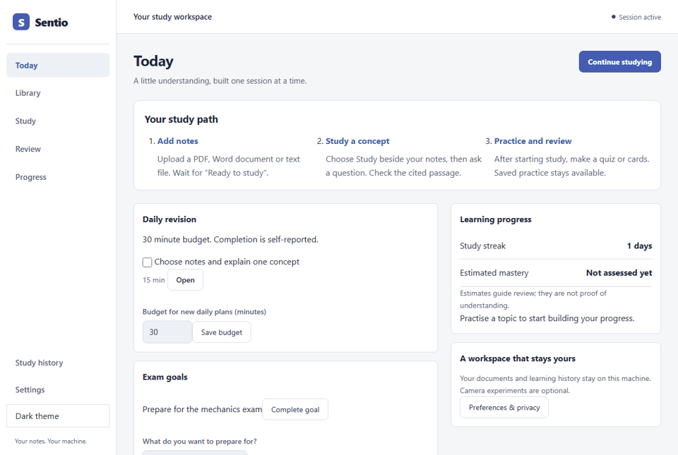
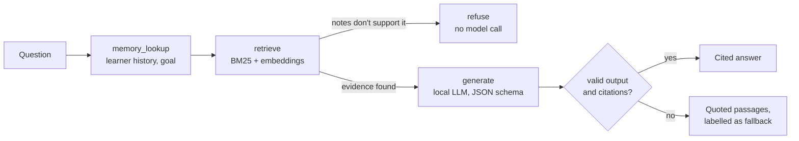
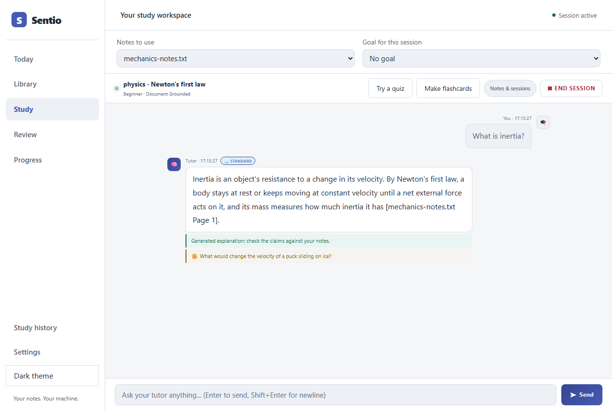
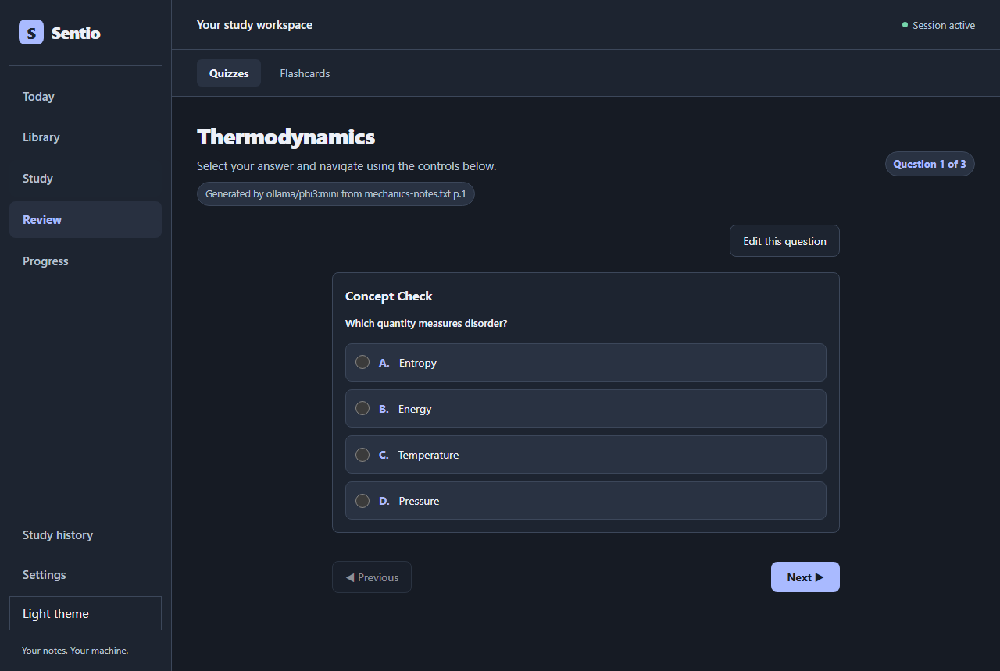
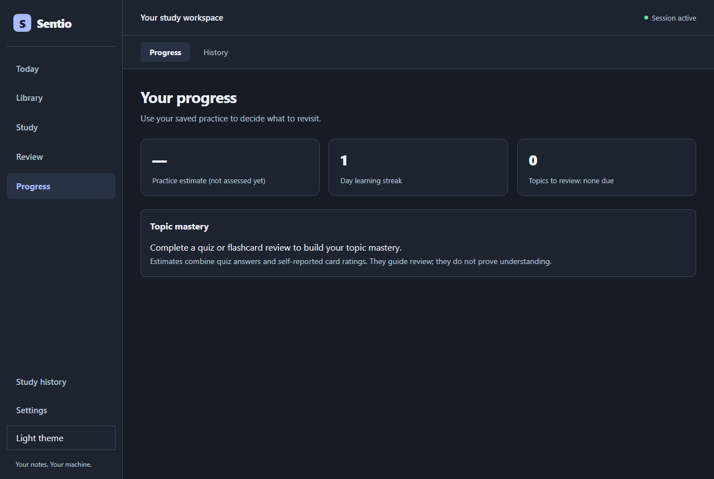

# Sentio

**A local AI study tutor that answers only from your own notes — with citations, a refusal when the notes don't cover the question, and practice that remembers what you need to review.**

[](https://github.com/karansingh1939/Sentio-An-Emotion-Aware-Tutor/actions/workflows/ci.yml)
[](pyproject.toml)
[](LICENSE)

[Quick start](#quick-start) | [How it works](#how-it-works) | [Results](#measured-results) | [Architecture](docs/architecture/ARCHITECTURE.md) | [Interview guide](docs/INTERVIEW_GUIDE.md)



Upload PDF, Word or text notes. Ask questions and get answers grounded in retrieved
passages, with page citations. Turn the same notes into quizzes and spaced-repetition
flashcards, and track what to review. Everything — the model, the database and your
files — runs on your own machine.

## How it works



1. **Retrieval-augmented generation.** Notes are chunked and indexed twice — BM25 for
   keywords and `all-MiniLM-L6-v2` embeddings in Qdrant — and fused with a hybrid score.
2. **Evidence gate.** A LangGraph workflow retrieves before it generates. If the selected
   notes have no relevant passage, it refuses without calling the model.
3. **Structured, validated output.** The local Ollama model must return JSON matching a
   schema; invalid replies are repaired or regenerated, and citations must name a
   retrieved passage. Otherwise Sentio shows the passages themselves, clearly labelled.
4. **Practice and review.** Quizzes and flashcards are generated as background jobs,
   saved with their provenance (model, cited pages, note versions) and scheduled with
   SM-2 spaced repetition.

| Study with citations                       | Quiz with provenance                    | Progress                                        |
| ------------------------------------------ | --------------------------------------- | ----------------------------------------------- |
|  |  |  |

## Tech stack

| Layer    | Technology                                                                                    |
| -------- | --------------------------------------------------------------------------------------------- |
| Language | **Python 3.12** (backend, AI, evaluation) · **JavaScript** (browser UI, no build step)        |
| API      | FastAPI, Uvicorn, Pydantic v2, server-sent events for streaming answers                       |
| AI       | Ollama (local LLM, `qwen2.5:7b` recommended), LangGraph workflow, sentence-transformers, BM25 |
| Storage  | SQLite via SQLAlchemy (source of truth) · Qdrant embedded (rebuildable vector index)          |
| Quality  | pytest + Playwright (Chromium), Node tests, Ruff, Prettier, GitHub Actions, Docker Compose    |

## What I built

- **RAG pipeline with an evidence gate** — hybrid retrieval, owner-scoped documents,
  and a refusal path that never reaches the model when evidence is missing.
- **Reliable structured generation** — schema-constrained output, a repair/regenerate
  loop, citation validation and honest fallbacks; this fixed quizzes from `qwen2.5:7b`
  falling back on every request.
- **Model evaluation** — a 12-case grounding test over real HTTP; compared four local
  models and chose `qwen2.5:7b` on measured results.
- **Durable, cancellable work** — background job lanes, streaming answers that can be
  stopped, idempotent request receipts and transactions that reject stale study context.
- **Study features** — session goals, editable quizzes with revision checks, practice
  provenance, spaced-repetition review, progress estimates.
- **Optional emotion-aware tone** — my earlier facial-emotion CNN (FER2013) and browser
  attention tracking, now an opt-in, consented side feature
  ([details](docs/guides/EMOTION.md)).

## Measured results

The project keeps failed experiments and separates software tests from model-quality
measurements.

| Experiment                                | Result                                                                                                                       | What it establishes                                                          |
| ----------------------------------------- | ---------------------------------------------------------------------------------------------------------------------------- | ---------------------------------------------------------------------------- |
| Four local models, 12-case grounding test | `qwen2.5:7b` answered 3/4 covered questions vs 2/4 for `phi3:mini`; every model declined 6/6 questions the notes don't cover | Larger local models improve coverage at higher latency (24 s vs 17 s median) |
| Retrieval on 12 synthetic documents       | Keyword and hybrid each found the relevant passage in 17/18 cases                                                            | Hybrid showed no gain on this small corpus                                   |
| Repeated semantic grading                 | Baseline and candidate each passed 20/25 rubrics per repeat                                                                  | The candidate traded false positives for false negatives; not adopted        |
| Evidence classifier pipeline              | Frozen 30-document, 120-question corpus with review and calibration tooling                                                  | Labels await human review; no classifier gains claimed                       |

Details: [model comparison](docs/evaluation/MODEL_COMPARISON_2026-10-29.md),
[grounding stress test](docs/evaluation/STUDY_QUALITY_2026-10-12.md),
[retrieval](reports/AI_EVALUATION_2026-10-11.md),
[grading](reports/GRADING_FOLLOWUP_2026-10-11.md),
[evidence experiment](docs/evaluation/EVIDENCE_EXPERIMENT.md). These are synthetic,
author-labelled experiments; they do not establish real-world accuracy or learning gains.

## Quick start

Install **Python 3.12**, **uv** and **Ollama**.

```sh
git clone https://github.com/karansingh1939/Sentio-An-Emotion-Aware-Tutor.git
cd Sentio-An-Emotion-Aware-Tutor
uv sync --locked
cp .env.example .env          # PowerShell: Copy-Item .env.example .env
ollama pull qwen2.5:7b        # or phi3:mini on machines with less than ~5 GB free memory
```

Set `OLLAMA_MODEL` in `.env` to the model you pulled, then:

```sh
uv run sentio --port 8001
```

Open http://127.0.0.1:8001, create a local account and upload notes in Library. API docs
are at `/docs` and capability checks at `/api/v1/ready`. See the
[setup guide](docs/guides/SETUP.md) for Docker, OCR and backups, and the
[learner guide](docs/guides/STUDY_GUIDE.md) for the study workflow.

## Project structure

```text
src/sentio/
  api/            FastAPI app, middleware, routes
  tutor/          LangGraph orchestrator, streaming turns
  rag/            Hybrid retrieval, evidence policy, vector store
  ai/             Ollama provider, prompts, structured-output parsing
  ingestion/      Upload pipeline, OCR, recovery journal
  quiz/ flashcards/ study/ intelligence/   Practice, planning, learner model
  repositories/   SQL access and migrations
  emotion/        Optional emotion-aware side feature
  static/         Browser UI
tests/            unit/ · integration/ · browser/ (Chromium) · js/
scripts/          dev/ · ops/ · eval/ · emotion/
docs/             guides/ · architecture/ · evaluation/ · project/ · images/
reports/          Recorded measurements and raw outputs
```

## Development

```sh
uv sync --locked && npm ci && uv run playwright install chromium
uv run ruff check src scripts tests && uv run ruff format --check src scripts tests
npm run format:check && npm test
uv run python scripts/dev/run_tests.py -q
uv run python scripts/dev/screenshots.py --output docs/images   # refresh screenshots
```

CI runs all of the above plus a package build, OCR evaluation and a Docker Compose
smoke test on every pull request.

## Limitations

- Built for one user on one machine; public hosting needs a separate security review.
- Citations show which passage was used, not that the answer is correct.
- Answers take roughly 15–60 seconds on CPU-only hardware.
- The emotion side feature has no validated accuracy and is off by default.

## Attribution

Maintained by **[Karan Singh](https://github.com/karansingh1939)**. Sentio builds on
[AayushiNagar2411/Sentio-An-Emotion-Aware-Tutor](https://github.com/AayushiNagar2411/Sentio-An-Emotion-Aware-Tutor);
the original attribution and MIT license are retained, and the
[contribution map](docs/project/CONTRIBUTIONS.md) separates inherited code from later
work. AI assistance was used during implementation. Licensed under [MIT](LICENSE).
