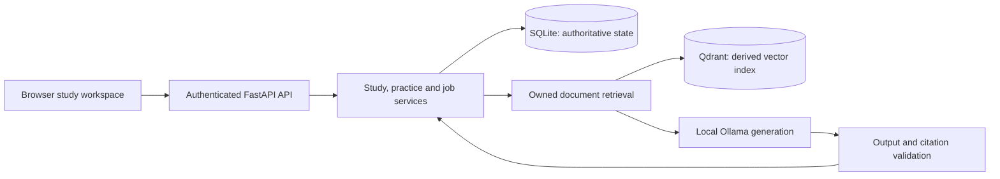

# Sentio

**Turn your notes into a local study workspace: cited explanations, practice, and scheduled review.**

[](https://github.com/karansingh1939/Sentio-An-Emotion-Aware-Tutor/actions/workflows/ci.yml)
[](pyproject.toml)
[](LICENSE)

[Quick start](#quick-start) | [Architecture](docs/ARCHITECTURE.md) | [Evaluation](#measured-ai-results) | [Contributing](CONTRIBUTING.md) | [Security](SECURITY.md)

Sentio brings a learner's documents, tutoring, quizzes, flashcards, and review history into one application. FastAPI serves both the API and browser interface; Ollama runs text generation locally. Saved materials remain accessible when generation is unavailable.

**Engineering contribution:** durable jobs, cancellable streaming, transactional reviews, owner-scoped document recovery, and reproducible evaluation tooling. The [contribution map](docs/CONTRIBUTIONS.md) links each area to an incremental commit and its tests.

**Status:** `2.0.0rc1`, a local application under active development. The supported workflow is **Library -> Study -> Practice -> Review**. Emotion recognition and a learned evidence classifier are experimental; neither has a validated accuracy claim. This repository is private; access is required to view its code and CI results.

## What it does

| Capability        | Implementation                                                                                                    |
| ----------------- | ----------------------------------------------------------------------------------------------------------------- |
| Document library  | Owner-scoped PDF, DOCX, and TXT uploads; optional English OCR for scanned PDFs and PNG/JPEG images                |
| Document tutoring | Selected-source keyword/vector retrieval, streaming responses, citations, cancellation, and saved-turn recovery   |
| Practice          | Validated quiz/card generation, durable background jobs, and explicit source-based recovery when generation fails |
| Scheduled review  | Persisted flashcards, review receipts, study plans, session history, and progress views                           |
| Local accounts    | JWT authentication, hashed single-use recovery keys, account cleanup, and ownership checks                        |
| Recovery          | SQLite migrations, interrupted-document recovery, restart persistence, and verified local backup tooling          |

## Quick start

Install **Python 3.12**, **uv**, and **Ollama**. Node.js 22 is used for frontend checks, not for serving the application.

```sh
git clone https://github.com/karansingh1939/Sentio-An-Emotion-Aware-Tutor.git
cd Sentio-An-Emotion-Aware-Tutor
uv sync --locked
```

Copy `.env.example` to `.env` (`Copy-Item .env.example .env` in PowerShell, or `cp .env.example .env` on Linux/macOS). The example selects `ollama` and `phi3:mini`.

Start Ollama, then run:

```sh
ollama pull phi3:mini
uv run sentio --port 8001
```

Open **http://127.0.0.1:8001**, register a local account, and upload readable notes in Library. Initial startup may take time while model libraries load or embedding assets are provisioned. Keyword search remains available when embeddings are unavailable.

- API documentation: http://127.0.0.1:8001/docs
- Capability diagnostics: http://127.0.0.1:8001/api/v1/ready
- Detailed setup, Docker, OCR, backups, and troubleshooting: [Setup guide](docs/SETUP.md)
- Step-by-step study workflow: [Learner guide](docs/STUDY_GUIDE.md)
- Review the actual AI replies yourself: [Author review and pilot guide](docs/AUTHOR_REVIEW.md)

## Architecture



One API process owns persistent storage. Durable request receipts and final transactions protect saved practice and reviews from duplicate submissions and stale context. Qdrant is a derived index; SQLite records active document revisions and saved learning state. [Architecture and request sequences](docs/ARCHITECTURE.md) explain these boundaries and tradeoffs.

```text
src/sentio/        API, retrieval, ingestion, study services, and bundled web UI
tests/             Unit, integration, browser, and JavaScript regression checks
scripts/           Development, evaluation, backup, and benchmark commands
datasets/          Versioned synthetic evidence corpus and manifests
reports/           Recorded measurements, failures, and experiment decisions
docs/              Setup, architecture, learner guides, and experiment methodology
```

## Measured AI results

The project retains failed experiments and separates deterministic software tests from model-quality measurements.

| Experiment                          | Recorded result                                                                    | What it establishes                                                                                 |
| ----------------------------------- | ---------------------------------------------------------------------------------- | --------------------------------------------------------------------------------------------------- |
| Retrieval on 12 synthetic documents | Keyword and hybrid each found the relevant passage in 17/18 positive cases         | Hybrid showed no gain on this small corpus; retrieved candidates do not establish supported answers |
| Repeated semantic grading           | Baseline and candidate each passed 20/25 semantic rubrics per repeat               | The candidate traded false positives for false negatives; no prompt change was adopted              |
| Local generation comparison         | 72 requests across two models and two prompt policies                              | Both models answered an unsupported question; faster output did not establish better grounding      |
| Evidence classifier pipeline        | Frozen 30-document, 120-question corpus; review, calibration, and ablation tooling | Labels remain unreviewed and classifier training results are pending                                |

See [retrieval evaluation](reports/AI_EVALUATION_2026-10-11.md), [grading follow-up](reports/GRADING_FOLLOWUP_2026-10-11.md), [generation experiment](docs/LOCAL_GENERATION_EXPERIMENT.md), and [evidence experiment](docs/EVIDENCE_EXPERIMENT.md) for datasets, hardware, commands, raw outputs, and limitations.

The [12-case real HTTP grounding stress test](docs/STUDY_QUALITY_2026-10-12.md) retains refusals and ambiguous-answer failures, reports recovery separately, and provides actual replies for author review. Standalone numeric short answers use exact comparisons; broader semantic grades remain fallible.

```sh
uv run python scripts/evaluate_retrieval.py --grade --output reports/evaluation.json
uv run python scripts/evaluate_grading.py --repeats 3 --output reports/grading-comparison.json
```

These commands require the documented locally available models. Synthetic, author-labelled experiments do not establish real-world accuracy or improved student learning.

## Development and checks

```sh
uv sync --locked
uv run playwright install chromium
npm ci
uv run ruff check src scripts tests
uv run ruff format --check src scripts tests
npm run format:check
npm test
uv run python scripts/run_tests.py -q
uv build
```

Tests isolate databases and use deterministic provider fixtures. Chromium checks exercise real browser/API interactions. GitHub Actions runs Python and JavaScript checks, browser tests, package builds, and live synthetic OCR evaluation; a separate job checks the Docker build. See [contribution guidance](CONTRIBUTING.md) before changing behavior.

## Scope and current limitations

- Intended for a local installation with one server process. Public hosting requires a separate security and storage review.
- Citations validate source references; they do not prove that an answer is semantically supported. Grading can accept wrong answers or reject valid paraphrases.
- Source-excerpt and source-recall fallbacks keep the workflow usable, but are distinct from generated teaching explanations and semantic quizzes.
- OCR requires Tesseract and the optional extra. Uploads are capped at 20 MiB; OCR processes at most 20 scanned pages per document.
- Camera/voice controls are excluded from the supported study interface. Emotion accuracy, independently reviewed evidence labels, and student learning outcomes remain unverified.
- CI checks Compose startup, storage, authentication, restart persistence, and saved browsing during a provider outage. Full Compose tutoring with an installed model and semantic answer quality remains a separate validation.

The [release handoff](docs/RELEASE_HANDOFF.md) records remaining acceptance gates. The [portfolio report](docs/PORTFOLIO_REPORT_DRAFT.md) distinguishes completed work from proposed research.
The [hiring-readiness ledger](docs/HIRING_READINESS.md) tracks completed repairs and remaining human/model validation.
The [human-only handoff](docs/HUMAN_HANDOFF.md) links the prepared review work and explains the feedback needed next.

## Development and attribution

Maintained by **[Karan Singh](https://github.com/karansingh1939)**. Current development includes the packaged/locked runtime, study UI, authenticated document flows, durable jobs, cancellable streaming, transactional review persistence, recovery, and reproducible evaluation tooling. The [development record](docs/DEVELOPMENT_LOG.md) documents milestones and evidence.

Sentio builds on [AayushiNagar2411/Sentio-An-Emotion-Aware-Tutor](https://github.com/AayushiNagar2411/Sentio-An-Emotion-Aware-Tutor). Original attribution and the MIT license are retained. The published baseline is a snapshot of that foundation; it is not a claim of new authorship of inherited code. Original history is preserved locally because historical LFS model/data objects were unavailable for publication. AI assistance was used for implementation and corpus drafting; the reports distinguish upstream models from repository contributions.

Licensed under [MIT](LICENSE). Learner uploads, credentials, local databases, model weights, and training data are excluded from the repository.
