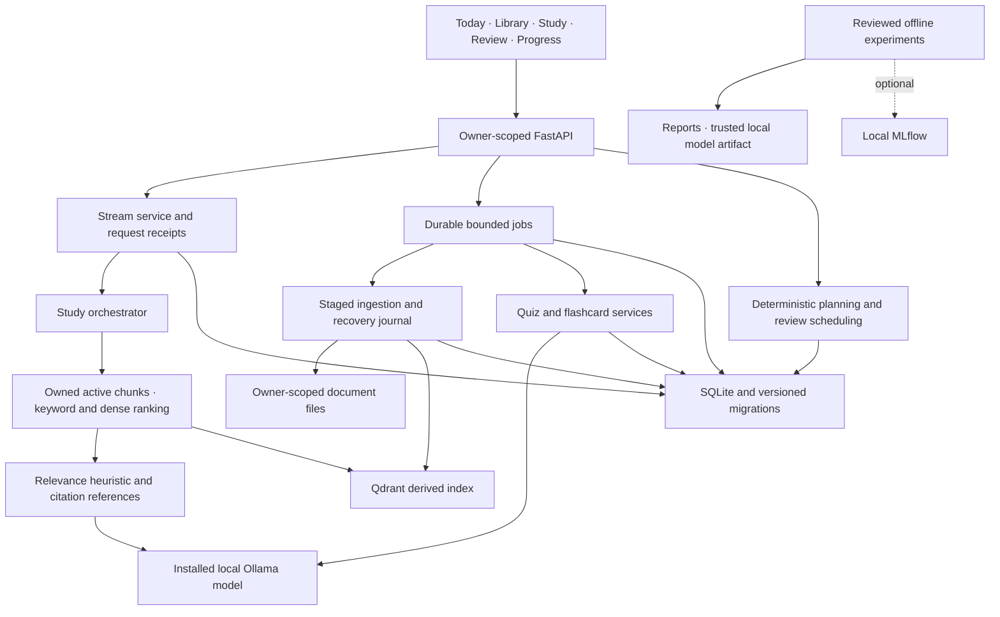
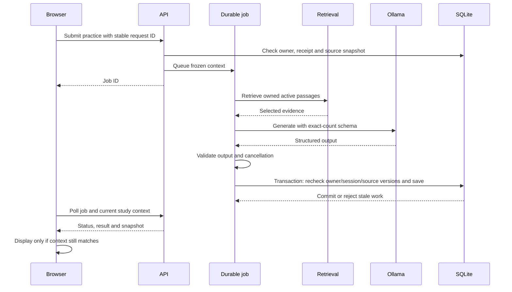

# Sentio local architecture

This records the implemented boundaries and remaining gaps on the private study
overhaul branch. It is not a claim that every release milestone has passed.

One running API owns persistent storage through a process lease. SQLite is
authoritative for active document revisions, saved practice, review receipts,
study plans and request state. Qdrant contains a derived index; retrieval checks
active registered chunks instead of accepting abandoned staged vectors.
Backup requires the application to stop and verifies checksums on restore.

The AI and ingestion lanes each have one worker; pending work is bounded.
Cancelled or interrupted generation is not replayed automatically. Durable
request receipts distinguish retrying an unknown submission from creating a new
job. Practice captures an owned session/source snapshot, publishes against that
snapshot inside a final SQLite transaction, and returns it with job status.
The browser checks current context again before displaying finished work.

Streaming emits status, readable text deltas and a final validated result.
Stop closes the provider response. A completed request is saved once with its
context; replay returns the saved result without incrementing exchanges again.
Replacing a same-named document changes its checksum and invalidates old context
and history. Citation checks establish reference membership, not semantic truth.

Storage and saved browsing are independent of local generation and camera
readiness. Camera assets are optional, locally provisioned and loaded on demand.
MLflow and training dependencies stay outside normal application startup.
The learned evidence model is not integrated: reviewed labels, baseline parity,
quality/coverage comparisons, latency and live acceptance are still required.

Remaining architectural work includes shared goal selection in study context,
persistent provenance and quiz editing, backend camera-consent enforcement,
broader grounding evaluation and further splitting of legacy modules as their
behavior is migrated. There is no public deployment or external model service
required by this local release.

## Usability checkpoint, 2026-10-12

The supported flow is now Library ? Study ? practice ? review, with guided Today
actions and no normal camera/voice controls. Authentication issues standard HS256
JWTs; migration 8 adds hashed single-use recovery keys and token revocation versions.
Legacy password hashes upgrade on successful login. See STUDY_GUIDE.md and
RELEASE_HANDOFF.md for recovery, supported workflow and open release gates.

A real three-item journey failed validation before fallback integration
(reports/generation/live-journey-usability-3-v1.json). The next journey completed
with source-excerpt tutoring and source-recall quizzes
(reports/generation/live-journey-usability-3-fallback-v2.json). This is a recovery
and persistence result, not an AI teaching or learning-quality improvement.
Earlier unsupported-answer failures remain applicable; citation membership alone
does not establish semantic support. No reviewed evidence-model result is claimed.
