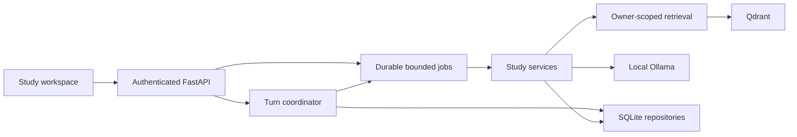
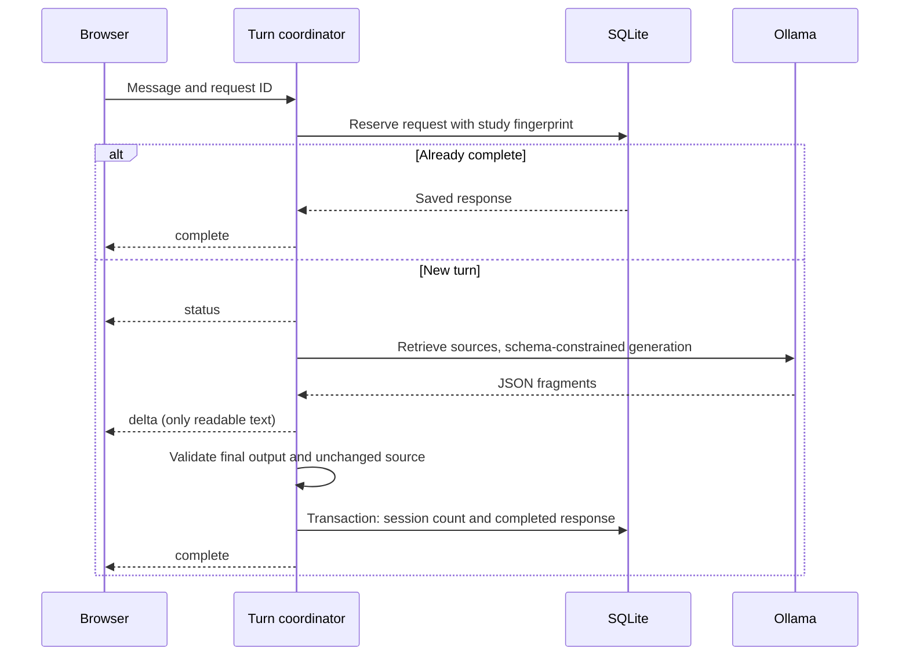

# Current local study runtime

Run one application process. SQLite owns the job inventory and completed turns;
the application owns its Qdrant client. Camera and experiment tracking are not
startup requirements. The architecture contract is in `tasks/plan.md`.

There is one worker for AI and one for ingestion, with at most eight pending or
running jobs in total. All Ollama calls share one inference slot. Job metadata
retains up to 500 recent records per learner and is pruned after seven days on
startup. Interrupted jobs require an explicit retry; startup does not replay
side effects. Completed tutoring turns remain study history.

## Turn sequence

Stop or disconnect cancels unpublished work and closes the upstream response.
A publication barrier prevents cancellation from claiming that an already saved
artifact was discarded. Drafts and invalid output never increment completed-turn
counts. Source changes cancel the old turn and clear prior conversation context.

The browser persists a request ID until completion, so retrying a disconnected
question replays its saved response if the server already committed it. Transcript
recovery uses the active topic/source context and bounded pagination. The latest
resume request alone may update the screen.

## Additive authenticated interfaces

All paths below are under `/api/v1`.

| Interface | Result |
|---|---|
| `POST /quizzes/jobs` | 202, durable job ID; captures the session context |
| `POST /flashcards/jobs` | 202, durable job ID; requires an owned deck/session |
| `GET /jobs/{job_id}` | Owner-scoped stage, status, result or stable error |
| `POST /jobs/{job_id}/cancel` | Whether cancellation was accepted |
| `POST /sessions/{id}/chat/stream` | `status`, `delta`, `complete`, `cancelled`, `error` events |
| `POST /sessions/{id}/chat/{request_id}/cancel` | Stop the matching pending turn |
| `GET /sessions/{id}/turns?limit=50&offset=0` | Saved turns for the current source context |

Synchronous study interfaces remain available during migration. New practice
jobs use the session's subject/topic/difficulty and snapshot its selected source.
The quiz form shows this context instead of offering conflicting topic controls.

Ollama streaming and schema support follow the [official chat API](https://docs.ollama.com/api/chat).
Final validation remains server-side. Deterministic provider tests and real browser
checks prove mechanics, not the educational quality of the local model.

Still pending: recoverable document publication, full planning/review journeys,
live-model quality measurement, manually reviewed ML labels and release acceptance.
See `tasks/continuation.md` for the exact next task.
