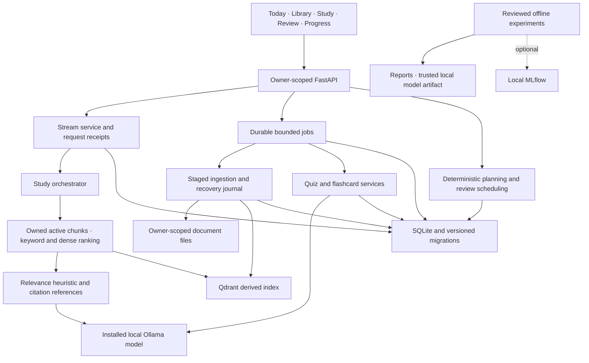
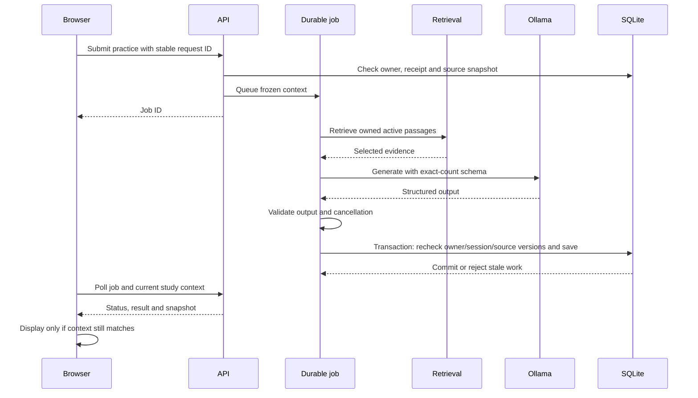
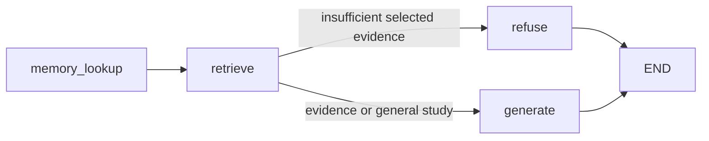

# Sentio local architecture

This records the implemented boundaries and remaining gaps. It is not a claim that
every release milestone has passed.

**Style:** a local-first modular monolith. One FastAPI process serves the API and a
framework-free browser UI; requests flow `routes → services → repositories → SQLite`,
with SQL only in repositories. Generation runs on a local Ollama model.

One running API owns persistent storage through a process lease. SQLite is
authoritative for active document revisions, saved practice, review receipts,
study plans and request state. Qdrant contains a derived index; retrieval checks
active registered chunks instead of accepting abandoned staged vectors.
Backup requires the application to stop and verifies checksums on restore.

The AI and ingestion lanes each have one worker; pending work is bounded.
Cancelled or interrupted generation is not replayed automatically. Durable
request receipts distinguish retrying an unknown submission from creating a new
job. Practice captures an owned session/source snapshot, publishes against that
snapshot inside a final SQLite transaction, and returns it with job status.
The browser checks current context again before displaying finished work.

Streaming emits status, readable text deltas and a final validated result.
Stop closes the provider response. A completed request is saved once with its
context; replay returns the saved result without incrementing exchanges again.
Replacing a same-named document changes its checksum and invalidates old context
and history. Citation checks establish reference membership, not semantic truth.

## Tutor workflow (LangGraph)

`memory_lookup` adds learner history, mistakes and the session goal. `retrieve` runs
hybrid keyword/dense search over the owner's active chunks and classifies evidence.
`refuse` answers without the model when selected notes do not support the question.
`generate` asks Ollama for schema-constrained JSON, validates citations against the
retrieved passages, and falls back to labelled source excerpts. Quizzes, flashcards and
plans have their own endpoints and jobs rather than graph branches.

A session studies from `all` notes, one document, a list, or `course:<id>`. Courses
(`repositories/courses.py`) are optional folders; `expand_source` resolves a course to its
current documents at question time, so retrieval, the stale-context fingerprint and
practice snapshots include lectures added after the session started. Sessions saved
without notes (`none`) get a fixed "choose notes" reply from the `refuse` node; there is no
built-in curriculum or ungrounded tutor. PowerPoint decks are parsed with `python-pptx`,
one page per slide (title, text, tables, speaker notes).

When the stream is open, `retrieve` emits a `sources` event, so the browser shows the
passages before the answer arrives.

Schema-constrained generation goes through one helper, `generate_structured`, used by
quizzes, flashcards and document overviews: a mismatch (`InvalidModelOutput`) is
repaired or regenerated before any fallback. A document overview (summary, key
concepts, suggested questions) is written as a background job from the document's
opening passages and cached on the document row against its checksum.

Topic mastery (`study/topics.py`, `repositories/topics.py`): a lecture's topics are page
ranges grouped by heading (slide titles; PDF page headings, skipping running headers),
stored in `note_topics` with the document checksum and rebuilt when it changes. After a
quiz is generated, each question is attributed to the retrieved passage it overlaps most
(`quiz_questions.source_document_id`, `source_page`), and each submitted answer records its
`question_id`. A topic's state comes from the answers whose question page falls in its
range, so renaming or merging topics regroups past answers without re-grading.

Flashcards are scheduled by `flashcards/fsrs.py`, a dependency-free FSRS-5 model: each
card stores stability, difficulty and its last review time, and the next review is set
for 90% predicted recall. Cards scheduled earlier by SM-2 are converted on their next
review. The learner model reuses the same recall probability for forgetting risk.

## Optional emotion feature

`sentio/emotion` holds the earlier emotion-aware prototype: a FER2013 CNN on the server
and MediaPipe attention estimates in the browser (`static/js/core/emotion_camera.js`).
It is off unless `ENABLE_EMOTION=true`; the server checks the learner's latest saved
consent before accepting telemetry, live frames or chat frames, and bounds frame size
and dimensions before decoding. The detected learning state only adjusts tone and
pacing. See [the emotion guide](../guides/EMOTION.md).

## Other boundaries

Storage and saved browsing are independent of local generation and the emotion
feature. MLflow and training dependencies stay outside normal application startup.
The learned evidence model is not integrated: reviewed labels, baseline parity,
quality/coverage comparisons, latency and live acceptance are still required.

A session may bind one of its owner's active goals. The goal's ID and text are part
of the study context version, so editing, completing or switching it invalidates
in-flight turns and practice. Saved quizzes and cards store provenance (generation
mode, model, cited pages and note checksums). Owners can edit quiz questions; each
edit bumps a quiz revision so earlier submissions replay unchanged while new answers
are graded against the correction.

Remaining architectural work includes broader grounding evaluation and further splitting of legacy modules as their
behavior is migrated. There is no public deployment or external model service
required by this local release.

## Usability checkpoint, 2026-10-12

The supported flow is now Library ? Study ? practice ? review, with guided Today
actions and no normal camera/voice controls. Authentication issues standard HS256
JWTs; migration 8 adds hashed single-use recovery keys and token revocation versions.
Legacy password hashes upgrade on successful login. See STUDY_GUIDE.md and
RELEASE_HANDOFF.md for recovery, supported workflow and open release gates.

A real three-item journey failed validation before fallback integration
(reports/generation/live-journey-usability-3-v1.json). The next journey completed
with source-excerpt tutoring and source-recall quizzes
(reports/generation/live-journey-usability-3-fallback-v2.json). This is a recovery
and persistence result, not an AI teaching or learning-quality improvement.
Earlier unsupported-answer failures remain applicable; citation membership alone
does not establish semantic support. No reviewed evidence-model result is claimed.
