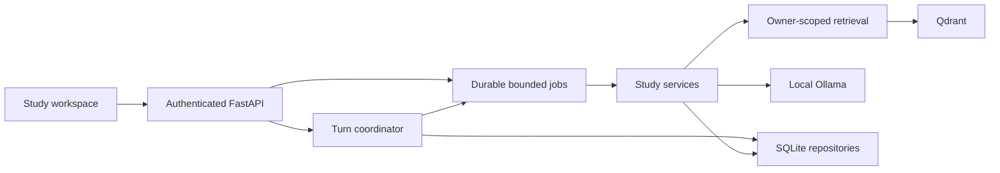
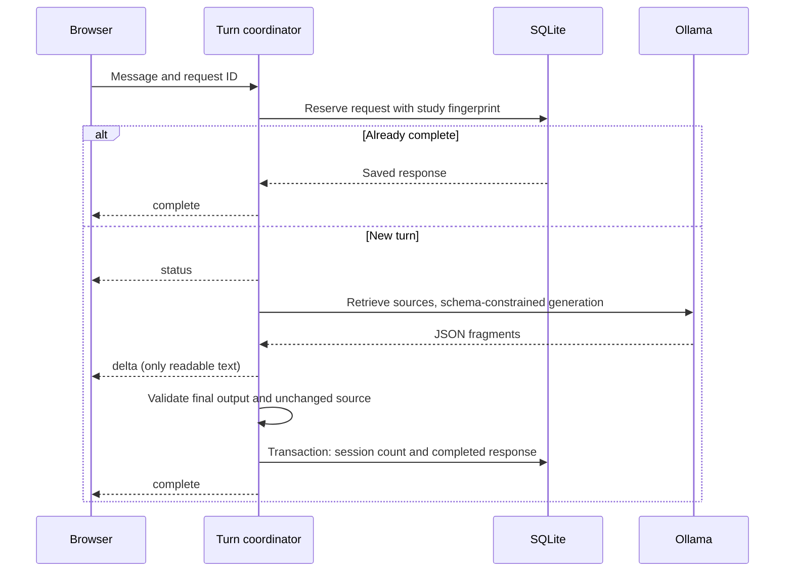

# Current local study runtime

Run one application process. SQLite owns the job inventory and completed turns;
the application owns its Qdrant client. Camera and experiment tracking are not
startup requirements. The architecture contract is in `docs/archive/tasks/plan.md`.

There is one worker for AI and one for ingestion, with at most eight pending or
running jobs in total. All Ollama calls share one inference slot. Job metadata
retains up to 500 recent records per learner and is pruned after seven days on
startup. Interrupted jobs require an explicit retry; startup does not replay
side effects. Completed tutoring turns remain study history.

The library stages new file/text/vector revisions before publication. SQL chunk
IDs are the retrieval authority, including citation text and metadata. A durable
file journal restores an old revision when SQL publication fails, or retries
cleanup after a committed replacement/deletion. Preview pages and ingestion job
status require the owning account. Limits are 20 MiB per upload, 2 million
extracted characters, and 2000 passages. Semantic models use the local CPU cache;
without them, saved text remains searchable through keywords.

`POST /api/v1/documents/jobs` accepts multipart uploads and returns a job ID.
`GET /api/v1/documents/{id}/preview?limit=20&offset=0` returns extracted passages
and `next_offset`. Existing synchronous upload remains compatible.

## Turn sequence

Saved quizzes are available through GET `/quizzes?limit=20&offset=0` and
`/quizzes/{id}`, without generation. Review shows recent saved mistakes and
explanations from each quiz. PATCH `/flashcards/{id}` saves edited front/back
text. Card ratings accept an optional stable `request_id`; the schedule, mastery
update and receipt commit together. Identical retries replay the result; changed
content with the same ID returns 409. Legacy rating calls remain supported.
Read requests have a separate rate budget from submissions/authentication, so
polling and browsing do not exhaust the write budget. Both remain limited.

Asynchronous upload/practice submissions accept `Idempotency-Key` (8–80 safe
characters). The browser persists it before sending. An identical owner-scoped
intent replays the same queued/running/completed job, even after restart; changed
payload/context returns 409. Submission receipts remain when old job status is
pruned, returning 410 instead of silently recreating work. Check saved artifacts
before explicitly starting a new intent. Legacy callers can omit the key.

Planning endpoints under `/api/v1/study`: GET/PUT `preferences` (5–240 daily
minutes), GET `daily-plan?day=YYYY-MM-DD`, PATCH `daily-plan/{day}/tasks/{id}`
with `completed`, and GET `feedback`. Plans freeze the day's task list and budget;
new preferences affect new plans. Completion is self-reported and does not itself
increase mastery. PATCH `/students/{id}/goals/{goal_id}` updates text, target
timestamp or active/completed/cancelled status. History accepts `limit` (1–100)
and `offset`, returning `total` and `next_offset`. All records are owner scoped
and included in privacy export/deletion and full SQLite backups.

Stop or disconnect cancels unpublished work and closes the upstream response.
A publication barrier prevents cancellation from claiming that an already saved
artifact was discarded. Drafts and invalid output never increment completed-turn
counts. Source changes cancel the old turn and clear prior conversation context.

The browser persists a request ID until completion, so retrying a disconnected
question replays its saved response if the server already committed it. Transcript
recovery uses the active topic/source context and bounded pagination. The latest
resume request alone may update the screen.

## Additive authenticated interfaces

All paths below are under `/api/v1`.

| Interface | Result |
|---|---|
| `POST /quizzes/jobs` | 202, durable job ID; captures the session context |
| `POST /flashcards/jobs` | 202, durable job ID; requires an owned deck/session |
| `GET /jobs/{job_id}` | Owner-scoped stage, status, result or stable error |
| `POST /jobs/{job_id}/cancel` | Whether cancellation was accepted |
| `POST /sessions/{id}/chat/stream` | `status`, `delta`, `complete`, `cancelled`, `error` events |
| `POST /sessions/{id}/chat/{request_id}/cancel` | Stop the matching pending turn |
| `GET /sessions/{id}/turns?limit=50&offset=0` | Saved turns for the current source context |

Synchronous study interfaces remain available during migration. New practice
jobs use the session's subject/topic/difficulty and snapshot its selected source.
Publication rechecks that snapshot, document revisions, account and deck inside
the artifact transaction. Stale generation cannot create a saved quiz or cards.
The quiz form shows this context instead of offering conflicting topic controls.

Ollama streaming and schema support follow the [official chat API](https://docs.ollama.com/api/chat).
Final validation remains server-side. Deterministic provider tests and real browser
checks prove mechanics, not the educational quality of the local model.

Library publication uses a recovery journal and saved practice connects to daily
plans and reviews. Local signing keys persist next to SQLite in `.sentio-secret`;
they are protected with a current-user/SYSTEM ACL on Windows or mode 0600 on Unix.
Private backups include the key. Restore the key with the database to retain login
signatures. An explicit configured secret takes precedence; production still
requires an explicit secure configuration. In-memory databases use ephemeral keys.

Optional camera activation requires current consent, owner and study session.
Late permission grants after navigation/logout are stopped; unavailable camera
models stop acquired media and preserve text study.

Still pending: full hardening and release acceptance, live-model quality
measurement, manually reviewed ML labels and the model experiment.
Current status and next steps are in `docs/project/FEATURE_AUDIT_2026-11-06.md`.
