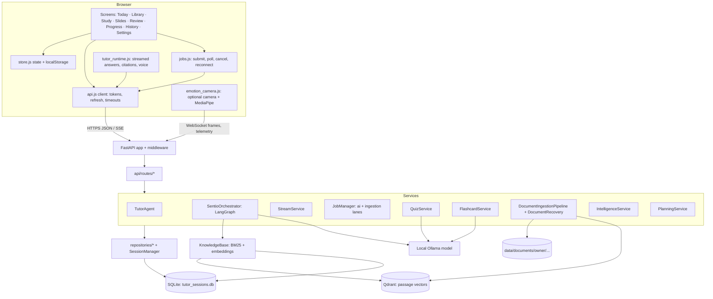
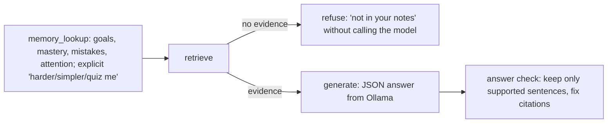

# Sentio system guide

What Sentio is made of, how a request travels through it, and what every file and
function does. Parts 1–3 describe the design. Parts 4–5 (the endpoint list and the
function reference) were built from the source code on the date below, using each
function's docstring or comment where it had one; update them when the code changes.

Last reviewed: 2026-11-27.

## Contents

1. [Architecture](#1-architecture)
2. [System design](#2-system-design)
3. [Main flows, step by step](#3-main-flows-step-by-step)
4. [HTTP endpoints](#4-http-endpoints)
5. [Function reference, file by file](#5-function-reference-file-by-file)

---

## 1. Architecture

**Style:** a local-first _modular monolith_. One Python process (FastAPI on uvicorn)
serves the JSON API and a framework-free browser UI written in plain ES modules.
Everything runs on the learner's own computer: SQLite for data, Qdrant (local disk
mode) for passage vectors, a local Ollama model for all text generation, and an
optional camera model (TensorFlow) that is off unless `ENABLE_EMOTION=true`.

### Layers

| Layer    | Folder                                                                             | Responsibility                                                      | Rule                                                                      |
| -------- | ---------------------------------------------------------------------------------- | ------------------------------------------------------------------- | ------------------------------------------------------------------------- |
| UI       | `static/`                                                                          | Screens, state, API client                                          | Never trusts its own state for ownership; the server checks every request |
| HTTP     | `api/`                                                                             | Routing, validation (Pydantic), auth, limits, error shape           | Routes do no SQL (enforced by `tests/unit/test_architecture.py`)          |
| Services | `tutor/`, `quiz/`, `flashcards/`, `ingestion/`, `study/`, `intelligence/`, `jobs/` | Business rules                                                      | Talk to storage only through repositories                                 |
| AI       | `ai/`, `rag/`                                                                      | Prompts, model calls, output validation, retrieval, answer checking | Notes are data, never instructions                                        |
| Storage  | `repositories/`, `session/manager.py`, `auth/repositories.py`                      | All SQL                                                             | Shared engine via `persister.engine`                                      |
| Ops      | `maintenance/`, `shared/`                                                          | Backups, readiness, cleanup, logging, rate limiting                 | —                                                                         |

### Processes and threads

- **One process per data folder.** `maintenance/storage_lease.py` holds a file lock, so
  a second Sentio on the same `SENTIO_HOME` refuses to start.
- **Two background lanes.** `JobManager` has one worker thread for `ai` work (tutor
  turns, quizzes, cards, overviews) and one for `ingestion` (uploads). One model call
  at a time keeps a laptop CPU responsive; at most 8 jobs can be open.
- **Streaming.** A tutor turn runs as an `ai` job; its events (status, sources, draft
  text, complete) reach the browser over a POST server-sent-event stream.

### Where data lives (`SENTIO_HOME`, default: the checkout or `~/.sentio`)

| Path                                      | Contents                                                                              |
| ----------------------------------------- | ------------------------------------------------------------------------------------- |
| `data/tutor_sessions.db`                  | All accounts, sessions, documents, passages, practice, plans, jobs (SQLite, WAL mode) |
| `data/qdrant_db/`                         | Passage embeddings (derived; can be rebuilt from the database)                        |
| `data/documents/<student_id>/<category>/` | The uploaded files themselves                                                         |
| `logs/sessions/`, `logs/emotions/`        | Session and camera logs (emotion logs only with consent)                              |
| `models/`                                 | Optional camera model weights                                                         |
| `.env`                                    | Local settings (model name, port, secret)                                             |

---

## 2. System design

### 2.1 Identity and ownership

- Accounts: email + PBKDF2-SHA256 password hash (`auth/password_hasher.py`). Passwords
  need 8+ characters with upper and lower case letters, a digit and any symbol.
- Sign-in returns a **15-minute access token** and a **30-day refresh token** (JWT,
  HS256, `auth/token_manager.py`). The refresh token is stored server-side and can be
  revoked (sign out). A password reset raises `token_version`, which ends every other session.
- **Recovery key** instead of email reset: shown once at sign-up, stored only as a
  SHA-256 digest (`auth/recovery.py`).
- Every route depends on `get_current_user`. Owner checks (`_verify_session_owner`,
  repository queries filtered by `student_id`) make sure one learner never sees another's data.
- In production (`ENV=production`), startup refuses a missing or weak secret and wildcard CORS.

### 2.2 Uploading notes (ingestion)

1. `POST /documents/jobs` checks the filename, type (PDF, DOCX, PPTX, TXT, PNG, JPEG),
   size (20 MB) and course, then streams the file into a private temp folder.
2. A job on the `ingestion` lane parses the file: PDF text via pypdf, with OCR for
   scanned pages (Tesseract, optional); DOCX paragraphs **and tables** in order; PPTX one
   page per slide (title, text, tables, speaker notes); images via OCR.
3. Each page is split along its own structure into passages of up to 1,000 characters
   (the embedding model reads about that much).
4. Passages are embedded with `all-MiniLM-L6-v2`. The model is **loaded once per
   process** (`rag/embeddings.py`) and stored in Qdrant. If embedding fails, the
   document still works with keyword search.
5. `DocumentRecovery` swaps in the new file, rows and vectors with a journal, so a crash
   mid-way is finished or rolled back at the next start.

### 2.3 Answering a question (retrieval-augmented, notes only)

The tutor answers **only from the learner's notes**, and every claim cites a page.
`SentioOrchestrator` is a LangGraph workflow:

- **Search:** BM25 keywords (with typo correction toward the notes' own vocabulary) plus
  cosine similarity in Qdrant, fused by weighted score (75% vector, 25% keyword), then
  filtered by a relevance gate and near-duplicate removal; the best 5 passages are kept.
  Follow-ups are searched twice (alone and joined to the conversation's topic) and the
  rankings merged by reciprocal rank.
- **Earlier lectures** of the same course are searched too, since later lectures build on them.
- **Injection guard:** sentences in the notes addressed to the tutor are removed before
  the model sees them (`ai/untrusted.py`).
- **Answer check:** `ai/answer_check.py` reviews each sentence against the passages.
  Unsupported sentences are dropped. If nothing is supported, the learner sees the
  passages themselves rather than an invented answer.
- **Difficulty** changes only when the learner asks, or after a quiz streak (3 right up,
  2 wrong down). Camera mood changes only the tone.

### 2.4 Practice

- **Quizzes and flashcards** are generated from the session's notes (or chosen topics)
  as background jobs. Output is validated per item (`ai/structured_parser.py`). For
  example, a true/false item must be a statement, and choice answers must be one of the
  options. Invalid items are regenerated one at a time. If the model fails, source-recall
  items are cut from the passages.
- A **study snapshot** (sources and their checksums, topic, level, goal) is frozen when
  the job starts. Practice is saved only if it is still current (`PracticeRepository.publication`).
- **Grading:** choices and blanks are exact or normalized matches. Short answers are graded
  by the model, with exact and numeric shortcuts first. Each submission is graded once
  (stored receipts).
- **Flashcards** follow FSRS spaced repetition (`flashcards/fsrs.py`). Ratings are
  idempotent per request id.

### 2.5 Progress and planning (no AI)

- **Topics** are detected from lecture headings (`study/topics.py`). Each topic's state
  (not started, practising, ready, review due) comes from its quiz and card evidence.
- **Mastery** is an exponential moving average per topic, weighted by difficulty.
- **Daily plan**: due reviews, then weak topics, then goals, within the minutes budget.
  It refreshes as new evidence arrives, until the learner ticks a task.
- **Syllabus**: pasted or uploaded syllabus lines are matched to lecture topics. The
  learner can correct matches; coverage and readiness are shown per course.

### 2.6 Reliability

- **Idempotency:** uploads, practice jobs, tutor turns and card ratings carry a client
  request id, so a retried request returns the first result instead of repeating the work.
- **Cancellation:** every job checks a `WorkControl` at checkpoints. Cancel closes an open
  model stream. Saving happens through one commit point, so a cancelled job never half-saves.
- **Crash recovery at startup:** unfinished jobs are marked interrupted, running tutor
  turns are marked failed, document operations are finished or rolled back, and pending
  account deletions are completed.
- **SQLite:** WAL mode with a 30 s busy timeout. Write transactions use `BEGIN IMMEDIATE`
  with retry (`shared/sqlite_tx.py`).

### 2.7 Security and privacy

- Request bodies are capped (2 MB JSON, 24 MB uploads). Rate limits are per IP, with
  separate budgets for reads, writes and sign-in. Security headers are set on every response.
- Camera frames are decoded only after authentication, ownership and consent checks, and
  are size- and pixel-bounded. The frame WebSocket re-checks auth on every frame.
- Data export (JSON), camera-data deletion and full account deletion (rows, files,
  vectors, logs, resumable) are in Settings.

### 2.8 Configuration (`.env`)

| Setting             | Default                  | Meaning                                                |
| ------------------- | ------------------------ | ------------------------------------------------------ |
| `OLLAMA_MODEL`      | `phi3:mini`              | Local model (this project uses `qwen2.5:7b`)           |
| `OLLAMA_BASE_URL`   | `http://127.0.0.1:11434` | Ollama address                                         |
| `OLLAMA_NUM_THREAD` | physical cores           | CPU threads for generation                             |
| `QDRANT_MODE`       | `local`                  | `local`, `memory` or `server`                          |
| `EMBEDDING_MODEL`   | `all-MiniLM-L6-v2`       | Must be downloaded locally (never fetched at run time) |
| `ENABLE_EMOTION`    | `false`                  | Optional camera feature                                |
| `API_SECRET`        | generated locally        | Token signing secret (required in production)          |
| `HOST` / `PORT`     | `127.0.0.1` / `8000`     | Server address                                         |
| `SENTIO_HOME`       | checkout or `~/.sentio`  | Data folder                                            |

### 2.9 Database tables

`student_accounts`, `refresh_tokens`, `audit_logs`, `consent_history` (identity) ·
`students`, `sessions`, `chat_requests` (study sessions and saved tutor turns) ·
`documents`, `document_chunks`, `courses`, `note_topics`, `syllabus_items` (notes) ·
`quizzes`, `quiz_questions`, `quiz_attempts`, `flashcard_decks`, `flashcards`,
`card_reviews` (practice) · `topics`, `student_knowledge`, `topic_prerequisites`,
`learning_goals`, `study_preferences`, `daily_plans` (progress) · `attention_logs`,
`emotion_events` (camera, optional) · `jobs`, `job_requests`, `recovery_operations`,
`account_cleanup`, `schema_migrations` (infrastructure).
Schema changes are numbered migrations in `repositories/migrations.py`, each applied once.

### 2.10 Tests

| Suite              | Command                                                     | What it covers                                                                   |
| ------------------ | ----------------------------------------------------------- | -------------------------------------------------------------------------------- |
| Unit + integration | `uv run python scripts/dev/run_tests.py -q`                 | Services, repositories, API contracts, ownership, recovery, architecture ratchet |
| Browser            | included above (`tests/browser`, Playwright)                | Real UI journeys against a real server                                           |
| JavaScript         | `npm test`                                                  | Rendering, store, API client, job client                                         |
| Style              | `ruff check`, `ruff format --check`, `npm run format:check` | Lint and formatting (also in CI)                                                 |

---

## 3. Main flows, step by step

**Sign up → first answer**

1. `POST /auth/register` creates the account and returns a recovery key (shown once).
2. `POST /auth/login` returns tokens. `store.js` keeps them in localStorage.
3. Library: `POST /documents/jobs` with each file, then `GET /jobs/{id}` until done.
4. Study: `POST /sessions` with `metadata.document_id`, then `POST /sessions/{id}/chat/stream`.
   The browser shows `sources` events first, then the checked answer with citation chips.

**Make and take a quiz**

1. `POST /quizzes/jobs` (with Idempotency-Key) freezes the study snapshot and queues generation.
2. `GET /jobs/{id}` returns the quiz once it is saved.
3. `POST /quizzes/{id}/questions/{qid}/check` gives instant feedback, and nothing is saved.
4. `POST /quizzes/{id}/submit` grades once, updates mastery and streaks, and may change the level.

**Review flashcards**

1. `POST /flashcards/jobs` makes cards. `GET /flashcards/reviews/due` lists due cards.
2. `POST /flashcards/{id}/review` with a rating and request id; FSRS schedules the next review.

**Leave and come back**

- Job ids are kept in localStorage, so leaving a page mid-job and returning reconnects to it.
- `GET /sessions/{id}/turns` restores the chat after a reload or a server restart.
- An expired access token is refreshed silently. If the refresh token is also invalid,
  the learner is signed out with a "Session expired" message.

---

## 4. HTTP endpoints

89 endpoints. All need a bearer token except register, login, refresh, reset-password, ready, health and `/`.

| Method    | Path                                                      | File              | Handler                             | Notes                                                                                                                                                                     |
| --------- | --------------------------------------------------------- | ----------------- | ----------------------------------- | ------------------------------------------------------------------------------------------------------------------------------------------------------------------------- |
| GET       | `/`                                                       | `system.py`       | `root`                              | Serve the frontend UI at http://localhost:8000                                                                                                                            |
| POST      | `/api/v1/auth/login`                                      | `auth.py`         | `login_user`                        | Login student using email/password. Returns access and refresh token pair.                                                                                                |
| POST      | `/api/v1/auth/logout`                                     | `auth.py`         | `logout_user`                       | Log out by revoking the specific refresh token.                                                                                                                           |
| POST      | `/api/v1/auth/recovery-key`                               | `auth.py`         | `replace_recovery_key`              |                                                                                                                                                                           |
| POST      | `/api/v1/auth/refresh`                                    | `auth.py`         | `refresh_token`                     | Obtain a fresh access token using a valid refresh token.                                                                                                                  |
| POST      | `/api/v1/auth/register`                                   | `auth.py`         | `register_user`                     | Register a new student account.                                                                                                                                           |
| POST      | `/api/v1/auth/reset-password`                             | `auth.py`         | `reset_password`                    |                                                                                                                                                                           |
| GET       | `/api/v1/courses`                                         | `courses.py`      | `list_courses`                      |                                                                                                                                                                           |
| POST      | `/api/v1/courses`                                         | `courses.py`      | `create_course`                     |                                                                                                                                                                           |
| DELETE    | `/api/v1/courses/{course_id}`                             | `courses.py`      | `delete_course`                     | Delete a course. Its lectures are kept, outside any course.                                                                                                               |
| PATCH     | `/api/v1/courses/{course_id}`                             | `courses.py`      | `rename_course`                     |                                                                                                                                                                           |
| GET       | `/api/v1/courses/{course_id}/progress`                    | `topics.py`       | `course_progress`                   | Topic states for every lecture in a course, with the weakest topics first.                                                                                                |
| DELETE    | `/api/v1/courses/{course_id}/syllabus`                    | `syllabus.py`     | `delete_syllabus`                   |                                                                                                                                                                           |
| GET       | `/api/v1/courses/{course_id}/syllabus`                    | `syllabus.py`     | `syllabus_progress`                 | Syllabus topics with their matched lecture topics, status and percentage ready.                                                                                           |
| PUT       | `/api/v1/courses/{course_id}/syllabus`                    | `syllabus.py`     | `save_syllabus`                     | Replace the course syllabus with pasted text or an uploaded file.                                                                                                         |
| GET       | `/api/v1/diagnostics/session/{session_id}`                | `analytics.py`    | `get_session_diagnostics`           | Retrieve detailed agent routing timeline, process memory footprint and latency metrics.                                                                                   |
| GET       | `/api/v1/diagnostics/structured_parser`                   | `analytics.py`    | `get_structured_parser_diagnostics` | Retrieve performance and recovery statistics of the Structured Output Reliability Layer (D0).                                                                             |
| GET       | `/api/v1/documents`                                       | `documents.py`    | `list_documents`                    | List all registered study materials and their indexing status.                                                                                                            |
| GET       | `/api/v1/documents/capabilities`                          | `documents.py`    | `document_capabilities`             |                                                                                                                                                                           |
| POST      | `/api/v1/documents/jobs`                                  | `documents.py`    | `upload_job`                        |                                                                                                                                                                           |
| POST      | `/api/v1/documents/sync`                                  | `documents.py`    | `sync_documents`                    | Scan the data/documents/ folders and sync with database/Qdrant.                                                                                                           |
| POST      | `/api/v1/documents/upload`                                | `documents.py`    | `upload_document`                   |                                                                                                                                                                           |
| DELETE    | `/api/v1/documents/{doc_id}`                              | `documents.py`    | `delete_document`                   | Delete a document, its chunks, and its vector embeddings from Qdrant.                                                                                                     |
| PATCH     | `/api/v1/documents/{document_id}/course`                  | `courses.py`      | `move_document`                     | Move a lecture into a course, or out of any course with course_id null.                                                                                                   |
| GET       | `/api/v1/documents/{document_id}/overview`                | `documents.py`    | `document_overview`                 |                                                                                                                                                                           |
| POST      | `/api/v1/documents/{document_id}/overview/jobs`           | `jobs.py`         | `overview_job`                      |                                                                                                                                                                           |
| GET       | `/api/v1/documents/{document_id}/preview`                 | `documents.py`    | `preview`                           |                                                                                                                                                                           |
| GET       | `/api/v1/documents/{document_id}/slides`                  | `slides.py`       | `document_slides`                   | A lecture slide by slide, each with its title, text and topic.                                                                                                            |
| GET       | `/api/v1/documents/{document_id}/topics`                  | `topics.py`       | `document_topics`                   | A lecture's topics (page ranges) with each topic's practice state.                                                                                                        |
| GET       | `/api/v1/flashcards/decks`                                | `flashcards.py`   | `list_flashcard_decks`              | Retrieve all flashcard decks for a student.                                                                                                                               |
| POST      | `/api/v1/flashcards/decks`                                | `flashcards.py`   | `create_flashcard_deck`             | Create a new flashcard deck for grouping cards.                                                                                                                           |
| POST      | `/api/v1/flashcards/generate`                             | `flashcards.py`   | `generate_flashcards`               | Extract and save term/definition flashcards from context.                                                                                                                 |
| POST      | `/api/v1/flashcards/jobs`                                 | `jobs.py`         | `card_job`                          |                                                                                                                                                                           |
| GET       | `/api/v1/flashcards/reviews/due`                          | `flashcards.py`   | `get_due_reviews`                   | Retrieve all flashcards currently due for spaced repetition review.                                                                                                       |
| PATCH     | `/api/v1/flashcards/{card_id}`                            | `flashcards.py`   | `edit_card`                         |                                                                                                                                                                           |
| POST      | `/api/v1/flashcards/{card_id}/review`                     | `flashcards.py`   | `review_flashcard`                  | Record review rating (0-5) and schedule the next review with FSRS.                                                                                                        |
| GET       | `/api/v1/flashcards/{card_id}/reviews/{request_id}`       | `flashcards.py`   | `get_review_receipt`                |                                                                                                                                                                           |
| GET       | `/api/v1/health`                                          | `system.py`       | `health_check`                      | Installed packages, model files and the local AI. The camera (TensorFlow) is an optional extra, so its absence never makes the app degraded.                              |
| GET       | `/api/v1/jobs/{job_id}`                                   | `jobs.py`         | `status`                            |                                                                                                                                                                           |
| POST      | `/api/v1/jobs/{job_id}/cancel`                            | `jobs.py`         | `cancel`                            |                                                                                                                                                                           |
| GET       | `/api/v1/quizzes`                                         | `quizzes.py`      | `saved_quizzes`                     |                                                                                                                                                                           |
| POST      | `/api/v1/quizzes/generate`                                | `quizzes.py`      | `generate_quiz`                     | Generate a customized quiz about a topic. Uses student memory and RAG context if available.                                                                               |
| POST      | `/api/v1/quizzes/jobs`                                    | `jobs.py`         | `quiz_job`                          |                                                                                                                                                                           |
| GET       | `/api/v1/quizzes/{quiz_id}`                               | `quizzes.py`      | `saved_quiz`                        |                                                                                                                                                                           |
| PUT       | `/api/v1/quizzes/{quiz_id}/questions/{question_id}`       | `quizzes.py`      | `edit_question`                     | Correct a saved question. Earlier results keep their grades; new answers use the edit.                                                                                    |
| POST      | `/api/v1/quizzes/{quiz_id}/questions/{question_id}/check` | `quizzes.py`      | `check_answer`                      | Instant feedback on one answer. Nothing is recorded until the quiz is submitted.                                                                                          |
| POST      | `/api/v1/quizzes/{quiz_id}/submit`                        | `quizzes.py`      | `submit_quiz_scoring`               | Submit quiz answers. Grades responses, updates student mastery via EMA, and records mistakes.                                                                             |
| GET       | `/api/v1/ready`                                           | `system.py`       | `ready`                             | Capability readiness, independent of optional camera or generation.                                                                                                       |
| GET       | `/api/v1/session/{session_id}/summary`                    | `intelligence.py` | `get_session_summary`               | Retrieve the pedagogical and emotional summary for a finished session.                                                                                                    |
| GET       | `/api/v1/sessions`                                        | `sessions.py`     | `list_sessions`                     | List all sessions, optionally filtered by student or active status.                                                                                                       |
| POST      | `/api/v1/sessions`                                        | `sessions.py`     | `create_session`                    | Create a new tutoring session.                                                                                                                                            |
| DELETE    | `/api/v1/sessions/{session_id}`                           | `sessions.py`     | `close_session`                     | Close a session gracefully. Returns the final SessionAnalytics report.                                                                                                    |
| GET       | `/api/v1/sessions/{session_id}`                           | `sessions.py`     | `get_session`                       | Get the current live state of a session.                                                                                                                                  |
| GET       | `/api/v1/sessions/{session_id}/analytics`                 | `analytics.py`    | `get_analytics`                     | Live analytics for an active session (no session close required).                                                                                                         |
| POST      | `/api/v1/sessions/{session_id}/chat`                      | `tutoring.py`     | `chat`                              | Main tutoring endpoint.                                                                                                                                                   |
| POST      | `/api/v1/sessions/{session_id}/chat/stream`               | `streaming.py`    | `stream`                            |                                                                                                                                                                           |
| POST      | `/api/v1/sessions/{session_id}/chat/{request_id}/cancel`  | `streaming.py`    | `cancel`                            |                                                                                                                                                                           |
| GET       | `/api/v1/sessions/{session_id}/context`                   | `sessions.py`     | `get_study_context`                 |                                                                                                                                                                           |
| POST      | `/api/v1/sessions/{session_id}/difficulty`                | `sessions.py`     | `choose_difficulty`                 | Set the level the learner chose and pin it: quiz streaks stop moving it until the learner asks for a change in chat. Used by Undo after an automatic change.              |
| POST      | `/api/v1/sessions/{session_id}/goal`                      | `sessions.py`     | `set_session_goal`                  | Bind one of the owner's active goals to this session, or clear it with null.                                                                                              |
| POST      | `/api/v1/sessions/{session_id}/grounding`                 | `sessions.py`     | `set_session_grounding`             | Update active document grounding source mid-session.                                                                                                                      |
| GET       | `/api/v1/sessions/{session_id}/mood`                      | `slides.py`       | `session_mood`                      | The camera's guess at how the learner is doing, steadied over the last moments.                                                                                           |
| POST      | `/api/v1/sessions/{session_id}/quiz`                      | `quizzes.py`      | `submit_quiz`                       | Record a standalone quiz answer (without sending a chat message). Triggers difficulty adaptation if streak thresholds are reached.                                        |
| POST      | `/api/v1/sessions/{session_id}/resume`                    | `sessions.py`     | `resume_session`                    |                                                                                                                                                                           |
| PUT       | `/api/v1/sessions/{session_id}/slide`                     | `slides.py`       | `set_session_slide`                 | Record the slide the learner is studying, for sessions on one lecture.                                                                                                    |
| POST      | `/api/v1/sessions/{session_id}/telemetry`                 | `emotion.py`      | `receive_telemetry`                 |                                                                                                                                                                           |
| GET       | `/api/v1/sessions/{session_id}/turns`                     | `streaming.py`    | `turns`                             |                                                                                                                                                                           |
| GET       | `/api/v1/student/{student_id}/consent`                    | `privacy.py`      | `get_student_consent`               | Retrieve consent history records.                                                                                                                                         |
| POST      | `/api/v1/student/{student_id}/consent`                    | `privacy.py`      | `update_student_consent`            | Save or update tracking and preference consent settings.                                                                                                                  |
| DELETE    | `/api/v1/student/{student_id}/data`                       | `privacy.py`      | `delete_student_data`               | Permanently delete all user profile and learning data records (GDPR compliance).                                                                                          |
| GET       | `/api/v1/student/{student_id}/export`                     | `privacy.py`      | `export_student_data`               | Export all stored learning data associated with the student.                                                                                                              |
| GET       | `/api/v1/student/{student_id}/learning_path`              | `intelligence.py` | `get_student_learning_path`         | What to study next, built from the learner's own lecture topics: due reviews first, then topics being practised, then new topics in lecture order. Optionally one course. |
| GET       | `/api/v1/student/{student_id}/profile`                    | `intelligence.py` | `get_student_profile`               | Retrieve the multidimensional LearnerModel for the student.                                                                                                               |
| GET       | `/api/v1/student/{student_id}/recommendations`            | `intelligence.py` | `get_student_recommendations`       | Retrieve actionable, explained study recommendations for the student.                                                                                                     |
| DELETE    | `/api/v1/student/{student_id}/telemetry`                  | `privacy.py`      | `delete_student_telemetry`          | Purge only webcam attention logs and emotional trace data.                                                                                                                |
| GET       | `/api/v1/students/{student_id}/goals`                     | `memory.py`       | `get_student_goals`                 | List active learning goals for the student.                                                                                                                               |
| POST      | `/api/v1/students/{student_id}/goals`                     | `memory.py`       | `create_student_goal`               | Add a new learning goal for the student.                                                                                                                                  |
| PATCH     | `/api/v1/students/{student_id}/goals/{goal_id}`           | `planning.py`     | `update_goal`                       |                                                                                                                                                                           |
| GET       | `/api/v1/students/{student_id}/memory`                    | `memory.py`       | `get_student_memory`                | Inspect the student profile, topic mastery, and mistake logs in memory.                                                                                                   |
| GET       | `/api/v1/study/daily-plan`                                | `planning.py`     | `daily_plan`                        |                                                                                                                                                                           |
| PATCH     | `/api/v1/study/daily-plan/{day}/tasks/{task_id}`          | `planning.py`     | `complete_task`                     |                                                                                                                                                                           |
| GET       | `/api/v1/study/feedback`                                  | `planning.py`     | `feedback`                          |                                                                                                                                                                           |
| GET       | `/api/v1/study/preferences`                               | `planning.py`     | `preferences`                       |                                                                                                                                                                           |
| PUT       | `/api/v1/study/preferences`                               | `planning.py`     | `save_preferences`                  |                                                                                                                                                                           |
| PATCH     | `/api/v1/syllabus/{item_id}`                              | `syllabus.py`     | `correct_match`                     | Correct a match: link one lecture topic, mark as not in the notes, or reset to auto.                                                                                      |
| GET       | `/api/v1/topics/due`                                      | `topics.py`       | `due_topics`                        | Topics due for review across all notes, least remembered first.                                                                                                           |
| PATCH     | `/api/v1/topics/{topic_id}`                               | `topics.py`       | `rename_topic`                      |                                                                                                                                                                           |
| POST      | `/api/v1/topics/{topic_id}/merge`                         | `topics.py`       | `merge_topic`                       | Join a topic to the topic before it in the same lecture.                                                                                                                  |
| WEBSOCKET | `/api/v1/ws/{session_id}`                                 | `emotion.py`      | `websocket_emotion_stream`          | Live emotion stream. The client sends {"frame_b64": "<base64 JPEG>"} and receives the detected emotion, learning state, confidence and current tutoring strategy.         |

---

## 5. Function reference, file by file

One table per file. Python (backend) first, then JavaScript (browser).

### 5.1 Python backend (`src/sentio`)

#### `sentio/__init__.py`

Package marker.

#### `sentio/__main__.py`

Start Sentio with `python -m sentio` or the installed `sentio` command.

| Function / class | What it does                                                           |
| ---------------- | ---------------------------------------------------------------------- |
| `main()`         | Parses --host/--port/--reload and starts the FastAPI app with uvicorn. |

#### `sentio/ai/__init__.py`

Package marker.

#### `sentio/ai/answer_check.py`

Check a generated answer sentence by sentence against the passages it was given.

| Function / class                           | What it does                                                                                                               |
| ------------------------------------------ | -------------------------------------------------------------------------------------------------------------------------- |
| `class Review`                             | Data record with fields: text, status, dropped, reason.                                                                    |
| `_mask_brackets(text)`                     | Hide [...] so a filename like "[4. Intro.pdf Page 3]" never ends a sentence.                                               |
| `_unmask(text, saved)`                     | Puts back the citation markers that were masked before sentence splitting.                                                 |
| `units(text)`                              | Sentences of each line, brackets kept intact; LINE_BREAK items mark line breaks.                                           |
| `_join(parts)`                             | Joins kept sentences back into readable text with the right spacing.                                                       |
| `is_gap(sentence)`                         | True when a sentence says the notes do not cover something (ignoring its citation).                                        |
| `stem(word)`                               | A light stem so "separates", "separator" and "separated" compare equal.                                                    |
| `stems(text)`                              | Set of word stems of the content words in a text, used for overlap checks.                                                 |
| `_checked_words(sentence)`                 | The stems a sentence claims something with, or an empty set when it claims nothing.                                        |
| `is_refusal(text)`                         | The reply says the notes lack the answer and claims nothing else.                                                          |
| `_known_text()`                            | Lower-cased text of all passages, used to check that numbers and names come from the notes.                                |
| `new_facts(sentence, known)`               | Years, percentages and names in the sentence that nothing it was given contains.                                           |
| `reference(citation)`                      | Citation label for a passage, e.g. [notes.pdf Page 3].                                                                     |
| `repair_citations(text, citations, prior)` | Keep citations to passages the model was given; cite the best passage if none remain.                                      |
| `readable(text)`                           | True when text has enough visible letters to be worth showing.                                                             |
| `honest_fallback(citations, shown)`        | What to show when no generated sentence could be checked: say so, then the closest readable slides (never unreadable OCR). |
| `review(text, passages, question, prior)`  | Keep the supported sentences of `text` and classify the result.                                                            |

#### `sentio/ai/conversation_history.py`

Sliding window of recent learner/tutor messages per session.

| Function / class                             | What it does                                                                                                                                |
| -------------------------------------------- | ------------------------------------------------------------------------------------------------------------------------------------------- |
| `class ConversationHistory`                  | Maintains a sliding window of Message objects. Older messages beyond MAX_HISTORY_TURNS are dropped to stay within the LLM's context window. |
| `ConversationHistory.__init__(max_turns)`    | Creates an empty sliding window holding the last max_turns exchanges.                                                                       |
| `ConversationHistory.add_user(content)`      | Appends a learner message.                                                                                                                  |
| `ConversationHistory.add_assistant(content)` | Appends a tutor reply.                                                                                                                      |
| `ConversationHistory.to_list()`              | Return as list of dicts for API calls.                                                                                                      |
| `ConversationHistory.clear()`                | Forgets the whole conversation.                                                                                                             |
| `ConversationHistory.__len__()`              | Number of stored messages.                                                                                                                  |

#### `sentio/ai/grounding.py`

Citation-reference checks and deterministic missing-source responses.

| Function / class                     | What it does                                                                                   |
| ------------------------------------ | ---------------------------------------------------------------------------------------------- |
| `says_missing(text)`                 | Whether the reply says the notes lack the answer, at its start or part-way through.            |
| `cited_files(text)`                  | The note files a reply cites, in the order it first cites them.                                |
| `earlier_lecture_note(files)`        | Sentence telling the learner the answer came from an earlier lecture of the course.            |
| `trim_abstention(text)`              | Keep a refusal a refusal: the decline and what is missing, not an answer after it.             |
| `validate_references(text, content)` | Checks that citations in a reply point to passages that were really given (evaluation helper). |
| `unlisted_items(text, passages)`     | Named list items (labels of two to four words) that never appear in the passages.              |
| `content_words(text)`                | Distinct words that carry meaning: four or more letters, or sizes like 7x7.                    |
| `support(answer, passage)`           | Share of the answer's content words that the passage contains (0 to 1).                        |
| `split_page_lists(text)`             | Write a bracket naming several pages as one citation per page.                                 |
| `cite_by_support(text, content)`     | Credit an uncited answer to the passages that clearly contain it.                              |

#### `sentio/ai/practice_schema.py`

Constrain each generated batch to the count the learner requested.

| Function / class                                                                    | What it does                                                                               |
| ----------------------------------------------------------------------------------- | ------------------------------------------------------------------------------------------ |
| `practice_schema(kind, count)`                                                      | Pydantic schema for exactly `count` quiz questions or flashcards.                          |
| `salvage(raw, kind)`                                                                | Return (heading, valid items) from a reply that failed as a whole.                         |
| `_call(backend, schema, system_prompt, user_message, temperature)`                  | One model call constrained to a practice schema; returns raw text even when it is invalid. |
| `generate_practice(backend, kind, count, system_prompt, user_message, temperature)` | Generate `count` valid items, regenerating only the items that were invalid.               |

#### `sentio/ai/prompts.py`

Prompt text: study answers (grounded), grading, overviews, and the legacy prompt kept for evaluation reports.

| Function / class                                                                                                                                                 | What it does                                                                                                                                                                                       |
| ---------------------------------------------------------------------------------------------------------------------------------------------------------------- | -------------------------------------------------------------------------------------------------------------------------------------------------------------------------------------------------- |
| `grading_prompt(question, reference)`                                                                                                                            | System prompt for grading a short answer against the reference answer.                                                                                                                             |
| `overview_prompt(passages)`                                                                                                                                      | System prompt for summarizing one document from its own passages.                                                                                                                                  |
| `compact_evaluation_prompt(context)`                                                                                                                             | Experimental prompt; production behavior is unchanged until evaluated.                                                                                                                             |
| `class PromptBuilder`                                                                                                                                            | Constructs emotion-aware, pedagogically-grounded prompts.                                                                                                                                          |
| `PromptBuilder.build_study_messages(student_message, subject, topic, difficulty, learning_state, strategy, tone_instruction, retrieved_content, student_memory)` | Keep current study inputs in user data; retain legacy prompts for old reports.                                                                                                                     |
| `PromptBuilder.build_system_prompt(subject, topic, difficulty, learning_state, strategy, tone_instruction, retrieved_content)`                                   | Build the full system prompt incorporating: - Tutor persona - Current subject/topic/difficulty - Student's emotional state + teaching strategy - Retrieved curriculum content as grounding context |

#### `sentio/ai/providers.py`

Local model backend: talks to Ollama over HTTP (streaming, cancellable, JSON-schema output).

| Function / class                                                                        | What it does                                                                                                                  |
| --------------------------------------------------------------------------------------- | ----------------------------------------------------------------------------------------------------------------------------- |
| `class LLMBackend(ABC)`                                                                 | Abstract base for all LLM backends.                                                                                           |
| `LLMBackend.load()`                                                                     | Abstract: connect to the model server.                                                                                        |
| `LLMBackend.complete(system_prompt, history, user_message, max_tokens, temperature)`    | Returns (response_text, tokens_used).                                                                                         |
| `LLMBackend.name()`                                                                     | Abstract: backend label shown in diagnostics.                                                                                 |
| `class OllamaBackend(LLMBackend)`                                                       | Local Ollama server (llama3, mistral, etc.) Requires: ollama server running + pip install requests                            |
| `OllamaBackend.__init__(cfg)`                                                           | Keeps config and opens a reusable HTTP session to Ollama.                                                                     |
| `OllamaBackend.name()`                                                                  | Label such as ollama/qwen2.5:7b.                                                                                              |
| `OllamaBackend.load()`                                                                  | Checks Ollama is reachable and the model is installed, then warms the model.                                                  |
| `OllamaBackend._options()`                                                              | Ollama generation options (thread count, context size, keep-alive).                                                           |
| `OllamaBackend.warm_up()`                                                               | Ask Ollama to load the model with the same options study requests use.                                                        |
| `OllamaBackend.complete(system_prompt, history, user_message, max_tokens, temperature)` | Sends system prompt, history and message to Ollama (streaming, cancellable, optional JSON schema) and returns (text, tokens). |

#### `sentio/ai/response_models.py`

Message and TutorResponse data classes.

| Function / class      | What it does                                                                                               |
| --------------------- | ---------------------------------------------------------------------------------------------------------- |
| `class Message`       | Single turn in a conversation.                                                                             |
| `Message.to_dict()`   | Message as {role, content} for the model API.                                                              |
| `class TutorResponse` | Structured response from the NLP engine. The TutorAgent uses this to build the final reply to the student. |

#### `sentio/ai/response_parser.py`

Turns the model's JSON reply into a TutorResponse.

| Function / class                                                                        | What it does                                                                                   |
| --------------------------------------------------------------------------------------- | ---------------------------------------------------------------------------------------------- |
| `class ResponseParser`                                                                  | Parses raw LLM output (expected JSON) into a TutorResponse. Handles malformed JSON gracefully. |
| `ResponseParser.parse(raw, strategy, learning_state, tokens, latency_ms, backend_name)` | Attempt JSON parse → fall back to treating entire response as text.                            |
| `ResponseParser._extract_json(raw)`                                                     | Try multiple strategies to extract valid JSON.                                                 |

#### `sentio/ai/source_practice.py`

Deterministic source recall when local generation cannot be validated.

| Function / class                                        | What it does                                                                                 |
| ------------------------------------------------------- | -------------------------------------------------------------------------------------------- |
| `source_recall(content, count)`                         | Fallback practice when the model fails: fill-in-the-blank items cut from the cited passages. |
| `practice_provenance(mode, content, backend, snapshot)` | Record how saved practice was made: generation mode, model, passages and note versions.      |
| `source_excerpt(content)`                               | Short excerpt of the cited passages (evaluation helper).                                     |

#### `sentio/ai/stream_schema.py`

Schema scope and safe incremental extraction of the tutor's JSON text field.

| Function / class                | What it does                                                                                |
| ------------------------------- | ------------------------------------------------------------------------------------------- |
| `class TutorPayload(BaseModel)` | Validated data model with fields: text, follow_up_question, encouragement, suggested_topic. |
| `current_schema()`              | The output schema active for the current model call, if any.                                |
| `output_schema(schema)`         | Context manager that sets the JSON schema the next model calls must follow.                 |
| `visible_text(raw)`             | Read only a top-level text value, including a safely terminated partial string.             |

#### `sentio/ai/structured_parser.py`

structured_parser.py -- Structured Output Reliability Layer (Phase D0) ======================================================================= Provides: - Pydantic schemas for Quiz, Flashcards and Quiz Scoring - 4-Attempt JSON Recovery Layer (Direct -> Repair -> Regex -> Regenerate) - Configurable retry/regeneration logic - In-memory metrics tracking for parse/recovery observability

| Function / class                                                                                        | What it does                                                                                                                                                                                                           |
| ------------------------------------------------------------------------------------------------------- | ---------------------------------------------------------------------------------------------------------------------------------------------------------------------------------------------------------------------- |
| `class SourcedItem(BaseModel)`                                                                          | Validated data model with fields: source.                                                                                                                                                                              |
| `SourcedItem.readable_source(value)`                                                                    | Accepts a citation index written as text ("[2]", "Citation 2") and keeps the number.                                                                                                                                   |
| `class QuizQuestion(SourcedItem)`                                                                       | One quiz question: text, type, options, correct answer, explanation, source.                                                                                                                                           |
| `QuizQuestion.validate_answer()`                                                                        | Rejects blank text, open questions marked true/false, missing or duplicate options, and answers not among the options.                                                                                                 |
| `class QuizPayloadSchema(BaseModel)`                                                                    | Validated data model with fields: title, questions.                                                                                                                                                                    |
| `class QuestionFeedback(BaseModel)`                                                                     | Validated data model with fields: question_index, is_correct, student_answer, correct_answer, explanation, score.                                                                                                      |
| `class QuizScoringSchema(BaseModel)`                                                                    | Validated data model with fields: total_score, passed, feedback, summary.                                                                                                                                              |
| `class ShortAnswerGrade(BaseModel)`                                                                     | Validated data model with fields: is_correct, score.                                                                                                                                                                   |
| `ShortAnswerGrade.check_threshold()`                                                                    | Ensures is_correct agrees with score >= 0.6.                                                                                                                                                                           |
| `class FlashcardItem(SourcedItem)`                                                                      | One flashcard: front, back, tags, source.                                                                                                                                                                              |
| `FlashcardItem.topic_tags_only(value)`                                                                  | Keeps tags a clean list of short strings.                                                                                                                                                                              |
| `class FlashcardPayloadSchema(BaseModel)`                                                               | Validated data model with fields: deck_name, cards.                                                                                                                                                                    |
| `class DocumentOverviewSchema(BaseModel)`                                                               | Validated data model with fields: summary, key_concepts, suggested_questions.                                                                                                                                          |
| `class ParserMetrics`                                                                                   | Thread-safe counters for how often model output parsed directly, after repair, or failed.                                                                                                                              |
| `ParserMetrics.__init__()`                                                                              | Starts all counters at zero.                                                                                                                                                                                           |
| `ParserMetrics.record_attempt()`                                                                        | Counts one parse attempt.                                                                                                                                                                                              |
| `ParserMetrics.record_direct_success()`                                                                 | Counts output that was valid as returned.                                                                                                                                                                              |
| `ParserMetrics.record_recovered_success()`                                                              | Counts output that was valid after repair.                                                                                                                                                                             |
| `ParserMetrics.record_regeneration()`                                                                   | Counts a request to the model to try again.                                                                                                                                                                            |
| `ParserMetrics.record_failure()`                                                                        | Counts output that could not be used.                                                                                                                                                                                  |
| `ParserMetrics.get_metrics()`                                                                           | Snapshot of the counters and success rate (used by diagnostics).                                                                                                                                                       |
| `repair_json_string(s)`                                                                                 | Cleans and completes truncated JSON strings. Extracts the first major block starting with { or [ and completes all unclosed structures. Discards trailing garbage by stopping once the root structure is fully closed. |
| `regex_fallback_parse(raw, schema_class)`                                                               | Scrapes key-value pairs or structured fields using regex if JSON parsers fail. Populates dictionaries for validation.                                                                                                  |
| `normalize_keys(data)`                                                                                  | Lower-cases and snake-cases JSON keys so slightly wrong model output still validates.                                                                                                                                  |
| `validate_model(schema_class, data)`                                                                    | Validates data against a schema after key normalization.                                                                                                                                                               |
| `extract_json_block(s)`                                                                                 | Extracts the substring between the first opening brace/bracket and the last closing brace/bracket to strip prefix preambles and postscripts.                                                                           |
| `parse_structured_output(raw_text, schema_class, llm_call_fn, original_prompt_args, max_regenerations)` | Executes the 4-Attempt JSON Recovery Layer pipeline. Validates output structure using Pydantic schemas.                                                                                                                |
| `generate_structured(backend, schema_class, system_prompt, user_message, temperature)`                  | Ask the model for JSON matching schema_class; repair or regenerate invalid replies.                                                                                                                                    |

#### `sentio/ai/tutor_llm.py`

NLPEngine: owns the model backend, prompt builder, reply parser and per-session histories.

| Function / class                                  | What it does                                                               |
| ------------------------------------------------- | -------------------------------------------------------------------------- |
| `class NLPEngine`                                 | Main NLP interface used by TutorAgent.                                     |
| `NLPEngine.__init__(cfg, prompt_builder, parser)` | Holds the prompt builder, reply parser, backend and per-session histories. |
| `NLPEngine.load()`                                | Connect to the local Ollama model.                                         |
| `NLPEngine._get_history(session_id)`              | The conversation window for a session, created on first use.               |
| `NLPEngine.clear_history(session_id)`             | Empties a session's conversation window.                                   |

#### `sentio/ai/untrusted.py`

Remove text addressed to the tutor from notes before the model reads them.

| Function / class           | What it does                                                                  |
| -------------------------- | ----------------------------------------------------------------------------- |
| `strip_instructions(text)` | The text without sentences addressed to the tutor, and how many were removed. |
| `clean_passages(content)`  | Strip tutor-addressed sentences from every retrieved passage, in place.       |

#### `sentio/api/__init__.py`

Package marker.

#### `sentio/api/app.py`

FastAPI composition root. Run with `uv run sentio`.

| Function / class                                   | What it does                                                                      |
| -------------------------------------------------- | --------------------------------------------------------------------------------- |
| `application_lifespan(app)`                        | Load all subsystems on startup; graceful shutdown on exit.                        |
| `lifespan(app)`                                    | Holds the storage lease (one process per data folder) around the app lifespan.    |
| `llm_service_unavailable_handler(request, exc)`    | Turns 'model not reachable' errors into HTTP 503 with a clear message.            |
| `http_failure(request, exc)`                       | Returns HTTP errors as JSON; hides internal detail of 500 errors.                 |
| `unhandled_failure(request, exc)`                  | Logs unexpected errors and returns a generic 500 message.                         |
| `class RevalidatedStaticFiles(StaticFiles)`        | Ask browsers to revalidate UI files so an update never runs old HTML with new JS. |
| `RevalidatedStaticFiles.get_response(path, scope)` | Serves UI files with Cache-Control: no-cache so updates load at once.             |

#### `sentio/api/dependencies.py`

Shared application services and resource ownership checks.

| Function / class                          | What it does                                                          |
| ----------------------------------------- | --------------------------------------------------------------------- |
| `_get_session_or_404(session_id)`         | Get session from agent or raise 404.                                  |
| `_verify_student_owner(student_id, user)` | Raises 403 unless the path's student id is the signed-in learner.     |
| `_verify_session_owner(session_id, user)` | Verify that the session exists and belongs to the authenticated user. |

#### `sentio/api/middleware.py`

Body-size limit, security headers and per-IP rate limiting.

| Function / class                                              | What it does                                                              |
| ------------------------------------------------------------- | ------------------------------------------------------------------------- |
| `class BodyLimitMiddleware`                                   | Bound actual bytes before JSON parsing or multipart disk spooling.        |
| `BodyLimitMiddleware.__init__(app, json_limit, upload_limit)` | Sets byte limits: 2 MB for JSON, 24 MB for uploads.                       |
| `BodyLimitMiddleware.__call__(scope, receive, send)`          | Rejects bodies over the limit, by header or while streaming.              |
| `class ResponseHeadersMiddleware`                             | Adds security headers to every response.                                  |
| `ResponseHeadersMiddleware.__init__(app)`                     | Wraps the app.                                                            |
| `ResponseHeadersMiddleware.__call__(scope, receive, send)`    | Adds nosniff, no-referrer, frame-deny and no-store (API) headers.         |
| `class RateLimitMiddleware(BaseHTTPMiddleware)`               | Per-IP token buckets with separate budgets for reads, writes and sign-in. |
| `RateLimitMiddleware.__init__(app, rate, burst, read_burst)`  | Sets rate and burst sizes; keeps at most 4096 client buckets.             |
| `RateLimitMiddleware.dispatch(request, call_next)`            | Answers 429 with Retry-After when a client's bucket is empty.             |

#### `sentio/api/routes/__init__.py`

Feature-specific API routers.

#### `sentio/api/routes/analytics.py`

Analytics API routes.

| Function / class                            | What it does                                                                                                                               |
| ------------------------------------------- | ------------------------------------------------------------------------------------------------------------------------------------------ |
| `get_analytics(session_id, user)`           | `GET /api/v1/sessions/{session_id}/analytics`: Live analytics for an active session (no session close required).                           |
| `get_session_diagnostics(session_id, user)` | `GET /api/v1/diagnostics/session/{session_id}`: Retrieve detailed agent routing timeline, process memory footprint and latency metrics.    |
| `get_structured_parser_diagnostics(user)`   | `GET /api/v1/diagnostics/structured_parser`: Retrieve performance and recovery statistics of the Structured Output Reliability Layer (D0). |

#### `sentio/api/routes/auth.py`

Auth API routes.

| Function / class                  | What it does                                                                                          |
| --------------------------------- | ----------------------------------------------------------------------------------------------------- |
| `register_user(req)`              | `POST /api/v1/auth/register`: Register a new student account.                                         |
| `login_user(req, request)`        | `POST /api/v1/auth/login`: Login student using email/password. Returns access and refresh token pair. |
| `refresh_token(req)`              | `POST /api/v1/auth/refresh`: Obtain a fresh access token using a valid refresh token.                 |
| `logout_user(req)`                | `POST /api/v1/auth/logout`: Log out by revoking the specific refresh token.                           |
| `reset_password(req, request)`    | `POST /api/v1/auth/reset-password`                                                                    |
| `replace_recovery_key(req, user)` | `POST /api/v1/auth/recovery-key`                                                                      |

#### `sentio/api/routes/courses.py`

Courses: optional, owner-scoped folders for lecture notes.

| Function / class                         | What it does                                                                                                            |
| ---------------------------------------- | ----------------------------------------------------------------------------------------------------------------------- |
| `class CourseName(BaseModel)`            | Validated data model with fields: name.                                                                                 |
| `CourseName.strip(value)`                | Collapses whitespace in a course name and rejects blank names.                                                          |
| `class CourseMove(BaseModel)`            | Validated data model with fields: course_id.                                                                            |
| `repository()`                           | A CourseRepository on the shared database engine.                                                                       |
| `list_courses(user)`                     | `GET /api/v1/courses`                                                                                                   |
| `create_course(body, user)`              | `POST /api/v1/courses`                                                                                                  |
| `rename_course(course_id, body, user)`   | `PATCH /api/v1/courses/{course_id}`                                                                                     |
| `delete_course(course_id, user)`         | `DELETE /api/v1/courses/{course_id}`: Delete a course. Its lectures are kept, outside any course.                       |
| `move_document(document_id, body, user)` | `PATCH /api/v1/documents/{document_id}/course`: Move a lecture into a course, or out of any course with course_id null. |

#### `sentio/api/routes/documents.py`

Documents API routes.

| Function / class                                                            | What it does                                                                                                                |
| --------------------------------------------------------------------------- | --------------------------------------------------------------------------------------------------------------------------- |
| `document_capabilities(user)`                                               | `GET /api/v1/documents/capabilities`                                                                                        |
| `_index_upload(filepath, category, subject, student_id, publisher, force)`  | Runs the ingestion pipeline on a staged file unless an identical version is already indexed.                                |
| `get_recovery(request)`                                                     | The DocumentRecovery service for this app, rebuilt if storage changed (tests).                                              |
| `stage_upload(request, file, category, course_id, owner)`                   | Validates filename, type, size and course, and writes the upload to a private temp folder.                                  |
| `ingest_staged(pending, destination, category, course_id, owner, recovery)` | Indexes a staged upload, refuses exact duplicates under a new name, files it in a course, reports added/unchanged/replaced. |
| `upload_document(request, file, category, course_id, user)`                 | `POST /api/v1/documents/upload`                                                                                             |
| `upload_job(request, file, category, course_id, user)`                      | `POST /api/v1/documents/jobs`                                                                                               |
| `preview(document_id, limit, offset, user)`                                 | `GET /api/v1/documents/{document_id}/preview`                                                                               |
| `document_overview(document_id, user)`                                      | `GET /api/v1/documents/{document_id}/overview`                                                                              |
| `list_documents(user)`                                                      | `GET /api/v1/documents`: List all registered study materials and their indexing status.                                     |
| `delete_document(doc_id, request, user)`                                    | `DELETE /api/v1/documents/{doc_id}`: Delete a document, its chunks, and its vector embeddings from Qdrant.                  |
| `sync_documents(user)`                                                      | `POST /api/v1/documents/sync`: Scan the data/documents/ folders and sync with database/Qdrant.                              |

#### `sentio/api/routes/emotion.py`

Emotion side-feature routes: browser attention telemetry and live emotion frames.

| Function / class                                        | What it does                                                                                                                                                                                           |
| ------------------------------------------------------- | ------------------------------------------------------------------------------------------------------------------------------------------------------------------------------------------------------ |
| `receive_telemetry(session_id, request, payload, user)` | `POST /api/v1/sessions/{session_id}/telemetry`                                                                                                                                                         |
| `websocket_emotion_stream(websocket, session_id)`       | `WEBSOCKET /api/v1/ws/{session_id}`: Live emotion stream. The client sends {"frame_b64": "<base64 JPEG>"} and receives the detected emotion, learning state, confidence and current tutoring strategy. |

#### `sentio/api/routes/flashcards.py`

Flashcards API routes.

| Function / class                                | What it does                                                                                                   |
| ----------------------------------------------- | -------------------------------------------------------------------------------------------------------------- |
| `class CardEdit(BaseModel)`                     | Validated data model with fields: front_text, back_text.                                                       |
| `edit_card(card_id, body, user)`                | `PATCH /api/v1/flashcards/{card_id}`                                                                           |
| `create_flashcard_deck(req, user)`              | `POST /api/v1/flashcards/decks`: Create a new flashcard deck for grouping cards.                               |
| `list_flashcard_decks(student_id, user)`        | `GET /api/v1/flashcards/decks`: Retrieve all flashcard decks for a student.                                    |
| `generate_flashcards(req, user)`                | `POST /api/v1/flashcards/generate`: Extract and save term/definition flashcards from context.                  |
| `get_due_reviews(student_id, deck_id, user)`    | `GET /api/v1/flashcards/reviews/due`: Retrieve all flashcards currently due for spaced repetition review.      |
| `get_review_receipt(card_id, request_id, user)` | `GET /api/v1/flashcards/{card_id}/reviews/{request_id}`                                                        |
| `review_flashcard(card_id, req, user)`          | `POST /api/v1/flashcards/{card_id}/review`: Record review rating (0-5) and schedule the next review with FSRS. |

#### `sentio/api/routes/intelligence.py`

Intelligence API routes.

| Function / class                                         | What it does                                                                                                                                                                                                                |
| -------------------------------------------------------- | --------------------------------------------------------------------------------------------------------------------------------------------------------------------------------------------------------------------------- |
| `get_student_profile(student_id, user)`                  | `GET /api/v1/student/{student_id}/profile`: Retrieve the multidimensional LearnerModel for the student.                                                                                                                     |
| `get_student_recommendations(student_id, user)`          | `GET /api/v1/student/{student_id}/recommendations`: Retrieve actionable, explained study recommendations for the student.                                                                                                   |
| `get_student_learning_path(student_id, course_id, user)` | `GET /api/v1/student/{student_id}/learning_path`: What to study next, built from the learner's own lecture topics: due reviews first, then topics being practised, then new topics in lecture order. Optionally one course. |
| `get_session_summary(session_id, user)`                  | `GET /api/v1/session/{session_id}/summary`: Retrieve the pedagogical and emotional summary for a finished session.                                                                                                          |

#### `sentio/api/routes/jobs.py`

Owner-scoped durable work, additive to the synchronous practice API.

| Function / class                                          | What it does                                                                   |
| --------------------------------------------------------- | ------------------------------------------------------------------------------ |
| `get_jobs(request)`                                       | The app's JobManager, or 503 when the work queue is closed.                    |
| `submission_id(request)`                                  | Reads and validates the Idempotency-Key header.                                |
| `fingerprint(payload)`                                    | Stable SHA-256 of a JSON payload, so a retried submission is recognised.       |
| `study_snapshot(service, session)`                        | Freezes the session's sources at submission time (409 if notes were removed).  |
| `current_topics(service, session)`                        | Checks the session's chosen topics still exist (409 if not).                   |
| `submit(manager, owner, kind, work, request_id, content)` | Submits work to the queue, mapping conflicts/expiry/queue-full to 409/410/429. |
| `status(job_id, jobs, user)`                              | `GET /api/v1/jobs/{job_id}`                                                    |
| `cancel(job_id, jobs, user)`                              | `POST /api/v1/jobs/{job_id}/cancel`                                            |
| `overview_job(document_id, request, jobs, user)`          | `POST /api/v1/documents/{document_id}/overview/jobs`                           |
| `quiz_job(req, request, jobs, user)`                      | `POST /api/v1/quizzes/jobs`                                                    |
| `card_job(req, request, jobs, user)`                      | `POST /api/v1/flashcards/jobs`                                                 |

#### `sentio/api/routes/memory.py`

Memory API routes.

| Function / class                              | What it does                                                                                                        |
| --------------------------------------------- | ------------------------------------------------------------------------------------------------------------------- |
| `create_student_goal(student_id, req, user)`  | `POST /api/v1/students/{student_id}/goals`: Add a new learning goal for the student.                                |
| `get_student_goals(student_id, status, user)` | `GET /api/v1/students/{student_id}/goals`: List active learning goals for the student.                              |
| `get_student_memory(student_id, user)`        | `GET /api/v1/students/{student_id}/memory`: Inspect the student profile, topic mastery, and mistake logs in memory. |

#### `sentio/api/routes/planning.py`

Owner-scoped deterministic planning API.

| Function / class                               | What it does                                                      |
| ---------------------------------------------- | ----------------------------------------------------------------- |
| `class Preferences(BaseModel)`                 | Validated data model with fields: daily_minutes.                  |
| `class Completion(BaseModel)`                  | Validated data model with fields: completed.                      |
| `class GoalUpdate(BaseModel)`                  | Validated data model with fields: goal_text, target_date, status. |
| `GoalUpdate.reject_empty()`                    | Rejects blank goal text or a null status in a goal edit.          |
| `service()`                                    | A PlanningService on the shared database engine.                  |
| `preferences(user)`                            | `GET /api/v1/study/preferences`                                   |
| `save_preferences(body, user)`                 | `PUT /api/v1/study/preferences`                                   |
| `daily_plan(day, user)`                        | `GET /api/v1/study/daily-plan`                                    |
| `complete_task(day, task_id, body, user)`      | `PATCH /api/v1/study/daily-plan/{day}/tasks/{task_id}`            |
| `feedback(user)`                               | `GET /api/v1/study/feedback`                                      |
| `update_goal(student_id, goal_id, body, user)` | `PATCH /api/v1/students/{student_id}/goals/{goal_id}`             |

#### `sentio/api/routes/privacy.py`

Privacy API routes.

| Function / class                                 | What it does                                                                                                                                       |
| ------------------------------------------------ | -------------------------------------------------------------------------------------------------------------------------------------------------- |
| `_emotion_history(student_id)`                   | Every camera reading kept for the student: the live timelines and the logs written when sessions end. (The emotion_events table is never written.) |
| `export_student_data(student_id, user)`          | `GET /api/v1/student/{student_id}/export`: Export all stored learning data associated with the student.                                            |
| `delete_student_data(student_id, request, user)` | `DELETE /api/v1/student/{student_id}/data`: Permanently delete all user profile and learning data records (GDPR compliance).                       |
| `delete_student_telemetry(student_id, user)`     | `DELETE /api/v1/student/{student_id}/telemetry`: Purge only webcam attention logs and emotional trace data.                                        |
| `get_student_consent(student_id, user)`          | `GET /api/v1/student/{student_id}/consent`: Retrieve consent history records.                                                                      |
| `update_student_consent(student_id, req, user)`  | `POST /api/v1/student/{student_id}/consent`: Save or update tracking and preference consent settings.                                              |

#### `sentio/api/routes/quizzes.py`

Quizzes API routes.

| Function / class                                  | What it does                                                                                                                                                                  |
| ------------------------------------------------- | ----------------------------------------------------------------------------------------------------------------------------------------------------------------------------- |
| `saved_quizzes(limit, offset, user)`              | `GET /api/v1/quizzes`                                                                                                                                                         |
| `saved_quiz(quiz_id, user)`                       | `GET /api/v1/quizzes/{quiz_id}`                                                                                                                                               |
| `class QuestionEdit(BaseModel)`                   | Validated data model with fields: question_text, options, correct_answer, explanation, expected_revision.                                                                     |
| `edit_question(quiz_id, question_id, body, user)` | `PUT /api/v1/quizzes/{quiz_id}/questions/{question_id}`: Correct a saved question. Earlier results keep their grades; new answers use the edit.                               |
| `class AnswerCheck(BaseModel)`                    | Validated data model with fields: answer.                                                                                                                                     |
| `check_answer(quiz_id, question_id, body, user)`  | `POST /api/v1/quizzes/{quiz_id}/questions/{question_id}/check`: Instant feedback on one answer. Nothing is recorded until the quiz is submitted.                              |
| `submit_quiz(session_id, req, user)`              | `POST /api/v1/sessions/{session_id}/quiz`: Record a standalone quiz answer (without sending a chat message). Triggers difficulty adaptation if streak thresholds are reached. |
| `generate_quiz(req, user)`                        | `POST /api/v1/quizzes/generate`: Generate a customized quiz about a topic. Uses student memory and RAG context if available.                                                  |
| `submit_quiz_scoring(quiz_id, req, user)`         | `POST /api/v1/quizzes/{quiz_id}/submit`: Submit quiz answers. Grades responses, updates student mastery via EMA, and records mistakes.                                        |

#### `sentio/api/routes/sessions.py`

Sessions API routes.

| Function / class                                              | What it does                                                                                                                                                                                                  |
| ------------------------------------------------------------- | ------------------------------------------------------------------------------------------------------------------------------------------------------------------------------------------------------------- |
| `_owned_source(owner, source)`                                | Notes a session studies from: "all", a course, a document id or a list of them.                                                                                                                               |
| `_owned_topics(owner, metadata)`                              | Topics a session practises: the student's own, inside the session's notes.                                                                                                                                    |
| `_owned_mode(owner, metadata)`                                | How a session studies: the default, or "slides" on one lecture the student owns.                                                                                                                              |
| `create_session(req, user)`                                   | `POST /api/v1/sessions`: Create a new tutoring session.                                                                                                                                                       |
| `get_session(session_id, user)`                               | `GET /api/v1/sessions/{session_id}`: Get the current live state of a session.                                                                                                                                 |
| `get_study_context(session_id, user)`                         | `GET /api/v1/sessions/{session_id}/context`                                                                                                                                                                   |
| `close_session(session_id, user)`                             | `DELETE /api/v1/sessions/{session_id}`: Close a session gracefully. Returns the final SessionAnalytics report.                                                                                                |
| `resume_session(session_id, user)`                            | `POST /api/v1/sessions/{session_id}/resume`                                                                                                                                                                   |
| `set_session_grounding(session_id, req, request, user)`       | `POST /api/v1/sessions/{session_id}/grounding`: Update active document grounding source mid-session.                                                                                                          |
| `_owned_goal(owner, goal_id)`                                 | Returns the learner's active goal, or 404 if it is not theirs or not active.                                                                                                                                  |
| `class DifficultyChoice(BaseModel)`                           | Validated data model with fields: difficulty.                                                                                                                                                                 |
| `choose_difficulty(session_id, req, user)`                    | `POST /api/v1/sessions/{session_id}/difficulty`: Set the level the learner chose and pin it: quiz streaks stop moving it until the learner asks for a change in chat. Used by Undo after an automatic change. |
| `set_session_goal(session_id, req, request, user)`            | `POST /api/v1/sessions/{session_id}/goal`: Bind one of the owner's active goals to this session, or clear it with null.                                                                                       |
| `list_sessions(student_id, active_only, limit, offset, user)` | `GET /api/v1/sessions`: List all sessions, optionally filtered by student or active status.                                                                                                                   |

#### `sentio/api/routes/slides.py`

Studying a lecture slide by slide: its slides, the slide being studied, and the study mood.

| Function / class                           | What it does                                                                                                              |
| ------------------------------------------ | ------------------------------------------------------------------------------------------------------------------------- |
| `class SlideChoice(BaseModel)`             | Validated data model with fields: number.                                                                                 |
| `repository()`                             | A SlideRepository on the shared database engine.                                                                          |
| `document_slides(document_id, user)`       | `GET /api/v1/documents/{document_id}/slides`: A lecture slide by slide, each with its title, text and topic.              |
| `set_session_slide(session_id, req, user)` | `PUT /api/v1/sessions/{session_id}/slide`: Record the slide the learner is studying, for sessions on one lecture.         |
| `session_mood(session_id, user)`           | `GET /api/v1/sessions/{session_id}/mood`: The camera's guess at how the learner is doing, steadied over the last moments. |

#### `sentio/api/routes/streaming.py`

Authenticated POST event stream; disconnects cancel unfinished work.

| Function / class                                  | What it does                                                  |
| ------------------------------------------------- | ------------------------------------------------------------- |
| `turns(session_id, request, limit, offset, user)` | `GET /api/v1/sessions/{session_id}/turns`                     |
| `class StreamRequest(BaseModel)`                  | Validated data model with fields: request_id, message.        |
| `stream(session_id, body, request, user)`         | `POST /api/v1/sessions/{session_id}/chat/stream`              |
| `cancel(session_id, request_id, request, user)`   | `POST /api/v1/sessions/{session_id}/chat/{request_id}/cancel` |

#### `sentio/api/routes/syllabus.py`

A course's syllabus: add it once, then see how much of it is ready.

| Function / class                             | What it does                                                                                                                |
| -------------------------------------------- | --------------------------------------------------------------------------------------------------------------------------- |
| `class LinkChoice(BaseModel)`                | Validated data model with fields: mode, topic_id.                                                                           |
| `LinkChoice.manual_needs_topic()`            | A manual link must name a topic, and only a manual link may.                                                                |
| `repository()`                               | A SyllabusRepository on the shared database engine.                                                                         |
| `_file_text(upload)`                         | Reads text from an uploaded syllabus file (PDF, DOCX, PPTX, TXT; max 5 MB).                                                 |
| `save_syllabus(course_id, text, file, user)` | `PUT /api/v1/courses/{course_id}/syllabus`: Replace the course syllabus with pasted text or an uploaded file.               |
| `syllabus_progress(course_id, user)`         | `GET /api/v1/courses/{course_id}/syllabus`: Syllabus topics with their matched lecture topics, status and percentage ready. |
| `delete_syllabus(course_id, user)`           | `DELETE /api/v1/courses/{course_id}/syllabus`                                                                               |
| `correct_match(item_id, body, user)`         | `PATCH /api/v1/syllabus/{item_id}`: Correct a match: link one lecture topic, mark as not in the notes, or reset to auto.    |

#### `sentio/api/routes/system.py`

System API routes.

| Function / class | What it does                                                                                                                                                       |
| ---------------- | ------------------------------------------------------------------------------------------------------------------------------------------------------------------ |
| `ready()`        | `GET /api/v1/ready`: Capability readiness, independent of optional camera or generation.                                                                           |
| `root()`         | `GET /`: Serve the frontend UI at http://localhost:8000                                                                                                            |
| `health_check()` | `GET /api/v1/health`: Installed packages, model files and the local AI. The camera (TensorFlow) is an optional extra, so its absence never makes the app degraded. |

#### `sentio/api/routes/topics.py`

Topics inside lectures, their practice state, and course progress.

| Function / class                     | What it does                                                                                                           |
| ------------------------------------ | ---------------------------------------------------------------------------------------------------------------------- |
| `repository()`                       | A TopicRepository on the shared database engine.                                                                       |
| `document_topics(document_id, user)` | `GET /api/v1/documents/{document_id}/topics`: A lecture's topics (page ranges) with each topic's practice state.       |
| `course_progress(course_id, user)`   | `GET /api/v1/courses/{course_id}/progress`: Topic states for every lecture in a course, with the weakest topics first. |
| `due_topics(user)`                   | `GET /api/v1/topics/due`: Topics due for review across all notes, least remembered first.                              |
| `rename_topic(topic_id, body, user)` | `PATCH /api/v1/topics/{topic_id}`                                                                                      |
| `merge_topic(topic_id, user)`        | `POST /api/v1/topics/{topic_id}/merge`: Join a topic to the topic before it in the same lecture.                       |

#### `sentio/api/routes/tutoring.py`

Tutoring API routes.

| Function / class              | What it does                                                       |
| ----------------------------- | ------------------------------------------------------------------ |
| `chat(session_id, req, user)` | `POST /api/v1/sessions/{session_id}/chat`: Main tutoring endpoint. |

#### `sentio/api/schemas.py`

Validated HTTP request bodies.

| Function / class                             | What it does                                                                                                       |
| -------------------------------------------- | ------------------------------------------------------------------------------------------------------------------ |
| `class CreateSessionRequest(BaseModel)`      | Validated data model with fields: student_id, subject, topic, difficulty, metadata.                                |
| `class ChatRequest(BaseModel)`               | Validated data model with fields: message, frame_b64, quiz_correct, response_time_sec.                             |
| `class QuizRequest(BaseModel)`               | Validated data model with fields: correct, question_preview, response_time_sec.                                    |
| `class GroundingRequest(BaseModel)`          | Validated data model with fields: document_id.                                                                     |
| `class SessionGoalRequest(BaseModel)`        | Validated data model with fields: goal_id.                                                                         |
| `class CreateGoalRequest(BaseModel)`         | Validated data model with fields: goal_text, topic_id, target_date.                                                |
| `class QuizGenerateRequest(BaseModel)`       | Validated data model with fields: student_id, session_id, subject, topic, difficulty, num_questions.               |
| `class QuizSubmitRequest(BaseModel)`         | Validated data model with fields: session_id, answers.                                                             |
| `class CreateDeckRequest(BaseModel)`         | Validated data model with fields: student_id, deck_name.                                                           |
| `class GenerateFlashcardsRequest(BaseModel)` | Validated data model with fields: session_id, student_id, deck_id, topic_id, num_cards.                            |
| `class ReviewCardRequest(BaseModel)`         | Validated data model with fields: request_id, quality_score.                                                       |
| `class TelemetryRequest(BaseModel)`          | Validated data model with fields: attention_score, focused, eye_openness, head_pose_pitch, head_pose_yaw, emotion. |
| `class RegisterRequest(BaseModel)`           | Validated data model with fields: email, password.                                                                 |
| `class LoginRequest(BaseModel)`              | Validated data model with fields: email, password.                                                                 |
| `class RefreshRequest(BaseModel)`            | Validated data model with fields: refresh_token.                                                                   |
| `class ResetPasswordRequest(BaseModel)`      | Validated data model with fields: email, recovery_key, new_password.                                               |
| `class RecoveryKeyRequest(BaseModel)`        | Validated data model with fields: current_password.                                                                |
| `class ConsentRequest(BaseModel)`            | Validated data model with fields: consent_version, preferences.                                                    |

#### `sentio/auth/__init__.py`

Re-exports the auth building blocks.

#### `sentio/auth/audit.py`

Writes audit events (sign-in, export, deletion...).

| Function / class                                                     | What it does                                                                     |
| -------------------------------------------------------------------- | -------------------------------------------------------------------------------- |
| `class AuditLogger`                                                  | Writes structured security and consent event records to SQLite and runtime logs. |
| `AuditLogger.__init__(repo)`                                         | Keeps the repository used to store audit events.                                 |
| `AuditLogger.log_event(student_id, event_type, ip_address, details)` | Saves a structured log item to persistence.                                      |

#### `sentio/auth/exceptions.py`

Auth error types.

| Function / class                             | What it does                                                       |
| -------------------------------------------- | ------------------------------------------------------------------ |
| `class AuthException(Exception)`             | Base exception for all authentication and authorization errors.    |
| `class CredentialsError(AuthException)`      | Raised when credentials (password or email) are invalid.           |
| `class ExpiredTokenError(AuthException)`     | Raised when a token has expired.                                   |
| `class InvalidTokenError(AuthException)`     | Raised when a token signature is invalid or formatted incorrectly. |
| `class PermissionDeniedError(AuthException)` | Raised when a user lacks the required role or permissions.         |
| `class ValidationError(AuthException)`       | Raised when registration input does not meet criteria.             |

#### `sentio/auth/local_secret.py`

Persistent local signing keys, published only after restricting access.

| Function / class        | What it does                                                                    |
| ----------------------- | ------------------------------------------------------------------------------- |
| `restrict_access(path)` | Makes the secret file readable only by the current user.                        |
| `local_secret(db_url)`  | Development token-signing secret, created once and stored next to the database. |

#### `sentio/auth/middleware.py`

FastAPI dependencies that authenticate bearer tokens and check permissions.

| Function / class                              | What it does                                                              |
| --------------------------------------------- | ------------------------------------------------------------------------- |
| `authenticate_access_token(persister, token)` | Shared HTTP/WebSocket authentication; identity comes from a live account. |
| `get_current_user(request, credentials)`      | Require authentication. Tests may explicitly override this dependency.    |
| `class RoleRequired`                          | Dependency filter to enforce role authorization boundaries.               |
| `RoleRequired.__init__(required_permission)`  | Dependency that requires a permission (e.g. manage_users).                |
| `RoleRequired.__call__(user)`                 | Raises 403 unless the user's role grants the permission.                  |

#### `sentio/auth/models.py`

Account, refresh token, audit and consent records.

| Function / class       | What it does                                     |
| ---------------------- | ------------------------------------------------ |
| `class UserAccount`    | Represents a student identity account.           |
| `class RefreshToken`   | Represents an active session refresh token.      |
| `class AuditLog`       | Represents a structured audit trace log.         |
| `class ConsentHistory` | Represents historical record of consent updates. |

#### `sentio/auth/password_hasher.py`

PBKDF2-SHA256 password hashing with upgrade on sign-in.

| Function / class                                            | What it does                                                                   |
| ----------------------------------------------------------- | ------------------------------------------------------------------------------ |
| `class PasswordHasherInterface(ABC)`                        | Abstraction for password hashing strategies.                                   |
| `PasswordHasherInterface.hash_password(password)`           | Abstract: hash a password.                                                     |
| `PasswordHasherInterface.verify_password(password, hashed)` | Abstract: check a password against a hash.                                     |
| `class PBKDF2PasswordHasher(PasswordHasherInterface)`       | Versioned PBKDF2-HMAC-SHA256 with random salts and constant-time verification. |
| `PBKDF2PasswordHasher.__init__(iterations)`                 | Sets the PBKDF2 iteration count.                                               |
| `PBKDF2PasswordHasher.hash_password(password)`              | Salts and hashes a plain text password.                                        |
| `PBKDF2PasswordHasher.verify_password(password, hashed)`    | Constant-time validation of password vs hash.                                  |
| `PBKDF2PasswordHasher.needs_upgrade(hashed)`                | True when a stored hash used fewer iterations than today's setting.            |

#### `sentio/auth/permissions.py`

Role to permission table.

| Function / class                      | What it does                                                                                          |
| ------------------------------------- | ----------------------------------------------------------------------------------------------------- |
| `verify_permission(role, permission)` | Checks if a role is authorized to perform a permission. Raises PermissionDeniedError if unauthorized. |

#### `sentio/auth/recovery.py`

Single-use local recovery keys; raw keys are never stored or audited.

| Function / class                                          | What it does                                                                                  |
| --------------------------------------------------------- | --------------------------------------------------------------------------------------------- |
| `key_digest(value)`                                       | SHA-256 of a recovery key; only the digest is stored.                                         |
| `class RecoveryRepository`                                | Stores recovery-key digests and performs password resets.                                     |
| `RecoveryRepository.__init__(engine)`                     | Keeps the database engine.                                                                    |
| `RecoveryRepository.issue(owner, expected_password_hash)` | Creates a new recovery key (replacing the old one) if the password has not changed meanwhile. |
| `RecoveryRepository.reset(email, key, password_hash)`     | Checks email + key, sets the new password, ends other sessions and returns a fresh key.       |

#### `sentio/auth/repositories.py`

SQL for accounts, tokens, audit, consent, export and telemetry deletion.

| Function / class                                                          | What it does                                                                                 |
| ------------------------------------------------------------------------- | -------------------------------------------------------------------------------------------- |
| `_existing_tables(connection)`                                            | Names of the tables that exist in the SQLite file.                                           |
| `account_exists(connection, student_id)`                                  | Whether the account still exists, read on the caller's connection and transaction.           |
| `class AuthRepository`                                                    | SQL persistence layer for all authentication and privacy entities.                           |
| `AuthRepository.__init__(persister)`                                      | Keeps the session persister (for its engine).                                                |
| `AuthRepository._execute(query, params)`                                  | Runs one SQL statement and commits.                                                          |
| `AuthRepository.save_account(account)`                                    | Saves a student account to SQLite.                                                           |
| `AuthRepository.upgrade_password_hash(owner, previous_hash, replacement)` | Replaces a hash only if it is still the one that was checked.                                |
| `AuthRepository.get_account_by_email(email)`                              | Looks up an account by login email.                                                          |
| `AuthRepository.get_account_by_student_id(student_id)`                    | Looks up an account by unique student ID.                                                    |
| `AuthRepository.delete_account(student_id, connection)`                   | Delete the complete owned SQL inventory atomically.                                          |
| `AuthRepository.export_profile(student_id)`                               | The account, sessions, knowledge, cards, attempts and goals, in the export's columns.        |
| `AuthRepository.export_study_artifacts(student_id)`                       | All of the learner's study rows (plans, reviews, quizzes, cards, topics...) for data export. |
| `AuthRepository.delete_telemetry(student_id)`                             | Purges only webcam-attention and emotion events telemetry.                                   |
| `AuthRepository.save_refresh_token(token)`                                | Stores a refresh token record.                                                               |
| `AuthRepository.get_refresh_token(token_str)`                             | Looks up a refresh token record by its value.                                                |
| `AuthRepository.revoke_refresh_token(token_id)`                           | Marks one refresh token as revoked (sign out).                                               |
| `AuthRepository.save_audit_log(audit)`                                    | Inserts an audit event.                                                                      |
| `AuthRepository.get_audit_logs(student_id)`                               | A learner's audit events, newest first.                                                      |
| `AuthRepository.save_consent(consent)`                                    | Inserts a consent record (camera on/off).                                                    |
| `AuthRepository.get_consent_history(student_id)`                          | A learner's consent records, newest first.                                                   |

#### `sentio/auth/service.py`

Registration, sign-in (token pair), refresh and sign-out.

| Function / class                                               | What it does                                                                  |
| -------------------------------------------------------------- | ----------------------------------------------------------------------------- |
| `class AuthService`                                            | Orchestrates authentication, token operations, audits, and account actions.   |
| `AuthService.__init__(repo, token_manager, hasher, validator)` | Wires repository, token manager, password hasher, validator and audit logger. |
| `AuthService.register_student(email, password)`                | Salts, hashes, and persists a new student account.                            |
| `AuthService.login_student(email, password, ip_address)`       | Validates credentials and issues an Access + Refresh token pair.              |
| `AuthService.refresh_access_token(refresh_token_str)`          | Rotates access token if the refresh token is valid and unrevoked.             |
| `AuthService.logout_student(refresh_token_str)`                | Revokes a single refresh token session.                                       |

#### `sentio/auth/token_manager.py`

Signs and verifies JWT access/refresh tokens.

| Function / class                                     | What it does                                                                                                                         |
| ---------------------------------------------------- | ------------------------------------------------------------------------------------------------------------------------------------ |
| `class TokenManager`                                 | Issues standard HS256 JWTs and verifies unexpired legacy signed tokens. Encapsulates serialization, deserialization, and validation. |
| `TokenManager.__init__(secret_key, issuer)`          | Keeps the signing secret and issuer name.                                                                                            |
| `TokenManager._base64_url_encode(data)`              | Base64url without padding (JWT encoding).                                                                                            |
| `TokenManager._base64_url_decode(data)`              | Base64url decoding that restores padding.                                                                                            |
| `TokenManager.create_token(payload, expires_in_sec)` | Issue a standard HS256 JWT with required issuer and expiration.                                                                      |
| `TokenManager.verify_token(token)`                   | Validates token structure, signature, and expiration.                                                                                |

#### `sentio/auth/validators.py`

Password rules.

| Function / class                         | What it does                                                                                                                                                                                                   |
| ---------------------------------------- | -------------------------------------------------------------------------------------------------------------------------------------------------------------------------------------------------------------- |
| `class PasswordValidator`                | Validates password strength according to standard security rules.                                                                                                                                              |
| `PasswordValidator.__init__(min_length)` | Sets the minimum password length.                                                                                                                                                                              |
| `PasswordValidator.validate(password)`   | Enforces password complexity: - length >= min_length - contains at least one uppercase letter - contains at least one lowercase letter - contains at least one digit - contains at least one special character |

#### `sentio/config.py`

config.py — Central Configuration for Emotion-Aware AI Tutor ============================================================= All hyperparameters, paths, model settings, and system-wide constants live here. Every other module imports from this file.

| Function / class                | What it does                                                                                                                              |
| ------------------------------- | ----------------------------------------------------------------------------------------------------------------------------------------- |
| `_physical_cores()`             | Physical CPU cores, or None to let Ollama choose when they cannot be read.                                                                |
| `class EmotionConfig`           | Camera feature settings: on/off, frame limits, classes, model path, smoothing.                                                            |
| `class NLPConfig`               | Local AI and search settings: Ollama URL/model/threads, Qdrant mode, embedding model, history length.                                     |
| `class TutorConfig`             | Tutoring rules: difficulty levels, state-to-strategy map, emotion thresholds, idle timeout.                                               |
| `class SessionConfig`           | Where session and emotion logs live, and the database URL.                                                                                |
| `class APIConfig`               | Host, port, reload, API prefix, secret and CORS origins.                                                                                  |
| `APIConfig.__init__()`          | Reads the secret and CORS origins from the environment.                                                                                   |
| `validate_security_config(cfg)` | Production security hardening validator. Fails startup immediately if insecure auth, secret, or CORS settings are detected in production. |
| `class DatasetConfig`           | FER2013 path and seed for the camera model training script.                                                                               |
| `class MasteryConfig`           | Mastery smoothing factor and per-difficulty weights.                                                                                      |

#### `sentio/emotion/__init__.py`

Optional emotion-aware side feature.

#### `sentio/emotion/access.py`

Who may send camera data, and how much of it the server will decode.

| Function / class                           | What it does                                                               |
| ------------------------------------------ | -------------------------------------------------------------------------- |
| `emotion_enabled()`                        | True when this installation turned the camera feature on (ENABLE_EMOTION). |
| `camera_consented(persister, owner)`       | The learner's most recent consent record must allow camera telemetry.      |
| `require_emotion_access(persister, owner)` | 404 if the camera feature is off, 403 if the learner has not consented.    |
| `decode_frame(frame_b64)`                  | Decode a bounded base64 JPEG/PNG into a BGR array, or None if unusable.    |

#### `sentio/emotion/detector.py`

detector.py — Computer Vision Pipeline for Emotion Detection ============================================================ Responsibilities: 1. Build / load a CNN model for 7-class facial emotion recognition 2. Detect faces in frames using OpenCV Haar Cascades 3. Run inference on single frames sent by the browser 4. Smooth predictions over a sliding window to avoid jitter 5. Map raw emotions → pedagogical learning states

| Function / class                                          | What it does                                                                                                                    |
| --------------------------------------------------------- | ------------------------------------------------------------------------------------------------------------------------------- |
| `_load_keras()`                                           | Import heavy training/inference libraries only for an explicit camera action.                                                   |
| `class FaceDetection`                                     | Bounding box for a single detected face.                                                                                        |
| `FaceDetection.roi()`                                     | Returns (x1, y1, x2, y2) for slicing.                                                                                           |
| `class EmotionResult`                                     | Full result for one frame's dominant face.                                                                                      |
| `EmotionResult.is_confident()`                            | True when the reading is confident enough to act on.                                                                            |
| `EmotionResult.__str__()`                                 | Short text form for logs.                                                                                                       |
| `class EmotionModelBuilder`                               | Builds the CNN architecture for emotion recognition. Supports three backbones: custom_cnn, mobilenet, resnet.                   |
| `EmotionModelBuilder.__init__(cfg)`                       | Keeps camera config (input shape, classes, backbone).                                                                           |
| `EmotionModelBuilder.build()`                             | Builds the Keras CNN for the configured backbone.                                                                               |
| `EmotionModelBuilder._build_custom_cnn()`                 | Deep CNN inspired by VGGNet-style blocks. Designed for 48×48 grayscale input (FER2013).                                         |
| `EmotionModelBuilder._conv_block(x, filters, block_name)` | Two Conv2D layers with BN + ReLU (VGG-style).                                                                                   |
| `EmotionModelBuilder._build_mobilenet()`                  | MobileNetV2 transfer learning. Converts grayscale → RGB by repeating channels.                                                  |
| `EmotionModelBuilder._build_resnet()`                     | Builds the ResNet-style backbone variant.                                                                                       |
| `class FaceDetector`                                      | Wraps OpenCV Haar Cascade for fast face detection. Falls back gracefully if cascade file is missing.                            |
| `FaceDetector.__init__(cfg)`                              | Loads OpenCV's Haar face cascade.                                                                                               |
| `FaceDetector.detect(gray_frame)`                         | Detect faces in a grayscale frame.                                                                                              |
| `class EmotionSmoother`                                   | Temporal smoothing using a sliding window of raw score vectors. Averages the last N softmax outputs to reduce per-frame jitter. |
| `EmotionSmoother.__init__(window_size)`                   | Keeps the last N score vectors to steady readings.                                                                              |
| `EmotionSmoother.update(scores)`                          | Push new scores and return EMA smoothed scores.                                                                                 |
| `EmotionSmoother.reset()`                                 | Forgets buffered readings.                                                                                                      |
| `EmotionSmoother.is_warm()`                               | True once buffer has enough frames.                                                                                             |
| `class EmotionDetector`                                   | End-to-end emotion detection pipeline.                                                                                          |
| `EmotionDetector.__init__(cfg)`                           | Sets up face detector, smoother, per-session streams and an inference lock (model loads lazily).                                |
| `EmotionDetector.build_model()`                           | Build model from scratch and compile it.                                                                                        |
| `EmotionDetector._compile()`                              | Compiles the Keras model with optimizer and loss.                                                                               |
| `EmotionDetector.save_model(path)`                        | Saves trained weights (used by the training script).                                                                            |
| `EmotionDetector.load_model(path)`                        | Load trained weights; disable inference if weights are unavailable.                                                             |
| `EmotionDetector.get_callbacks()`                         | Standard training callbacks.                                                                                                    |
| `EmotionDetector.preprocess_face(face_roi)`               | Prepare a face ROI for CNN inference.                                                                                           |
| `EmotionDetector.predict_emotion(face_roi, smooth)`       | Run CNN inference on a single face ROI.                                                                                         |
| `EmotionDetector.detect_from_frame(frame, session_id)`    | Share model weights while keeping prediction history per session.                                                               |
| `EmotionDetector.clear_session(session_id)`               | Drops a session's smoothing state.                                                                                              |
| `EmotionDetector._detect_from_frame(frame)`               | Full pipeline: BGR frame → EmotionResult for the primary face.                                                                  |

#### `sentio/emotion/policy.py`

How camera emotion readings become a study mood: steady, honest and tone-only.

| Function / class                                | What it does                                                                              |
| ----------------------------------------------- | ----------------------------------------------------------------------------------------- |
| `study_mood(events, now)`                       | The learner's recent study mood from EmotionEvents (oldest first).                        |
| `_mood(state, confidence, since, nudge, fresh)` | Builds the mood dict returned to the UI.                                                  |
| `_weights(readings)`                            | Summed confidence per state, then the latest time seen, so a tie goes to the newer state. |
| `_stretches(readings)`                          | Consecutive readings of one state, without a camera gap, as [state, first, last].         |
| `_run(stretches, state)`                        | (since, last, current) for the latest run of a state.                                     |
| `_nudge(state, persisted)`                      | Suggests 'simpler' or 'break' when a confused or disengaged state has lasted long enough. |

#### `sentio/evaluation/__init__.py`

Reproducible evaluation tools; results are measurements, not model guarantees.

#### `sentio/evaluation/evidence_corpus.py`

Original AI-assisted academic drafts; every evidence label still needs human review.

| Function / class | What it does                                                         |
| ---------------- | -------------------------------------------------------------------- |
| `build_corpus()` | Builds the evidence-gate research corpus of documents and questions. |

#### `sentio/evaluation/evidence_dataset.py`

Frozen source/question contracts and auditable manual passage annotations.

| Function / class                              | What it does                                            |
| --------------------------------------------- | ------------------------------------------------------- |
| `digest(value)`                               | SHA-256 of canonical JSON (identifies corpus versions). |
| `tokens(text)`                                | Set of lower-case word tokens.                          |
| `validate_corpus(corpus)`                     | Checks corpus structure and ids before freezing.        |
| `freeze_corpus(corpus, destination)`          | Writes a validated corpus with its hash to disk.        |
| `load_corpus(directory)`                      | Loads a frozen corpus and verifies its hash.            |
| `pair_hash(question, document)`               | Stable id for a question/passage pair.                  |
| `reviewed_labels(corpus, pairs, annotations)` | Joins human annotations to question/passage pairs.      |

#### `sentio/evaluation/evidence_features.py`

Offline CPU feature extraction, reusing Sentio's keyword and reranking code.

| Function / class                                   | What it does                                                      |
| -------------------------------------------------- | ----------------------------------------------------------------- |
| `collect_features(corpus, encoder, cross_encoder)` | Computes lexical, dense and cross-encoder features for each pair. |
| `cached_models(model_name)`                        | Loads the encoder models once (local files only).                 |
| `weight_digest(model)`                             | Hash of a model's weights, recorded in reports.                   |

#### `sentio/evaluation/evidence_model.py`

Reviewed-data logistic experiments. Imported only by the offline CLI.

| Function / class                                                         | What it does                                                              |
| ------------------------------------------------------------------------ | ------------------------------------------------------------------------- |
| `gate_metrics(rows, scores, threshold, k)`                               | Precision/recall of the evidence gate at a threshold.                     |
| `choose_threshold(rows, scores)`                                         | Picks the gate threshold on the selection split.                          |
| `candidate_scores(rows, probabilities)`                                  | Scores only pairs that would reach the gate.                              |
| `bootstrap_outcomes(outcomes, repeats)`                                  | Question-group resampling; with two test topics this is exploratory only. |
| `fit_development(train, calibration, selection, columns)`                | Trains and calibrates the gate classifier.                                |
| `run_experiment(corpus, pack, annotations, output, track, render_plots)` | End-to-end evidence-gate experiment with report and optional plots.       |

#### `sentio/evaluation/evidence_review.py`

Offline annotation UI with no proposed labels or learner data.

| Function / class                      | What it does                                 |
| ------------------------------------- | -------------------------------------------- |
| `export_review(corpus, pack, output)` | Writes the HTML page used to annotate pairs. |

#### `sentio/evaluation/generation_compare.py`

Repeated CPU/schema-stream comparisons using installed models and authored fixtures.

| Function / class                                                          | What it does                                                    |
| ------------------------------------------------------------------------- | --------------------------------------------------------------- |
| `measure(client, model, case, messages, phase, repetition)`               | Times one generation call and records its output.               |
| `comparison_messages(case, source, profile, policy)`                      | Builds prompts for a case under the legacy or grounding policy. |
| `compare_models(dataset_dir, models, output, repetitions, prompt_policy)` | Compares local models on the same cases and writes a report.    |

#### `sentio/evaluation/latency.py`

Fresh-context CPU inference experiments; never mutate a learner session.

| Function / class                                              | What it does                                                            |
| ------------------------------------------------------------- | ----------------------------------------------------------------------- |
| `messages_for(case, source, profile)`                         | Prompt messages for one latency case.                                   |
| `quality_check(raw, case)`                                    | Conservative lexical rubric, not a semantic correctness/accuracy claim. |
| `measure(client, case, messages, profile, phase, repetition)` | Times one model call.                                                   |
| `cold_runs(client, cases, dataset_dir, results)`              | Measures first calls after unloading the model.                         |
| `warm_runs(client, cases, dataset_dir, results, repetitions)` | Measures repeated calls with the model loaded.                          |
| `benchmark(dataset_dir, repetitions, case_count)`             | Runs the CPU latency benchmark and summarises it.                       |

#### `sentio/evaluation/metrics.py`

Retrieval metrics (hit rate, recall, MRR, nDCG).

| Function / class                                     | What it does                                                                        |
| ---------------------------------------------------- | ----------------------------------------------------------------------------------- |
| `retrieval_metrics(ranked, relevant, k)`             | Hit rate, recall, MRR and nDCG at k for one query.                                  |
| `aggregate(rows)`                                    | Averages per-query metrics.                                                         |
| `ndcg(ranked, relevant, k)`                          | Binary-relevance nDCG@k.                                                            |
| `bootstrap_interval(values, resamples, seed)`        | 95% percentile bootstrap interval of the mean.                                      |
| `paired_bootstrap_p(first, second, resamples, seed)` | Two-sided paired bootstrap p-value for a difference in means over the same queries. |

#### `sentio/evaluation/ocr.py`

Synthetic OCR evaluation through the production extraction path.

| Function / class                      | What it does                                                          |
| ------------------------------------- | --------------------------------------------------------------------- |
| `distance(reference, hypothesis)`     | Levenshtein edit count with memory proportional to hypothesis length. |
| `normalize(text)`                     | Lower-case words only, for OCR error rates.                           |
| `error_rates(reference, hypothesis)`  | Character and word error rates.                                       |
| `choose_font(font_path)`              | A font available on this machine for fixtures.                        |
| `native_page(writer)`                 | Adds a blank PDF page with native text.                               |
| `make_fixture(root, case, font_path)` | Renders a test image/PDF for one OCR case.                            |
| `evaluate(font_path)`                 | Runs the OCR evaluation and returns error rates.                      |

#### `sentio/evaluation/public_retrieval.py`

Retrieval methods measured on public question-passage benchmarks.

| Function / class                                     | What it does                                                                           |
| ---------------------------------------------------- | -------------------------------------------------------------------------------------- |
| `class Dataset`                                      | Data record with fields: name, corpus, queries, relevant.                              |
| `load_sciq(root)`                                    | School science questions, each written from one support paragraph (its gold passage).  |
| `load_scifact(root)`                                 | Scientific claims with human relevance judgements over paper abstracts (BEIR).         |
| `class Index`                                        | Passage index (BM25 + dense vectors) for a public retrieval dataset.                   |
| `Index.__init__(dataset, model_name, cache_dir)`     | Loads the dataset, embeds passages (cached) and builds BM25.                           |
| `Index._passage_vectors(cache_dir)`                  | Passage embeddings, read from or written to the cache.                                 |
| `Index.embed(query)`                                 | Embeds a query with the model's query prefix.                                          |
| `Index.nearest(vector, limit)`                       | Top passages by cosine similarity.                                                     |
| `keyword(index, query, vector)`                      | Keyword-only ranking.                                                                  |
| `dense(index, query, vector)`                        | Dense-only ranking.                                                                    |
| `_fused(index, query, vector)`                       | The tutor's hybrid ranking (same fusion as production).                                |
| `hybrid(index, query, vector)`                       | The tutor's path: 20 + 20 candidates, similarity floor, relevance gate, weighted sum.  |
| `hybrid_unfiltered(index, query, vector)`            | The same weighted sum with the similarity floor and relevance gate switched off.       |
| `rank_fusion(index, query, vector, depth, constant)` | Reciprocal rank fusion (Cormack et al., 2009) of the keyword and dense rankings.       |
| `measure(index, methods, limit)`                     | Per-query scores for each method, plus what the similarity floor did to gold passages. |
| `summarise(rows, baseline)`                          | Means with 95% bootstrap intervals; `baseline` is the tutor path's per-query nDCG.     |
| `floor_effect(gold_similarity)`                      | How often the best gold passage scores under the tutor's similarity floor.             |

#### `sentio/evaluation/runner.py`

Isolated evaluations against production ingestion, ownership and retrieval.

| Function / class                                            | What it does                                                           |
| ----------------------------------------------------------- | ---------------------------------------------------------------------- |
| `class KeywordOnly`                                         | Stand-in encoder that forces keyword-only retrieval.                   |
| `KeywordOnly.encode()`                                      | Always raises, so the pipeline falls back to keywords.                 |
| `isolated_runtime(model)`                                   | Never scan, modify or read the learner's real database or uploads.     |
| `_ingest(sm, pipeline, dataset_dir, dataset, owner, model)` | Indexes the evaluation documents for a test owner.                     |
| `_relevant_chunks(sm, documents, case)`                     | Chunk ids that count as correct for a case.                            |
| `_summarise(rows)`                                          | Aggregates retrieval rows into a summary.                              |
| `measure_retrieval(dataset_dir, dataset, model)`            | Measures retrieval quality in an isolated runtime.                     |
| `measure_dense(dataset_dir, dataset, model)`                | Embedding similarity alone, with no score floor and no keyword filter. |
| `measure_grading(dataset)`                                  | Measures short-answer grading against labelled answers.                |
| `evaluate(dataset_dir, grade)`                              | Runs the retrieval (and optional grading) evaluation.                  |

#### `sentio/evaluation/study_quality.py`

Real HTTP study observations; lexical diagnostics are never semantic ground truth.

| Function / class                                          | What it does                                                              |
| --------------------------------------------------------- | ------------------------------------------------------------------------- |
| `has_term(term, text)`                                    | Whole-term match, so "8" is not found inside "48" nor "0%" inside "100%". |
| `observe_answer(case, response)`                          | Checks one tutor answer for citations, refusals and length.               |
| `evaluate_cases(dataset_path, call, client, base, owner)` | Runs study-quality cases through the real API.                            |

#### `sentio/flashcards/__init__.py`

Package marker.

#### `sentio/flashcards/fsrs.py`

FSRS memory model for flashcard scheduling.

| Function / class                          | What it does                                                                       |
| ----------------------------------------- | ---------------------------------------------------------------------------------- |
| `rating_from_quality(quality)`            | Map the 0-5 review score the API accepts onto the four FSRS ratings.               |
| `retrievability(elapsed_days, stability)` | Probability of recalling a card after elapsed days.                                |
| `interval_days(stability)`                | Days until recall falls to the target retention.                                   |
| `_initial_difficulty(rating)`             | FSRS difficulty after the first rating.                                            |
| `_clamp(difficulty)`                      | Keeps difficulty between 1 and 10.                                                 |
| `memory_state(card)`                      | Return (stability, difficulty, last_review_at), or None for a card never reviewed. |
| `review(card, rating, now)`               | Return the card's (stability, difficulty) after a rating given at time now.        |
| `next_intervals(card, now)`               | Days until the next review for each rating, shown on the review buttons.           |
| `recall_probability(card, now)`           | Chance the learner recalls the card now, or None if it was never reviewed.         |

#### `sentio/flashcards/service.py`

service.py -- Flashcards & Spaced Repetition Subsystem (Phase D3 & D4) ================================================================================ Provides deck creation, card generation, due review scheduling, and FSRS scheduling.

| Function / class                                                                                                                            | What it does                                                                  |
| ------------------------------------------------------------------------------------------------------------------------------------------- | ----------------------------------------------------------------------------- |
| `class FlashcardService`                                                                                                                    | Decks, AI card generation from notes, and spaced-repetition reviews.          |
| `FlashcardService.__init__(agent)`                                                                                                          | Keeps the tutor agent (database, retrieval, model).                           |
| `FlashcardService.create_deck(student_id, deck_name)`                                                                                       | Create a new flashcard deck.                                                  |
| `FlashcardService.list_decks(student_id)`                                                                                                   | List all flashcard decks for a student.                                       |
| `FlashcardService.generate_flashcards(student_id, deck_id, topic_id, num_cards, session_id, study_session, source_snapshot, require_owner)` | Generate flashcards from retrieved RAG context/curriculum.                    |
| `FlashcardService.get_due_reviews(student_id, deck_id)`                                                                                     | Fetch flashcards due for review, with the interval each rating would give.    |
| `FlashcardService.review_card(card_id, quality_score, student_id, request_id)`                                                              | Records a rating once per request id and schedules the next review with FSRS. |
| `FlashcardService._apply_rating(card, quality_score, connection)`                                                                           | Schedule the card's next review with FSRS and update topic mastery.           |

#### `sentio/ingestion/__init__.py`

Supported upload file extensions.

#### `sentio/ingestion/ocr.py`

Optional, bounded local OCR. PDFium calls are serialized (not thread safe).

| Function / class                        | What it does                                                                         |
| --------------------------------------- | ------------------------------------------------------------------------------------ |
| `class ExtractionError(ValueError)`     | An actionable document extraction failure.                                           |
| `class UnreadablePage(ExtractionError)` | One image held no readable text, or took too long to read.                           |
| `tesseract_path()`                      | Path to the Tesseract program (TESSERACT_CMD or PATH).                               |
| `require_ocr(pdf)`                      | Raises a setup message if OCR tools are missing.                                     |
| `read_image(image)`                     | Text of one image, trying rotations and keeping the most confident.                  |
| `recognise(image)`                      | Best text over four orientations, with its mean word confidence (0-100).             |
| `image_page(filepath)`                  | A photo or scan as one page of text.                                                 |
| `pdf_pages(filepath)`                   | PDF pages as text; pages without text are rendered and OCR'd (up to the page limit). |
| `page_text(image)`                      | Text of one scanned PDF page, or "" for a picture or diagram with no readable text.  |

#### `sentio/ingestion/pipeline.py`

Upload indexing: parse PDF/DOCX/PPTX/TXT/images, split into passages, embed, save.

| Function / class                                                                                     | What it does                                                                                                                                                                                                |
| ---------------------------------------------------------------------------------------------------- | ----------------------------------------------------------------------------------------------------------------------------------------------------------------------------------------------------------- |
| `class DocumentIngestionPipeline`                                                                    | Intelligent document ingestion pipeline for Sentio. Supports PDF, DOCX, PPTX, TXT and image files. Handles incremental indexing, duplicate checksum detection, chunking with metadata, and Qdrant indexing. |
| `DocumentIngestionPipeline.__init__(sm, vdb)`                                                        | Keeps the session manager and vector store; creates the document folders.                                                                                                                                   |
| `DocumentIngestionPipeline.load()`                                                                   | Initialize DB engine and connect Qdrant.                                                                                                                                                                    |
| `DocumentIngestionPipeline._lazy_load_embedding_model()`                                             | Lazy-load the sentence transformer model for indexing embeddings.                                                                                                                                           |
| `DocumentIngestionPipeline.compute_checksum(filepath)`                                               | Compute MD5 checksum of a file to check for content modifications.                                                                                                                                          |
| `DocumentIngestionPipeline.parse_txt(filepath)`                                                      | Parse raw text file. Returns list of parsed page/paragraph contents.                                                                                                                                        |
| `DocumentIngestionPipeline.parse_pdf(filepath)`                                                      | PDF pages as text (native text, OCR for scans).                                                                                                                                                             |
| `DocumentIngestionPipeline.parse_docx(filepath)`                                                     | A Word document as one page: paragraphs and table rows in document order.                                                                                                                                   |
| `DocumentIngestionPipeline.parse_pptx(filepath)`                                                     | One page per slide: title, text boxes and table cells in order, then speaker notes.                                                                                                                         |
| `DocumentIngestionPipeline.chunk_text(text, chunk_size)`                                             | Split one page into passages along its own structure.                                                                                                                                                       |
| `DocumentIngestionPipeline.process_file(filepath, category, subject, student_id, publisher, force)`  | Indexes one file under a process-wide lock, staying cancellable while it waits.                                                                                                                             |
| `DocumentIngestionPipeline._process_file(filepath, category, subject, student_id, publisher, force)` | Parse, chunk, index, and save a document if it is new or modified.                                                                                                                                          |
| `DocumentIngestionPipeline._discard_staged(document_id, chunks)`                                     | Removes vectors staged for a failed or cancelled upload.                                                                                                                                                    |
| `DocumentIngestionPipeline.scan_and_sync(subject_map)`                                               | Scan document root folders, index new/modified files, and prune deleted files from the registry and vector store.                                                                                           |

#### `sentio/ingestion/recovery.py`

Recoverable file publication; SQL decides which document revision is active.

| Function / class                                                               | What it does                                                                             |
| ------------------------------------------------------------------------------ | ---------------------------------------------------------------------------------------- |
| `class DocumentRecovery`                                                       | Crash-safe replace and delete of document files, rows and vectors, using a journal.      |
| `DocumentRecovery.__init__(persister, vectors, root, require_owner)`           | Keeps engine, vector store and the documents root.                                       |
| `DocumentRecovery.path(value, owner)`                                          | Resolves a path inside the owner's folder; refuses paths outside it.                     |
| `DocumentRecovery._start(owner, kind, payload)`                                | Writes a journal entry before a file operation.                                          |
| `DocumentRecovery._state(operation, status, error)`                            | Updates a journal entry's status.                                                        |
| `DocumentRecovery.prune()`                                                     | Deletes old finished journal entries.                                                    |
| `DocumentRecovery.replace(pending, destination, document, chunks, old_chunks)` | Swaps in a new file and its chunks atomically, keeping a backup until committed.         |
| `DocumentRecovery.delete(document, destination, chunks)`                       | Deletes a document's file, rows and vectors; returns False if cleanup must finish later. |
| `DocumentRecovery._rollback(payload, owner)`                                   | Restores the previous file after an interrupted replace.                                 |
| `DocumentRecovery._cleanup(operation, payload, owner)`                         | Removes backups and old vectors after a committed operation.                             |
| `DocumentRecovery.recover(owner)`                                              | At startup, finishes or rolls back operations a crash interrupted.                       |
| `DocumentRecovery.active_checksum(document_id, owner)`                         | Checksum of the document version currently in the database.                              |
| `DocumentRecovery.file_hash(path)`                                             | SHA-256 of a file.                                                                       |

#### `sentio/intelligence/__init__.py`

Re-exports the learner-model engines.

#### `sentio/intelligence/adaptation.py`

Suggests depth, pace and hints from mastery.

| Function / class                                               | What it does                                                                                                                           |
| -------------------------------------------------------------- | -------------------------------------------------------------------------------------------------------------------------------------- |
| `class AdaptationEngine`                                       | Computes real-time tutoring parameters (difficulty, pace, depth, complexity, and hint frequency) from a student's active LearnerModel. |
| `AdaptationEngine.compute_adaptation(topic_id, learner_model)` | Derives adaptive tutoring parameters for active session orchestration.                                                                 |

#### `sentio/intelligence/confidence.py`

Confidence in a mastery estimate, decaying with time.

| Function / class                                                                                             | What it does                                                                                                                                         |
| ------------------------------------------------------------------------------------------------------------ | ---------------------------------------------------------------------------------------------------------------------------------------------------- |
| `class ConfidenceEngine`                                                                                     | Computes probabilistic confidence scores for learning concepts. Combines mastery, forgetting risk, review consistency, and credibility coefficients. |
| `ConfidenceEngine.__init__(lambda_decay)`                                                                    | Sets how fast confidence decays over time.                                                                                                           |
| `ConfidenceEngine.calculate_confidence(mastery, last_attempt_at, current_time, attempts_count, quiz_scores)` | Formula: Confidence = Mastery _ ForgettingDecay _ ConsistencyScore \* CredibilityWeight                                                              |

#### `sentio/intelligence/explanation.py`

Explains a recommendation in words (used by tests).

| Function / class                                                      | What it does                                                                                          |
| --------------------------------------------------------------------- | ----------------------------------------------------------------------------------------------------- |
| `class ExplanationEngine`                                             | Generates human-readable, structured explanations for study recommendations and tutoring adaptations. |
| `ExplanationEngine.explain_recommendation(action, topic_id, details)` | Formulates a structured explanation for a given study recommendation action.                          |

#### `sentio/intelligence/forgetting.py`

Forgetting risk from time since practice and repetitions.

| Function / class                                                                                       | What it does                                                                                                                                                                                                                                                |
| ------------------------------------------------------------------------------------------------------ | ----------------------------------------------------------------------------------------------------------------------------------------------------------------------------------------------------------------------------------------------------------- |
| `class ForgettingEngine`                                                                               | Estimates forgetting risk and knowledge stability (memory half-life) for topics without reviewed flashcards, from quiz attempts, mastery and elapsed time. Topics with reviewed cards use the FSRS recall probability instead (see sentio.flashcards.fsrs). |
| `ForgettingEngine.calculate_forgetting_risk(last_attempt_at, current_time, repetition_count, mastery)` | Calculates: 1. Knowledge Stability (S) - expected memory half-life in days. 2. Forgetting Risk (R) - probability of recall failure.                                                                                                                         |

#### `sentio/intelligence/learning_path.py`

Readiness and ordering of topics given prerequisites.

| Function / class                                                                     | What it does                                                                                                                                                            |
| ------------------------------------------------------------------------------------ | ----------------------------------------------------------------------------------------------------------------------------------------------------------------------- |
| `class LearningPathEngine`                                                           | Constructs personalized learning paths by topologically sorting topics based on prerequisite graphs and evaluating student readiness.                                   |
| `LearningPathEngine.sequence_topics(all_topics, prerequisites)`                      | Topologically sorts a list of topics. Prerequisite parents always precede their child topics. Handles cyclic dependencies gracefully by falling back to original order. |
| `LearningPathEngine.evaluate_readiness(topic_id, prereqs, topic_mastery, threshold)` | Checks if the student is ready to study a topic. True if and only if all prerequisites have mastery scores >= threshold.                                                |

#### `sentio/intelligence/mastery.py`

Combines quiz, card and tutor evidence into mastery.

| Function / class                                                                          | What it does                                                                                                                                                                                            |
| ----------------------------------------------------------------------------------------- | ------------------------------------------------------------------------------------------------------------------------------------------------------------------------------------------------------- |
| `class MasteryEngine`                                                                     | Calculates student topic mastery using multiple evidence sources (quizzes, flashcards, tutoring emotional timeline) and propagates mastery down the knowledge graph.                                    |
| `MasteryEngine.__init__(w_quiz, w_flashcard, w_tutor)`                                    | Sets the weights of quiz, flashcard and tutor evidence.                                                                                                                                                 |
| `MasteryEngine.calculate_topic_mastery(quiz_attempts, flashcard_reviews, emotion_events)` | Calculates topic-level mastery from quiz, flashcard, and tutoring timeline logs. Re-weights evidence dynamically if certain sources are missing.                                                        |
| `MasteryEngine.propagate_mastery(raw_mastery, prerequisites)`                             | Applies prerequisite limits to downstream mastery targets. If a prerequisite topic has low mastery, the downstream target's mastery estimate is scaled down to reflect weak foundational understanding. |

#### `sentio/intelligence/misconception.py`

Flags patterns of repeated wrong answers.

| Function / class                                                                                       | What it does                                                                                                                                                                                                                                                                             |
| ------------------------------------------------------------------------------------------------------ | ---------------------------------------------------------------------------------------------------------------------------------------------------------------------------------------------------------------------------------------------------------------------------------------- |
| `class MisconceptionEngine`                                                                            | Detects conceptual misconceptions rather than simple low scores. Analyses quiz attempt text, student answers, and hint requests.                                                                                                                                                         |
| `MisconceptionEngine.detect_misconceptions(topic_id, quiz_attempts, hints_requested, total_exchanges)` | Analyzes patterns to identify specific misconceptions: 1. Confusing base case with recursive step (recursion). 2. Pseudo-force confusion (Newton's laws). 3. Hint dependency (asking for hints too often). 4. Infinite recursion confusion (getting stuck without a stopping condition). |

#### `sentio/intelligence/models.py`

LearnerModel, StudyRecommendation and SessionSummaryReport.

| Function / class                 | What it does                                                                                                                               |
| -------------------------------- | ------------------------------------------------------------------------------------------------------------------------------------------ |
| `class LearnerModel`             | Continually updated multidimensional state representation of a student. Covers mastery, retention, interaction behaviors, and preferences. |
| `LearnerModel.to_dict()`         | JSON form for /student/{id}/profile.                                                                                                       |
| `class StudyRecommendation`      | An actionable, explained educational task recommended for a student.                                                                       |
| `StudyRecommendation.to_dict()`  | JSON form for /student/{id}/recommendations.                                                                                               |
| `class SessionSummaryReport`     | Pedagogical progress and engagement overview for a finished session.                                                                       |
| `SessionSummaryReport.to_dict()` | JSON form of a session summary.                                                                                                            |

#### `sentio/intelligence/progress.py`

Progress timeline and stability metrics.

| Function / class                                                       | What it does                                                                                                                                                                                                                                                 |
| ---------------------------------------------------------------------- | ------------------------------------------------------------------------------------------------------------------------------------------------------------------------------------------------------------------------------------------------------------ |
| `class ProgressEngine`                                                 | Tracks and parses historical mastery progress data to determine velocity, concept stability, and learning trends.                                                                                                                                            |
| `ProgressEngine.calculate_progress_metrics(timeline, current_mastery)` | Processes session progress snapshots to compute: - overall_gain: overall mastery change. - velocity: rate of mastery change per session. - trend: positive &#124; stable &#124; declining. - weekly_velocity: average change rate in recent timeline points. |

#### `sentio/intelligence/recommendation.py`

Next-step recommendations (review, practise, quiz) with reasons.

| Function / class                                                                                                                                    | What it does                                                                                                                                                    |
| --------------------------------------------------------------------------------------------------------------------------------------------------- | --------------------------------------------------------------------------------------------------------------------------------------------------------------- |
| `_name(topic_id)`                                                                                                                                   | A topic as the learner named it; old ids written with underscores read as words.                                                                                |
| `class RecommendationEngine`                                                                                                                        | Evaluates concept mastery, confidence, and database signals to recommend optimal study actions (reviewing flashcards, starting tutoring, taking quizzes, etc.). |
| `RecommendationEngine.generate_recommendations(student_id, topic_id, mastery, confidence, due_flashcards_count, has_deck, prereqs, prereq_mastery)` | Evaluates topic stats and returns study recommendations with structured reasoning.                                                                              |

#### `sentio/intelligence/service.py`

Builds the learner model and recommendations from the database.

| Function / class                                           | What it does                                                                                                                                                                            |
| ---------------------------------------------------------- | --------------------------------------------------------------------------------------------------------------------------------------------------------------------------------------- |
| `study_streak(timestamps, now)`                            | Consecutive local calendar days with a session, ending today or yesterday.                                                                                                              |
| `class IntelligenceService`                                | Lightweight orchestration service for the Adaptive Learning Intelligence Platform. Coordinates all independent engines to maintain student models, recommend paths, and adapt tutoring. |
| `IntelligenceService.__init__(sm)`                         | Creates all learner-model engines.                                                                                                                                                      |
| `IntelligenceService.build_learner_model(student_id)`      | Gathers database evidence to build a continuously evolving student model.                                                                                                               |
| `IntelligenceService.generate_recommendations(student_id)` | Creates explainable next actions ranked by priority score.                                                                                                                              |
| `IntelligenceService.generate_session_summary(session_id)` | Compiles the progress metrics and recommendations for a finished session.                                                                                                               |
| `IntelligenceService._get_knowledge_graph()`               | Prerequisite links from the topic_prerequisites table, and child -> parents.                                                                                                            |

#### `sentio/intelligence/session_summary.py`

Compiles a deterministic summary of one session.

| Function / class                                                                                                                                                                     | What it does                                                                                                                                                    |
| ------------------------------------------------------------------------------------------------------------------------------------------------------------------------------------ | --------------------------------------------------------------------------------------------------------------------------------------------------------------- |
| `class SessionSummaryEngine`                                                                                                                                                         | Analyzes session logs (emotion timelines, quiz attempts, duration) to compile a SessionSummaryReport detailing topics, retention estimates, and emotion trends. |
| `SessionSummaryEngine.compile_summary(session_id, student_id, subject, duration_min, topics_covered, quiz_attempts, emotion_events, topic_retention, next_reviews, recommendations)` | Synthesizes active session logs into a structured summary report.                                                                                               |

#### `sentio/jobs/__init__.py`

Bounded local work with durable status and cooperative cancellation.

#### `sentio/jobs/control.py`

Cancellation and publication barriers shared by jobs and model requests.

| Function / class                       | What it does                                                              |
| -------------------------------------- | ------------------------------------------------------------------------- |
| `class WorkCancelled(Exception)`       | Error type (Exception) raised by this module.                             |
| `class WorkInputError(ValueError)`     | A deliberately safe, actionable message for an owner-scoped job.          |
| `class WorkControl`                    | Cancellation flag, progress callback and single commit point for one job. |
| `WorkControl.__init__(progress, emit)` | Starts uncancelled and uncommitted.                                       |
| `WorkControl.check()`                  | Raises WorkCancelled if the job was cancelled.                            |
| `WorkControl.cancel()`                 | Cancels unless already committed; closes an open model stream.            |
| `WorkControl.commit(action)`           | Runs the save action once, unless cancelled first.                        |
| `current_control()`                    | The WorkControl of the job running in this context, if any.               |
| `checkpoint(stage)`                    | Raises if cancelled and reports a progress stage.                         |
| `publish(action)`                      | Saves through the job's commit point, or directly outside a job.          |
| `execution(control)`                   | Context manager making a WorkControl current while a job runs.            |

#### `sentio/jobs/service.py`

JobManager: durable background work in 'ai' and 'ingestion' lanes.

| Function / class                                                                              | What it does                                                                                   |
| --------------------------------------------------------------------------------------------- | ---------------------------------------------------------------------------------------------- |
| `class JobManager`                                                                            | Durable background jobs in two single-worker lanes (ai, ingestion) with idempotent submission. |
| `JobManager.__init__(engine, queue_limit)`                                                    | Marks interrupted jobs failed and starts the lane executors.                                   |
| `JobManager.submit(owner, kind, work, lane, on_done, request_id, fingerprint, study_context)` | Replays a known submission, or records and queues new work (max 8 open).                       |
| `JobManager._run(job_id, control, work, on_done)`                                             | Runs a job and records succeeded/failed/cancelled.                                             |
| `JobManager.get(job_id, owner)`                                                               | A job record if it belongs to the owner.                                                       |
| `JobManager.cancel(job_id, owner)`                                                            | Requests cancellation of a running or queued job.                                              |
| `JobManager.close()`                                                                          | Cancels all jobs and waits for workers at shutdown.                                            |
| `JobManager.cancel_owner(owner)`                                                              | Cancels an account's jobs and blocks new ones (deletion, reset).                               |
| `JobManager.resume_owner(owner)`                                                              | Allows the account to submit jobs again.                                                       |

#### `sentio/maintenance/__init__.py`

Local recovery tools, independent of model initialization.

#### `sentio/maintenance/account_cleanup.py`

Commit account deletion before recoverable cleanup of owned files and vectors.

| Function / class                                                                         | What it does                                                                  |
| ---------------------------------------------------------------------------------------- | ----------------------------------------------------------------------------- |
| `class AccountCleanup`                                                                   | Deletes an account's rows, files, vectors and logs, resumable after a crash.  |
| `AccountCleanup.__init__(persister, vectors, document_root, session_logs, emotion_logs)` | Keeps storage handles and log folders.                                        |
| `AccountCleanup.delete(owner)`                                                           | Deletes the account's rows in one transaction, then cleans files and vectors. |
| `AccountCleanup.owned_directory(owner)`                                                  | The account's document folder, validating the id.                             |
| `AccountCleanup.log_path(root, session_id, suffix)`                                      | A session log path, validating the id.                                        |
| `AccountCleanup.cleanup(owner, documents, sessions)`                                     | Removes files, vectors and logs recorded for a deleted account.               |
| `AccountCleanup.recover()`                                                               | At startup, finishes cleanups a crash interrupted.                            |

#### `sentio/maintenance/backup.py`

Checksummed local snapshots. Keep snapshots private: they include secrets.

| Function / class                           | What it does                                                                     |
| ------------------------------------------ | -------------------------------------------------------------------------------- |
| `_digest(path)`                            | SHA-256 of a file.                                                               |
| `_publish(staging, destination, attempts)` | Move a verified staging folder into place, waiting out brief Windows file locks. |
| `_safe_file(root, name)`                   | Resolves a manifest path, refusing paths outside the snapshot.                   |
| `_sqlite_snapshot(source, destination)`    | Consistent copy of the SQLite database with SQLite's backup API.                 |
| `create_backup(home, destination)`         | Snapshot a stopped local installation, holding Qdrant's exclusive lock.          |
| `_copy_home(home, staging)`                | Copies the data folder into staging and hashes every file.                       |
| `verify_backup(snapshot)`                  | Checks every file in a snapshot against its manifest.                            |
| `restore_backup(snapshot, destination)`    | Verify everything first; never merge a snapshot into an existing home.           |

#### `sentio/maintenance/health_check.py`

Runtime health check: Python, dependencies, model files and the local LLM.

| Function / class        | What it does                                                                  |
| ----------------------- | ----------------------------------------------------------------------------- |
| `system_health_check()` | Check system readiness and print a summary. Returns a dict with status flags. |

#### `sentio/maintenance/readiness.py`

Capability probes without inference, model downloads or additional DB owners.

| Function / class   | What it does                                                 |
| ------------------ | ------------------------------------------------------------ |
| `ai_readiness()`   | Whether Ollama runs and the configured model is installed.   |
| `readiness(agent)` | Storage, AI, retrieval, OCR and camera readiness for /ready. |

#### `sentio/maintenance/storage_lease.py`

One application process owns persistent SQLite and document recovery.

| Function / class        | What it does                                             |
| ----------------------- | -------------------------------------------------------- |
| `storage_lease(db_url)` | File lock so only one Sentio process uses a data folder. |

#### `sentio/quiz/__init__.py`

Package marker.

#### `sentio/quiz/service.py`

service.py -- Quiz Subsystem (Phase D1 & D2) =================================================== Provides quiz generation, SQLite persistence, automated grading, EMA mastery updates, and mistakes logging.

| Function / class                                                                                                                              | What it does                                                                         |
| --------------------------------------------------------------------------------------------------------------------------------------------- | ------------------------------------------------------------------------------------ |
| `numeric_value(answer)`                                                                                                                       | Exact values for standalone decimals/fractions/percentages, never prose or units.    |
| `class QuizService`                                                                                                                           | Quiz generation from notes, grading and score recording.                             |
| `QuizService.__init__(agent, grader_fn)`                                                                                                      | Keeps the agent and an optional grader override (tests).                             |
| `QuizService.generate_quiz(student_id, session_id, subject, topic, difficulty, num_questions, study_session, source_snapshot, require_owner)` | Generate a quiz matching the QuizPayloadSchema using RAG context and student memory. |
| `QuizService.score_quiz(quiz_id, student_answers, session_id)`                                                                                | Grade a quiz, log attempts, update topic mastery via EMA, and log mistakes.          |
| `QuizService.grade_answer(question, answer)`                                                                                                  | Grade one answer: exact match for choices, normalized words for blanks.              |
| `QuizService._grade_short_answer(question, correct_answer, student_answer)`                                                                   | Uses LLM with a schema to grade short answer responses semantically.                 |

#### `sentio/rag/__init__.py`

Package marker.

#### `sentio/rag/bm25.py`

BM25 keyword index with typo correction toward the notes' vocabulary.

| Function / class                    | What it does                                                                                                                                                                                           |
| ----------------------------------- | ------------------------------------------------------------------------------------------------------------------------------------------------------------------------------------------------------ |
| `edit_distance(a, b, limit)`        | Optimal string alignment distance (a swap of neighbours counts once), capped at limit + 1.                                                                                                             |
| `class BM25Searcher`                | Lightweight, pure-Python BM25 keyword search implementation. Designed for search over document chunks in Sentio.                                                                                       |
| `BM25Searcher.__init__(k1, b)`      | Sets BM25 parameters k1 and b.                                                                                                                                                                         |
| `BM25Searcher._tokenize(text)`      | Simple tokenizer that lowercases, removes punctuation, and splits by whitespace.                                                                                                                       |
| `BM25Searcher.correct_query(query)` | The query with each misspelled word followed by the notes' word it most likely meant.                                                                                                                  |
| `BM25Searcher.index(chunks)`        | Build the BM25 index from a list of document chunks. Each chunk is expected to be a dictionary containing: - 'chunk_id' or 'id' - 'text_content' or 'text' - metadata fields                           |
| `BM25Searcher.search(query, limit)` | Search the BM25 index for a query. Returns a sorted list of hits, where each hit is a dictionary: - 'id': chunk ID - 'score': raw BM25 score - 'text': raw chunk text - 'payload': metadata dictionary |

#### `sentio/rag/embeddings.py`

One sentence-embedding model per process, shared by search and uploads.

| Function / class        | What it does                                                             |
| ----------------------- | ------------------------------------------------------------------------ |
| `embedding_model(name)` | The loaded SentenceTransformer for `name`, loading it once on first use. |

#### `sentio/rag/evidence_policy.py`

Conservative retrieval relevance signals, never an answer-correctness probability.

| Function / class                                        | What it does                                                                          |
| ------------------------------------------------------- | ------------------------------------------------------------------------------------- |
| `content_terms(text)`                                   | Content words of a text (function words removed).                                     |
| `has_relevance_signal(question, passage, vector_score)` | True when a passage shares a content word with the question or is semantically close. |

#### `sentio/rag/knowledge_base.py`

knowledge_base.py: retrieval over the learner's own notes.

| Function / class                                                                                                 | What it does                                                                                                                                                          |
| ---------------------------------------------------------------------------------------------------------------- | --------------------------------------------------------------------------------------------------------------------------------------------------------------------- |
| `class Difficulty(str, Enum)`                                                                                    | Enumeration: BEGINNER, INTERMEDIATE, ADVANCED.                                                                                                                        |
| `class RetrievedContent`                                                                                         | Assembled content package for a single tutoring response. The tutor agent reads this to construct its message.                                                        |
| `RetrievedContent.has_content()`                                                                                 | True when retrieval found passages.                                                                                                                                   |
| `class SemanticRetriever`                                                                                        | Lazily loads the sentence-transformers model used to embed queries.                                                                                                   |
| `SemanticRetriever.__init__(model_name)`                                                                         | Keeps the embedding model name (loaded lazily).                                                                                                                       |
| `SemanticRetriever._load_model()`                                                                                | Lazy-load sentence-transformers model.                                                                                                                                |
| `class ContentAdapter`                                                                                           | Maps a teaching strategy to a tone instruction.                                                                                                                       |
| `ContentAdapter.get_tone(strategy)`                                                                              | Tone sentence for a teaching strategy.                                                                                                                                |
| `bm25_score_for(searcher, query, doc_id)`                                                                        | BM25 score of one indexed chunk for a query.                                                                                                                          |
| `distinct_passages(ranked, kept)`                                                                                | The best `kept` ranked passages, skipping any that repeat a better one.                                                                                               |
| `fuse_candidates(query, vector_results, bm25_results, bm25_searcher, chunks_by_id, ranker, limit, floor, gate)`  | Merge vector and keyword hits, drop those with no relevance signal, and rank them.                                                                                    |
| `class KnowledgeBase`                                                                                            | Main interface used by the TutorAgent.                                                                                                                                |
| `KnowledgeBase.__init__(retriever, adapter, vdb, doc_repo, ranker)`                                              | Wires retriever, tone adapter, Qdrant, document repository and hybrid ranker.                                                                                         |
| `KnowledgeBase._keyword_index(chunks)`                                                                           | The keyword index for exactly these chunks, reused while they are unchanged.                                                                                          |
| `KnowledgeBase.load()`                                                                                           | Open the document registry and the vector index.                                                                                                                      |
| `KnowledgeBase.retrieve(subject, topic, difficulty, learning_state, query, session_id, student_id, document_id)` | Main retrieval method. Returns a RetrievedContent package. Supports hybrid RAG retrieval if documents are indexed, with fallback to built-in static curriculum store. |
| `KnowledgeBase.topic_content(subject, topic, difficulty, topics)`                                                | Chosen topics' own slides as source material, in place of search results.                                                                                             |
| `KnowledgeBase.get_tone_instruction(learning_state)`                                                             | Tone sentence for a learning state.                                                                                                                                   |

#### `sentio/rag/reranker.py`

Hybrid score ranking (and a cross-encoder used only in evaluation).

| Function / class                                  | What it does                                                                                                                                                                                                                                                                |
| ------------------------------------------------- | --------------------------------------------------------------------------------------------------------------------------------------------------------------------------------------------------------------------------------------------------------------------------- |
| `class BaseReranker`                              | Abstract interface for all RAG rerankers in Sentio.                                                                                                                                                                                                                         |
| `BaseReranker.rerank(query, hits, limit)`         | Abstract: order hits for a query.                                                                                                                                                                                                                                           |
| `class HybridRanker(BaseReranker)`                | Linear fusion hybrid ranker. Normalizes vector cosine similarity and BM25 scores to [0, 1] and merges them using custom weights.                                                                                                                                            |
| `HybridRanker.__init__(w_vector, w_keyword)`      | Sets the weights of vector and keyword scores.                                                                                                                                                                                                                              |
| `HybridRanker.rerank(query, hits, limit)`         | Merge and rank hits based on linear combination of normalized scores. Each hit should contain: - 'id': chunk ID - 'text': chunk text - 'payload': chunk metadata - 'vector_score': cosine similarity score from Qdrant [0, 1] - 'bm25_score': keyword search score [0, inf) |
| `class CrossEncoderReranker(BaseReranker)`        | Placeholder for future deep learning cross-encoder. Uses sentence-transformers cross-encoder to compute query-chunk similarity.                                                                                                                                             |
| `CrossEncoderReranker.__init__(model_name)`       | Keeps the cross-encoder model name (evaluation only).                                                                                                                                                                                                                       |
| `CrossEncoderReranker._load_model()`              | Loads the cross-encoder from local files.                                                                                                                                                                                                                                   |
| `CrossEncoderReranker.rerank(query, hits, limit)` | Orders hits by cross-encoder score.                                                                                                                                                                                                                                         |

#### `sentio/rag/vector_db.py`

Qdrant vector store: index, search and delete passage embeddings.

| Function / class                                              | What it does                                                                                                                                                                                                  |
| ------------------------------------------------------------- | ------------------------------------------------------------------------------------------------------------------------------------------------------------------------------------------------------------- |
| `class QdrantVectorDB`                                        | Integrates Qdrant Vector Database for semantic search (RAG). Defaults to in-memory mode (':memory:') for easy local development and tests, with support for connecting to a local docker daemon if available. |
| `QdrantVectorDB.__init__(host, port, location, mode)`         | Chooses local-disk, memory or server Qdrant from config.                                                                                                                                                      |
| `QdrantVectorDB.is_available()`                               | Check if Qdrant client library is installed and client is successfully connected.                                                                                                                             |
| `QdrantVectorDB.connect()`                                    | Initialize the Qdrant client connection.                                                                                                                                                                      |
| `QdrantVectorDB.create_collection_if_not_exists(vector_size)` | Create a collection configured for sentence embeddings (384 dimensions by default).                                                                                                                           |
| `QdrantVectorDB.index_chunks(ids, vectors, payloads)`         | Batch index chunks into Qdrant.                                                                                                                                                                               |
| `QdrantVectorDB.search(query_vector, limit, filter_payload)`  | Perform similarity search with optional metadata payload filtering.                                                                                                                                           |
| `QdrantVectorDB.delete_document_points(doc_id)`               | Delete all points associated with a specific document ID from Qdrant.                                                                                                                                         |
| `QdrantVectorDB.delete_chunk_points(chunk_ids)`               | Deletes vectors by chunk id.                                                                                                                                                                                  |

#### `sentio/repositories/__init__.py`

Package marker.

#### `sentio/repositories/chat_requests.py`

Durable tutor-turn receipts: one row per (session, request ID), replayed on retry.

| Function / class                                                                         | What it does                                                                      |
| ---------------------------------------------------------------------------------------- | --------------------------------------------------------------------------------- |
| `fail_running(connection)`                                                               | Mark turns left running by an earlier process as failed; nothing replays them.    |
| `find(connection, owner, session_id, request_id)`                                        | The owner's saved receipt for this request, or None.                              |
| `reserve(connection, owner, session_id, request_id, fingerprint, message, context, now)` | Record the turn as running, replacing an earlier failed attempt with the same ID. |
| `complete(connection, owner, session_id, request_id, result, now)`                       | Marks a tutor turn complete and stores its result for replay.                     |
| `fail(connection, session_id, request_id, now)`                                          | Mark the turn failed unless it already completed.                                 |
| `completed_turns(connection, owner, session_id, context, limit, offset)`                 | Completed turns saved under this study context, newest first.                     |
| `recent_messages(connection, session_id, kept)`                                          | The last `kept` completed, non-empty learner messages in a session, oldest first. |

#### `sentio/repositories/courses.py`

Owner-scoped courses: optional folders that group a student's lecture notes.

| Function / class                                                   | What it does                                                                   |
| ------------------------------------------------------------------ | ------------------------------------------------------------------------------ |
| `class CourseConflict(ValueError)`                                 | Error type (ValueError) raised by this module.                                 |
| `class CourseRepository`                                           | Owner-scoped courses and which lectures belong to them.                        |
| `CourseRepository.__init__(engine)`                                | Keeps the database engine.                                                     |
| `CourseRepository.list(owner)`                                     | The learner's courses with lecture counts.                                     |
| `CourseRepository.get(owner, course_id, connection)`               | One course if it belongs to the learner.                                       |
| `CourseRepository._check_name(connection, owner, name, course_id)` | Raises CourseConflict if another course has the same name.                     |
| `CourseRepository.create(owner, name)`                             | Creates a course with a unique name.                                           |
| `CourseRepository.rename(owner, course_id, name)`                  | Renames an owned course (None if not found).                                   |
| `CourseRepository.delete(owner, course_id)`                        | Delete the course; its lectures stay, outside any course.                      |
| `CourseRepository.move_document(owner, document_id, course_id)`    | Moves a lecture into a course, or out with None.                               |
| `CourseRepository.document_ids(owner, course_id, connection)`      | Ids of the lectures in a course, in order.                                     |
| `expand_source(connection, owner, source)`                         | Resolve a "course:<id>" study source to that course's current document ids.    |
| `lecture_number(filename)`                                         | The lecture number a filename shows, or None when it shows none.               |
| `earlier_lectures(connection, owner, document_id)`                 | The indexed lectures of the same course taught before this one, nearest first. |
| `with_earlier_lectures(engine, owner, source)`                     | A single lecture together with the course lectures taught before it.           |

#### `sentio/repositories/documents.py`

Document rows, passages, previews and cached overviews.

| Function / class                                                 | What it does                                                                                                                                  |
| ---------------------------------------------------------------- | --------------------------------------------------------------------------------------------------------------------------------------------- |
| `document_checksums(connection, owner)`                          | (id, checksum) rows for the owner's documents, read on the caller's connection.                                                               |
| `class DocumentRepository`                                       | Repository for managing curriculum document and chunk persistence operations. Decoupled from SessionManager to resolve circular dependencies. |
| `DocumentRepository.__init__(persister)`                         | Keeps the session persister (shared engine).                                                                                                  |
| `DocumentRepository.load()`                                      | Opens the database through the persister.                                                                                                     |
| `DocumentRepository.list_documents(student_id)`                  | Documents of a learner (or all).                                                                                                              |
| `DocumentRepository.get_all_chunks(student_id)`                  | All passages of a learner's documents, with file metadata.                                                                                    |
| `DocumentRepository.replace(document, chunks, require_owner)`    | Saves a document row and its passages in one transaction.                                                                                     |
| `DocumentRepository.remove(document_id)`                         | Deletes a document row and its passages.                                                                                                      |
| `DocumentRepository.preview(document_id, owner, limit, offset)`  | A page of an owned document's passages (Library preview).                                                                                     |
| `DocumentRepository.get_overview(document_id, owner)`            | The cached overview, or None when absent or written for an older version.                                                                     |
| `DocumentRepository.save_overview(document_id, owner, overview)` | Caches an overview for the current version of a document.                                                                                     |

#### `sentio/repositories/jobs.py`

Job and submission-receipt rows.

| Function / class                                                                  | What it does                                                                                   |
| --------------------------------------------------------------------------------- | ---------------------------------------------------------------------------------------------- |
| `class JobConflict(ValueError)`                                                   | Error type (ValueError) raised by this module.                                                 |
| `class JobExpired(ValueError)`                                                    | Error type (ValueError) raised by this module.                                                 |
| `class JobRepository`                                                             | Job rows and idempotency receipts in SQLite.                                                   |
| `JobRepository.__init__(engine)`                                                  | Keeps the database engine.                                                                     |
| `JobRepository.recover()`                                                         | At startup marks unfinished jobs interrupted and deletes week-old finished ones.               |
| `JobRepository.replay(owner, kind, request_id, fingerprint)`                      | Returns the job of an earlier identical submission, or raises on reuse with different content. |
| `JobRepository.create(owner, kind, lane, request_id, fingerprint, study_context)` | Inserts a queued job (and its submission receipt); keeps the latest 500 per learner.           |
| `JobRepository.get(job_id, owner)`                                                | One owned job with decoded result and study context.                                           |
| `JobRepository.update(job_id, status, stage, result, error)`                      | Moves a job to a new status/stage; finished jobs never change again.                           |

#### `sentio/repositories/migrations.py`

Additive SQLite migrations, versioned and committed together.

| Function / class           | What it does                                                                       |
| -------------------------- | ---------------------------------------------------------------------------------- |
| `apply_migrations(engine)` | Applies numbered schema migrations once each, recording them in schema_migrations. |

#### `sentio/repositories/planning.py`

Owner-scoped persisted study preferences, goal changes and daily snapshots.

| Function / class                                              | What it does                                                                            |
| ------------------------------------------------------------- | --------------------------------------------------------------------------------------- |
| `active_goal(connection, owner, goal_id)`                     | The owner's active goal bound to study context, or None if absent, foreign or finished. |
| `class PlanningRepository`                                    | Study preferences, daily plans, goals and practice feedback.                            |
| `PlanningRepository.__init__(engine)`                         | Keeps the database engine.                                                              |
| `PlanningRepository.preferences(owner)`                       | The learner's daily minutes (default 30).                                               |
| `PlanningRepository.save_preferences(owner, minutes)`         | Saves the daily minutes budget.                                                         |
| `PlanningRepository.plan(owner, day)`                         | The saved plan for one day, or None.                                                    |
| `PlanningRepository.save_plan(owner, day, minutes, tasks)`    | Save the day's plan, replacing an earlier one only while none of its tasks is done.     |
| `PlanningRepository.complete(owner, day, task_id, completed)` | Ticks or unticks a task in a day's plan.                                                |
| `PlanningRepository.candidates(owner, review_before)`         | Due card topics, weak topics and active goals for building a plan.                      |
| `PlanningRepository.feedback(owner)`                          | Quiz answer counts, last attempt time and recent mistakes.                              |
| `PlanningRepository.update_goal(owner, goal_id, changes)`     | Edits an owned goal's text, date or status.                                             |

#### `sentio/repositories/practice.py`

Saved practice access and atomic card review receipts.

| Function / class                                                                          | What it does                                                                              |
| ----------------------------------------------------------------------------------------- | ----------------------------------------------------------------------------------------- |
| `class ReviewConflict(ValueError)`                                                        | Error type (ValueError) raised by this module.                                            |
| `class PracticeRepository`                                                                | Study snapshots, guarded saving of practice, quiz lists, card edits and review receipts.  |
| `PracticeRepository.__init__(engine)`                                                     | Keeps the database engine.                                                                |
| `PracticeRepository.snapshot(session, connection)`                                        | The session's subject, topic, level, sources (with checksums) and goal, frozen for a job. |
| `PracticeRepository.publication(session, snapshot, deck_id, student_id)`                  | Transaction that saves practice only if the account, session and snapshot are unchanged.  |
| `PracticeRepository.review_receipt(owner, card_id, request_id)`                           | The stored result of a card rating by request id.                                         |
| `PracticeRepository.quizzes(owner, limit, offset)`                                        | A page of the learner's saved quizzes with scores.                                        |
| `PracticeRepository.edit_card(owner, card_id, front, back)`                               | Changes an owned card's front and back.                                                   |
| `PracticeRepository.rating(owner, card_id, request_id, quality)`                          | Locks a card for rating and returns an earlier receipt for the same request.              |
| `PracticeRepository.save_rating(connection, owner, card_id, request_id, quality, result)` | Stores a rating receipt in the caller's transaction.                                      |

#### `sentio/repositories/quizzes.py`

Keep grading progress and replayable results in one SQLite transaction.

| Function / class                                                                       | What it does                                                                          |
| -------------------------------------------------------------------------------------- | ------------------------------------------------------------------------------------- |
| `class RevisionConflict(ValueError)`                                                   | Error type (ValueError) raised by this module.                                        |
| `class QuizRepository`                                                                 | Quiz question edits and stored submission results.                                    |
| `QuizRepository.__init__(persister)`                                                   | Keeps the session persister.                                                          |
| `QuizRepository.submission(quiz_id)`                                                   | Locked transaction exposing a quiz's earlier results, so a submission is graded once. |
| `QuizRepository.save_results(connection, quiz_id, results)`                            | Stores submission results in the caller's transaction.                                |
| `QuizRepository.edit_question(owner, quiz_id, question_id, fields, expected_revision)` | Apply a validated edit and bump the quiz revision; None when not owned or absent.     |

#### `sentio/repositories/sessions.py`

SessionPersister: opens SQLite, creates tables, migrations; session and document SQL.

| Function / class                                                            | What it does                                                              |
| --------------------------------------------------------------------------- | ------------------------------------------------------------------------- |
| `class SessionPersister`                                                    | Saves and loads Session summaries in SQLite via SQLAlchemy.               |
| `SessionPersister.__init__()`                                               | No database until load().                                                 |
| `SessionPersister.engine()`                                                 | The SQLAlchemy engine repositories share; None until load() runs.         |
| `SessionPersister.load()`                                                   | Open SQLite, create tables and apply migrations.                          |
| `SessionPersister._init_db()`                                               | Creates the base tables if they do not exist.                             |
| `SessionPersister.save_session(session, connection)`                        | Writes a session (optionally in the caller's transaction).                |
| `SessionPersister.save_owned_session(session)`                              | Saves a session only if it and its account still exist.                   |
| `SessionPersister._save_to_db(session, data, connection)`                   | INSERT OR REPLACE of the session row and its JSON.                        |
| `SessionPersister.load_session_data(session_id)`                            | Session JSON by id, or None.                                              |
| `SessionPersister._load_from_db(session_id)`                                | Reads the session JSON and summary.                                       |
| `SessionPersister.list_sessions(student_id, limit)`                         | List recent sessions, optionally filtered by student.                     |
| `SessionPersister.session_page(owner, active_only, limit, offset)`          | A page of a learner's sessions, newest first, with total and next offset. |
| `SessionPersister._list_from_db(student_id, limit)`                         | Recent sessions, optionally for one learner.                              |
| `SessionPersister.register_document(doc, connection)`                       | Inserts or replaces a document row, keeping its course.                   |
| `SessionPersister.get_document_by_filename(filename, student_id, category)` | A learner's document by filename (and category).                          |
| `SessionPersister.delete_document(doc_id)`                                  | Deletes a document row.                                                   |
| `SessionPersister.list_documents(student_id)`                               | Document rows, optionally for one learner.                                |
| `SessionPersister.save_document_chunks(doc_id, chunks, connection)`         | Replaces a document's passages.                                           |
| `SessionPersister.get_document_chunks(doc_id)`                              | A document's passages in order.                                           |
| `SessionPersister.get_all_chunks(student_id)`                               | All passages joined with their document's metadata.                       |
| `SessionPersister.clear_all_documents_and_chunks()`                         | Deletes every document and passage (test reset).                          |

#### `sentio/repositories/slides.py`

Owner-scoped slides (pages) of a lecture, with the topic each belongs to.

| Function / class                                    | What it does                                                                |
| --------------------------------------------------- | --------------------------------------------------------------------------- |
| `_first_line(content)`                              | First non-empty line of a slide, used as its title.                         |
| `class SlideRepository`                             | A lecture as slides (one page each) with titles and topics.                 |
| `SlideRepository.__init__(engine)`                  | Keeps the database engine.                                                  |
| `SlideRepository._pages(owner, document_id)`        | (filename, [(page, text)]) of an indexed document the owner has, else None. |
| `SlideRepository.slides(owner, document_id)`        | {"document_id", "filename", "slides": [...]}, or None.                      |
| `SlideRepository.slide(owner, document_id, number)` | One slide with "filename" and "document_id", or None.                       |

#### `sentio/repositories/syllabus.py`

Owner-scoped course syllabi and their progress against the student's lecture topics.

| Function / class                                                | What it does                                                                     |
| --------------------------------------------------------------- | -------------------------------------------------------------------------------- |
| `class SyllabusRepository`                                      | Course syllabus items, their links to lecture topics and readiness.              |
| `SyllabusRepository.__init__(engine)`                           | Keeps the database engine.                                                       |
| `SyllabusRepository._owns_course(connection, owner, course_id)` | True when the course belongs to the learner.                                     |
| `SyllabusRepository.replace(owner, course_id, items)`           | Replaces a course's syllabus items.                                              |
| `SyllabusRepository.course_words(owner, course_id)`             | The vocabulary of a course's lectures, for repairing a syllabus title.           |
| `SyllabusRepository.delete(owner, course_id)`                   | Removes a course's syllabus.                                                     |
| `SyllabusRepository.set_link(owner, item_id, mode, topic_id)`   | Sets an item's match: automatic, a chosen topic, or not in the notes.            |
| `SyllabusRepository.progress(owner, course_id)`                 | Syllabus items with their matched lecture topics, status and the course summary. |

#### `sentio/repositories/topics.py`

Owner-scoped topic maps of lectures, with each topic's practice state.

| Function / class                                                            | What it does                                                                                                                                             |
| --------------------------------------------------------------------------- | -------------------------------------------------------------------------------------------------------------------------------------------------------- |
| `class TopicChanged(WorkInputError)`                                        | A topic chosen for practice was merged away, or its lecture was replaced.                                                                                |
| `class TopicRepository`                                                     | Topics found in lectures, their practice state, due reviews and learning path.                                                                           |
| `TopicRepository.__init__(engine)`                                          | Keeps the database engine.                                                                                                                               |
| `TopicRepository._document(connection, owner, document_id)`                 | An owned, indexed document row.                                                                                                                          |
| `TopicRepository._pages(connection, document_id)`                           | A document's text grouped by page.                                                                                                                       |
| `TopicRepository._topics(connection, owner, document)`                      | The document's stored topics, rebuilt when the lecture file has changed.                                                                                 |
| `TopicRepository._results(connection, owner, document_ids)`                 | Reviews of page-attributed quiz questions and flashcards, in time order: {document_id: [(page, time, FSRS rating), ...]}.                                |
| `TopicRepository._lecture(connection, owner, document, results, with_text)` | A lecture's topics with state, memory and optional page text.                                                                                            |
| `TopicRepository.document_topics(owner, document_id)`                       | A lecture's topics, building them on first use or after the file changed.                                                                                |
| `TopicRepository.course_progress(owner, course_id, with_text)`              | Topic states for every lecture in a course, weakest first.                                                                                               |
| `TopicRepository.learning_path(owner, course_id, limit)`                    | What to study next from the learner's own lectures: due reviews first (least remembered), then topics being practised, then new topics in lecture order. |
| `TopicRepository.due_topics(owner)`                                         | Topics due for review across all the student's notes, least remembered first.                                                                            |
| `TopicRepository.passages(owner, topic_ids)`                                | The chosen topics in order, each with its (page, text) pairs.                                                                                            |
| `TopicRepository.focus(session)`                                            | The topics a session practises, with their slides; [] when it has none.                                                                                  |
| `TopicRepository.rename(owner, topic_id, title)`                            | Renames an owned topic.                                                                                                                                  |
| `TopicRepository.merge_into_previous(owner, topic_id)`                      | Join a topic to the one before it; returns False if it is missing or first.                                                                              |
| `TopicRepository.forget_document(document_id)`                              | Deletes the topics of a deleted document.                                                                                                                |
| `_due(topics)`                                                              | Topics due for review, least remembered first.                                                                                                           |

#### `sentio/session/__init__.py`

Package marker.

#### `sentio/session/analytics.py`

Computes session analytics reports.

| Function / class                               | What it does                                                                  |
| ---------------------------------------------- | ----------------------------------------------------------------------------- |
| `class SessionAnalyticsEngine`                 | Computes analytics from a live or closed Session.                             |
| `SessionAnalyticsEngine.compute(session)`      | Builds the SessionAnalytics report from a session's timeline and quiz record. |
| `SessionAnalyticsEngine._dominant_emotion(tl)` | The most frequent emotion, or neutral.                                        |

#### `sentio/session/manager.py`

SessionManager: session lifecycle, quiz attempts, mastery, memory context, practice storage.

| Function / class                                                                                                                                                  | What it does                                                                                      |
| ----------------------------------------------------------------------------------------------------------------------------------------------------------------- | ------------------------------------------------------------------------------------------------- |
| `class SessionManager`                                                                                                                                            | Main interface used by TutorAgent and the API layer.                                              |
| `SessionManager.__init__(persister, analytics_engine)`                                                                                                            | In-memory session cache, persister, analytics engine and diagnostics buffer.                      |
| `SessionManager.record_diagnostics(session_id, diagnostics)`                                                                                                      | Keeps the last 200 routing/latency traces of a session.                                           |
| `SessionManager.get_diagnostics(session_id)`                                                                                                                      | A session's diagnostic traces.                                                                    |
| `SessionManager.load()`                                                                                                                                           | Opens the database.                                                                               |
| `SessionManager.create_session(student_id, subject, topic, difficulty, metadata)`                                                                                 | Create and register a new active session.                                                         |
| `SessionManager.get_session(session_id)`                                                                                                                          | A session from memory, or loaded from the database with its quiz history.                         |
| `SessionManager.get_or_raise(session_id)`                                                                                                                         | Like get_session but raises KeyError when missing.                                                |
| `SessionManager.resume_session(session_id)`                                                                                                                       | Reactivates an ended session (only if the account still owns it).                                 |
| `SessionManager.close_session(session_id)`                                                                                                                        | Close a session, compute final analytics, persist, and return report.                             |
| `SessionManager.timeout_idle_sessions()`                                                                                                                          | Call periodically to close sessions that have gone idle.                                          |
| `SessionManager.record_emotion(session_id, emotion_result, strategy_active)`                                                                                      | Record an emotion detection result. It informs tone only, never difficulty.                       |
| `SessionManager.record_quiz_attempt(session_id, correct, topic, response_time_sec, question_preview, difficulty, connection, student_answer, score, question_id)` | Record a quiz answer and update difficulty if needed.                                             |
| `SessionManager.record_exchange(session_id, tokens, latency_ms, new_topic)`                                                                                       | Record that a tutor–student exchange occurred.                                                    |
| `SessionManager._maybe_adapt_difficulty(session)`                                                                                                                 | Step the level after a quiz streak (sentio.tutor.difficulty), unless it is pinned.                |
| `SessionManager.get_analytics(session_id)`                                                                                                                        | Compute live analytics for an active or closed session.                                           |
| `SessionManager.get_current_state(session_id)`                                                                                                                    | Lightweight state snapshot used by TutorAgent on every exchange.                                  |
| `SessionManager.list_sessions(student_id, active_only)`                                                                                                           | List sessions. If active_only, return from in-memory store. Otherwise include persisted sessions. |
| `SessionManager.ensure_student_exists(student_id, connection)`                                                                                                    | Inserts the students row if missing.                                                              |
| `SessionManager.ensure_topic_exists(topic_id, subject, connection)`                                                                                               | Inserts a topics row if missing.                                                                  |
| `SessionManager.update_topic_mastery(student_id, topic_id, correct, difficulty, connection)`                                                                      | Moves topic mastery toward 1 or 0 (smoothed, weighted by difficulty).                             |
| `SessionManager.get_weak_topics(student_id)`                                                                                                                      | Topics with mastery below 50%.                                                                    |
| `SessionManager.get_strong_topics(student_id)`                                                                                                                    | Topics with mastery of 80% or more.                                                               |
| `SessionManager.add_learning_goal(student_id, goal_text, topic_id, target_date)`                                                                                  | Creates an active goal and returns its id.                                                        |
| `SessionManager.get_learning_goals(student_id, status)`                                                                                                           | Goals with a given status.                                                                        |
| `SessionManager.get_student_mistake_metrics(student_id)`                                                                                                          | Recent wrong answers, recurring weak topics and error rates by topic.                             |
| `SessionManager.get_student_memory_context(student_id)`                                                                                                           | Plain-text learner summary (goals, strengths, mistakes) given to the tutor as context.            |
| `SessionManager.register_document(doc)`                                                                                                                           | Saves a document row (delegates to the persister).                                                |
| `SessionManager.get_document_by_filename(filename, student_id, category)`                                                                                         | A learner's document by filename (delegates).                                                     |
| `SessionManager.delete_document(doc_id)`                                                                                                                          | Deletes a document row (delegates).                                                               |
| `SessionManager.list_documents(student_id)`                                                                                                                       | A learner's documents (delegates).                                                                |
| `SessionManager.save_document_chunks(doc_id, chunks)`                                                                                                             | Replaces a document's passages (delegates).                                                       |
| `SessionManager.get_document_chunks(doc_id)`                                                                                                                      | A document's passages (delegates).                                                                |
| `SessionManager.get_all_chunks()`                                                                                                                                 | Every passage (delegates).                                                                        |
| `SessionManager.clear_all_documents_and_chunks()`                                                                                                                 | Deletes all documents (test reset).                                                               |
| `SessionManager.save_attention_log(session_id, attention_score, focused, eye_openness, head_pose_pitch, head_pose_yaw, emotion)`                                  | Stores one camera attention reading.                                                              |
| `SessionManager.get_attention_logs(session_id)`                                                                                                                   | All attention readings of a session.                                                              |
| `SessionManager.get_attention_summary(session_id)`                                                                                                                | Average attention, focus rate and latest state of a session.                                      |
| `SessionManager.clear_session_telemetry(session_id)`                                                                                                              | Deletes a session's attention readings.                                                           |
| `SessionManager.save_all_active()`                                                                                                                                | Checkpoint all active sessions (call on shutdown).                                                |
| `SessionManager._save_emotion_log(session)`                                                                                                                       | Persist full emotion timeline to a separate JSON file.                                            |
| `SessionManager.save_quiz(quiz_id, student_id, session_id, title, questions, connection, provenance)`                                                             | Stores a quiz and its questions (optionally in the caller's transaction).                         |
| `SessionManager.get_quiz(quiz_id)`                                                                                                                                | A quiz with its questions, revision and provenance.                                               |
| `SessionManager.save_flashcard_deck(deck_id, student_id, deck_name)`                                                                                              | Creates a deck row.                                                                               |
| `SessionManager.list_flashcard_decks(student_id)`                                                                                                                 | A learner's decks.                                                                                |
| `SessionManager.save_flashcards(cards, student_id, topic_id, deck_id, connection, provenance)`                                                                    | Stores new cards, due immediately.                                                                |
| `SessionManager.get_due_flashcards(student_id, deck_id)`                                                                                                          | Cards due now, optionally in one deck.                                                            |
| `SessionManager.get_flashcard(card_id)`                                                                                                                           | One card row.                                                                                     |
| `SessionManager.update_flashcard_review(card_id, interval, repetitions, stability, difficulty, reviewed_at, next_review, connection)`                             | Saves a card's new FSRS state and next review time.                                               |

#### `sentio/session/models.py`

Session, emotion timeline, quiz tracker and analytics data classes.

| Function / class                                    | What it does                                                                                                     |
| --------------------------------------------------- | ---------------------------------------------------------------------------------------------------------------- |
| `class SessionStatus(str, Enum)`                    | Enumeration: ACTIVE, PAUSED, CLOSED, TIMEDOUT.                                                                   |
| `class EmotionEvent`                                | A single timestamped emotion detection result.                                                                   |
| `EmotionEvent.to_dict()`                            | Event as JSON with a readable timestamp.                                                                         |
| `class QuizAttempt`                                 | Record of a single quiz question attempt.                                                                        |
| `QuizAttempt.to_dict()`                             | Attempt as JSON.                                                                                                 |
| `class DifficultyChange`                            | Log entry for a difficulty level change.                                                                         |
| `DifficultyChange.to_dict()`                        | Level change as JSON.                                                                                            |
| `class SessionAnalytics`                            | Post-session or live analytics report. Produced by SessionAnalyticsEngine.compute().                             |
| `SessionAnalytics.to_dict()`                        | Report as JSON.                                                                                                  |
| `SessionAnalytics.summary_text()`                   | One-line report for logs.                                                                                        |
| `class EmotionTimeline`                             | Ring buffer of EmotionEvents with analytics helpers. Stores up to MAX_EVENTS events; older events are dropped.   |
| `EmotionTimeline.__init__()`                        | Empty ring buffer of up to 2000 events.                                                                          |
| `EmotionTimeline.record(event)`                     | Adds an event.                                                                                                   |
| `EmotionTimeline.recent(n)`                         | Return the last n events.                                                                                        |
| `EmotionTimeline.current_state()`                   | Most recent learning state.                                                                                      |
| `EmotionTimeline.dominant_state(last_n)`            | Most frequent learning state in the last n events.                                                               |
| `EmotionTimeline.emotion_distribution()`            | Fraction of time in each emotion.                                                                                |
| `EmotionTimeline.state_distribution()`              | Share of events in each learning state.                                                                          |
| `EmotionTimeline.engagement_score()`                | Weighted average positivity score (0–1). Higher = more engaged/curious time.                                     |
| `EmotionTimeline.emotional_volatility()`            | Measures how rapidly the student's state changes (0–1). High volatility may indicate difficulty or distractions. |
| `EmotionTimeline.all_as_dicts()`                    | All events as JSON.                                                                                              |
| `EmotionTimeline.__len__()`                         | Number of events.                                                                                                |
| `class QuizTracker`                                 | Tracks quiz attempt history and consecutive streaks. The KnowledgeBase uses streaks to adapt difficulty.         |
| `QuizTracker.__init__()`                            | Empty attempt list and streak counters.                                                                          |
| `QuizTracker.record(attempt)`                       | Adds an attempt and updates the right/wrong streaks.                                                             |
| `QuizTracker.total_attempts()`                      | Number of attempts.                                                                                              |
| `QuizTracker.total_correct()`                       | Number of correct attempts.                                                                                      |
| `QuizTracker.accuracy()`                            | Share of correct attempts.                                                                                       |
| `QuizTracker.recent_accuracy()`                     | Accuracy over the last 5 attempts.                                                                               |
| `QuizTracker.all_as_dicts()`                        | All attempts as JSON.                                                                                            |
| `class Session`                                     | Live in-memory state for a single tutoring session. One Session per student per learning session.                |
| `Session.duration_seconds()`                        | Seconds from start to close (or now).                                                                            |
| `Session.duration_minutes()`                        | Duration in minutes.                                                                                             |
| `Session.is_active()`                               | True while the session is active.                                                                                |
| `Session.is_idle()`                                 | True when nothing happened for IDLE_TIMEOUT_SEC.                                                                 |
| `Session.current_learning_state()`                  | Last learning state set by a turn, else the camera's latest, else neutral.                                       |
| `Session.current_strategy()`                        | Last teaching strategy set by a turn, else from the learning state.                                              |
| `Session.touch()`                                   | Update last-activity timestamp.                                                                                  |
| `Session.add_topic(topic)`                          | Adds a topic to topics_covered once.                                                                             |
| `Session.update_difficulty(new_difficulty, reason)` | Changes the level and logs why.                                                                                  |
| `Session.record_exchange(tokens, latency_ms)`       | Counts a turn and its tokens and latency.                                                                        |
| `Session.to_dict()`                                 | Full session as JSON (saved in the sessions table).                                                              |

#### `sentio/shared/__init__.py`

Package marker.

#### `sentio/shared/exceptions.py`

exceptions.py — Custom Exceptions for Sentio ============================================= Defines standard exceptions for runtime error propagation and handling.

| Function / class                                             | What it does                                                                      |
| ------------------------------------------------------------ | --------------------------------------------------------------------------------- |
| `class LLMServiceUnavailableError(Exception)`                | Raised when the LLM service is offline, unreachable, or has model loading issues. |
| `LLMServiceUnavailableError.__init__(backend_name, message)` | Keeps the backend name for the 503 message.                                       |
| `class InvalidModelOutput(ValueError)`                       | The model finished, but its output does not match the requested schema.           |
| `InvalidModelOutput.__init__(raw, error)`                    | Keeps the raw invalid model reply so callers can salvage it.                      |

#### `sentio/shared/logging_setup.py`

Application logging: coloured console output plus a rotating log file.

| Function / class                                          | What it does                                                                            |
| --------------------------------------------------------- | --------------------------------------------------------------------------------------- |
| `class ColorFormatter(logging.Formatter)`                 | ANSI colour codes for console log levels.                                               |
| `ColorFormatter.format(record)`                           | Colours the level name in console logs.                                                 |
| `setup_logging(level, log_file, max_bytes, backup_count)` | Configure root logger with: - Coloured console handler - Optional rotating file handler |

#### `sentio/shared/rate_limit.py`

Token-bucket rate limiter used by the API rate-limit middleware.

| Function / class                    | What it does                                                                                  |
| ----------------------------------- | --------------------------------------------------------------------------------------------- |
| `class RateLimiter`                 | Simple token-bucket rate limiter. Used to throttle webcam processing or API calls.            |
| `RateLimiter.__init__(rate, burst)` | Token bucket with a refill rate and burst size.                                               |
| `RateLimiter.allow()`               | Returns True if a call is allowed under the rate limit. Refills tokens based on elapsed time. |
| `RateLimiter.retry_after()`         | Seconds until the next token, for Retry-After.                                                |

#### `sentio/shared/sqlite_tx.py`

Start SQLite write transactions that survive brief contention.

| Function / class                               | What it does                                                              |
| ---------------------------------------------- | ------------------------------------------------------------------------- |
| `begin_immediate(connection, attempts, pause)` | Run BEGIN IMMEDIATE on `connection`, retrying a refused lock a few times. |

#### `sentio/shared/text.py`

Text clean-up for learner input before it reaches the model.

| Function / class                   | What it does                                                                                                                    |
| ---------------------------------- | ------------------------------------------------------------------------------------------------------------------------------- |
| `sanitise_input(text, max_length)` | Clean student input before sending to the LLM: - Strip leading/trailing whitespace - Remove null bytes - Truncate to max_length |

#### `sentio/study/__init__.py`

Deterministic study planning and review services.

#### `sentio/study/focus.py`

What a study session without a topic of its own is about, for making practice.

| Function / class                                                     | What it does                                                                  |
| -------------------------------------------------------------------- | ----------------------------------------------------------------------------- |
| `_lectures(agent, student_id, document_id)`                          | The indexed lectures a session studies from: one, a course's, or all of them. |
| `recent_questions(agent, session_id, kept)`                          | The learner's last questions in this session, from the saved turns.           |
| `session_focus(agent, session_id, student_id, document_id, subject)` | A search query and a label for practising a session that has no topic.        |

#### `sentio/study/overview.py`

Short overview of one document: summary, key concepts and questions to ask.

| Function / class                               | What it does                                                                  |
| ---------------------------------------------- | ----------------------------------------------------------------------------- |
| `generate_overview(agent, owner, document_id)` | Cached or newly written summary, key concepts and questions for one document. |

#### `sentio/study/planning.py`

Revision priorities from saved evidence, without an AI provider.

| Function / class                                  | What it does                                                                                                |
| ------------------------------------------------- | ----------------------------------------------------------------------------------------------------------- |
| `class PlanningService`                           | Builds daily revision plans and practice feedback without AI.                                               |
| `PlanningService.__init__(engine)`                | Keeps a PlanningRepository.                                                                                 |
| `PlanningService.daily_plan(owner, day, persist)` | Today's plan: due reviews, weak topics, goals, within the minutes budget; refreshes until a task is ticked. |
| `PlanningService.feedback(owner)`                 | Practice summary: answers correct so far and recent mistakes.                                               |

#### `sentio/study/syllabus.py`

A course syllabus: its units and topics, matched to the topics of the student's lectures.

| Function / class                    | What it does                                                                                                                              |
| ----------------------------------- | ----------------------------------------------------------------------------------------------------------------------------------------- |
| `vocabulary(texts)`                 | Words a syllabus title may be repaired towards: the course's own, plus common ones.                                                       |
| `_known(word, words)`               | True when a word (or its singular) is in the notes' vocabulary.                                                                           |
| `repair_title(title, words, known)` | Undo PDF damage: "a nd", "probl ems", "toggle -switches" and "Booth�s".                                                                   |
| `_clean(text)`                      | Strips hours, bullets and punctuation from a syllabus line.                                                                               |
| `_split(text)`                      | Splits a line of comma/semicolon separated topics.                                                                                        |
| `_join(lines)`                      | Rejoin a paragraph wrapped across lines; "Small-" + "scale" becomes "Small-scale".                                                        |
| `_body_items(unit, lines)`          | Topic items found in a unit's body lines.                                                                                                 |
| `parse_syllabus(text, words)`       | [{"unit": label or None, "title": topic, "hours": unit hours or None}] in syllabus order.                                                 |
| `_close_unit(items, unit, name)`    | A named unit with no listed topics ("Module 2 - Deadlocks") is itself one topic.                                                          |
| `_words(text)`                      | Comparable words: lower case, singular, with "vs"/"comparison" treated as one word. Two-letter words count only as acronyms ("AI", "IO"). |
| `_title_words(title, text)`         | Words of a topic's title and of the sub-headings merged into it.                                                                          |
| `match(title, topics)`              | Ids of the lecture topics a syllabus topic matches, best first.                                                                           |
| `item_status(states)`               | Status of a syllabus topic from the states of the lecture topics it matches.                                                              |
| `item_weights(items)`               | Each item's share of its unit's teaching hours; equal unless every unit states hours.                                                     |
| `summarise(statuses, weights)`      | Counts and weighted percent ready across syllabus items.                                                                                  |

#### `sentio/study/topics.py`

Topics inside a lecture, and how well each one has been practised.

| Function / class                      | What it does                                                                                                                                                         |
| ------------------------------------- | -------------------------------------------------------------------------------------------------------------------------------------------------------------------- |
| `_candidates(text)`                   | Lines of a page that could be headings.                                                                                                                              |
| `_key(title)`                         | Heading normalized for comparison (drops 'cont.' and part numbers).                                                                                                  |
| `_continues(heading, title)`          | The same heading, or a sub-heading of it ("Control Bus- Example" after "Control Bus").                                                                               |
| `_heading_shaped(line)`               | True when a line is short and looks like a heading.                                                                                                                  |
| `_heading(text, running)`             | The page's heading: its first short line that is not a running header or page number.                                                                                |
| `subheadings(title, text)`            | Headings inside a topic that extend its title ("Control Bus- Example" under "Control Bus"). Their pages were merged into the topic, so its title does not show them. |
| `build_topics(pages, fallback_title)` | Group ordered (page_number, text) pairs into topics of consecutive pages.                                                                                            |
| `_words(text)`                        | Content words of a text.                                                                                                                                             |
| `fit_pages(pages, budget)`            | (page, text) pairs spread evenly across a topic, within a budget of characters.                                                                                      |
| `_asked(question)`                    | Words of a question and its answer.                                                                                                                                  |
| `_overlap(question, citation)`        | Number of shared words between a question and a passage.                                                                                                             |
| `_best_overlap(question, citations)`  | The passage sharing the most words with a question; ties keep the higher-ranked one.                                                                                 |
| `place(citation)`                     | The (document_id, page) of a passage, or (None, None) without a document.                                                                                            |
| `attribute(question, citations)`      | The (document_id, page) of the retrieved passage that best matches a question.                                                                                       |
| `turn(index, citations, focus)`       | The passages of the chosen topic whose turn it is; None without chosen topics.                                                                                       |
| `turns_rule(focus, count, noun)`      | Prompt line asking for items on several chosen topics in turn.                                                                                                       |
| `locate(question, citations, topic)`  | The passage a question came from, and how that was decided.                                                                                                          |
| `topic_state(results)`                | State of a topic from its answers in time order (True = correct).                                                                                                    |
| `_sittings(reviews)`                  | Reviews within a day of a sitting's first one count once, rated by the worst of them.                                                                                |
| `topic_memory(reviews, now)`          | Recall chance now and the time it reaches 90%, from (time, rating) reviews in order.                                                                                 |
| `topic_progress(reviews, now)`        | A topic's state and memory. Ready needs the last answers right and recall still high; with the answers right but recall faded, the topic is due for review.          |
| `is_weak(topic)`                      | Practised, with a wrong answer among the recent ones.                                                                                                                |

#### `sentio/tutor/__init__.py`

Package marker.

#### `sentio/tutor/agent.py`

agent.py -- Core Orchestrator for Emotion-Aware AI Tutor ============================================================== The TutorAgent is the single entry-point that wires together every subsystem and produces a final tutoring response for each student turn.

| Function / class                                                                                   | What it does                                                                                                                                                                                            |
| -------------------------------------------------------------------------------------------------- | ------------------------------------------------------------------------------------------------------------------------------------------------------------------------------------------------------- |
| `class AgentResponse`                                                                              | Full response package returned to the API / UI layer. Bundles the LLM reply with live session state metadata so the frontend can render the emotion overlay, difficulty badge, strategy indicator, etc. |
| `AgentResponse.to_dict()`                                                                          | JSON returned for a tutor turn (text, level, citations, timing...).                                                                                                                                     |
| `class TutorAgent`                                                                                 | Orchestrates the full Emotion-Aware AI Tutor pipeline.                                                                                                                                                  |
| `TutorAgent.__init__(detector, kb, nlp, sm)`                                                       | Creates (or accepts) the emotion detector, knowledge base, AI engine and session manager.                                                                                                               |
| `TutorAgent.load()`                                                                                | Load all subsystems. Call once at application startup. Safe to call multiple times (idempotent).                                                                                                        |
| `TutorAgent._require_loaded()`                                                                     | Raises if load() has not run.                                                                                                                                                                           |
| `TutorAgent.start_session(student_id, subject, topic, difficulty, metadata)`                       | Create a new tutoring session and return the Session object.                                                                                                                                            |
| `TutorAgent.end_session(session_id)`                                                               | Close a session, persist it, and return the analytics report.                                                                                                                                           |
| `TutorAgent.resume_session(session_id)`                                                            | Reactivates an ended session.                                                                                                                                                                           |
| `TutorAgent.chat(session_id, student_message, frame, quiz_correct, response_time_sec, defer_turn)` | Process one student turn and return an AgentResponse.                                                                                                                                                   |
| `TutorAgent.get_analytics(session_id)`                                                             | Return live SessionAnalytics without closing the session.                                                                                                                                               |
| `TutorAgent._detect_emotion(frame, session_id)`                                                    | Run emotion detection on a frame. Returns a neutral EmotionResult if frame is None or detection fails.                                                                                                  |
| `TutorAgent.ensure_camera()`                                                                       | Load once on demand; normal studying never requires camera weights.                                                                                                                                     |
| `TutorAgent._neutral_emotion_result()`                                                             | Fallback EmotionResult used when no frame is available (camera inactive).                                                                                                                               |
| `TutorAgent._check_flashcard_suggestion(session_id, current_msg, history)`                         | Scan messages to see if the student is struggling with a term/concept. Returns the term name if they have asked about it at least twice recently.                                                       |
| `TutorAgent.shutdown()`                                                                            | Graceful shutdown: checkpoint all active sessions.                                                                                                                                                      |

#### `sentio/tutor/difficulty.py`

The one place that decides when a session's difficulty changes.

| Function / class                              | What it does                                                                     |
| --------------------------------------------- | -------------------------------------------------------------------------------- |
| `requested_change(message)`                   | The direction the learner explicitly asked for ("harder" or "easier"), or None.  |
| `asks_for_another_explanation(message)`       | The learner says they are confused: re-explain, without changing the level.      |
| `step(level, direction)`                      | The next level up or down, staying within beginner..advanced.                    |
| `streak_change(correct_streak, wrong_streak)` | (direction, reason) when a run of quiz answers should move the level, else None. |
| `describe(previous, current, reason)`         | The change as shown to the learner, with what Undo would restore.                |

#### `sentio/tutor/orchestrator.py`

LangGraph workflow for a tutor turn: memory, retrieval, evidence gate, generation and answer checking.

| Function / class                                                                                                                  | What it does                                                                                                                                                                                                                                                                                   |
| --------------------------------------------------------------------------------------------------------------------------------- | ---------------------------------------------------------------------------------------------------------------------------------------------------------------------------------------------------------------------------------------------------------------------------------------------- |
| `class OrchestratorState(TypedDict)`                                                                                              | The state passed between workflow nodes for one turn.                                                                                                                                                                                                                                          |
| `class SentioOrchestrator`                                                                                                        | LangGraph workflow for one tutor turn: memory -> retrieve -> refuse or generate.                                                                                                                                                                                                               |
| `SentioOrchestrator.__init__(tutor_agent)`                                                                                        | Compiles the workflow graph.                                                                                                                                                                                                                                                                   |
| `SentioOrchestrator._compile_graph()`                                                                                             | memory_lookup -> retrieve -> (refuse &#124; generate) -> END.                                                                                                                                                                                                                                  |
| `SentioOrchestrator._session_goal(student_id, session_id)`                                                                        | The active goal bound to the session, if any.                                                                                                                                                                                                                                                  |
| `SentioOrchestrator.memory_lookup_node(state)`                                                                                    | Adds learner memory, goal and attention to the context and applies explicit 'harder/simpler/quiz me' requests.                                                                                                                                                                                 |
| `SentioOrchestrator._detect_student_adaptation_intent(user_msg, current_difficulty, current_strategy, current_state, session_id)` | Deterministic, lightweight analysis of explicit student requests for: - difficulty adjustment (harder, easier) - pedagogical style adjustment (simplify, reframe, challenge, quiz) Returns (new_strategy, new_difficulty, new_learning_state, directive_instruction, difficulty_change_reason) |
| `SentioOrchestrator.route_after_retrieval(state)`                                                                                 | Goes to refuse when the notes gave no evidence, else to generate.                                                                                                                                                                                                                              |
| `SentioOrchestrator._session(session_id)`                                                                                         | The live session object, if the manager has one.                                                                                                                                                                                                                                               |
| `SentioOrchestrator._study_slide(state)`                                                                                          | The slide being studied in slide mode, or None to retrieve as usual.                                                                                                                                                                                                                           |
| `SentioOrchestrator._retrieve(state, document_id, query)`                                                                         | Runs knowledge-base retrieval for this turn's scope and query.                                                                                                                                                                                                                                 |
| `SentioOrchestrator._active_topic(state)`                                                                                         | The question the conversation is about, saved with the session.                                                                                                                                                                                                                                |
| `SentioOrchestrator._search(state, scope)`                                                                                        | Retrieve for this turn in the context of the conversation's active topic.                                                                                                                                                                                                                      |
| `SentioOrchestrator._remember_topic(state, answered)`                                                                             | After an answer from the notes, keep the question the conversation is about.                                                                                                                                                                                                                   |
| `SentioOrchestrator._earlier_lectures(state)`                                                                                     | Lectures of the same course taught before the selected one, if any.                                                                                                                                                                                                                            |
| `SentioOrchestrator._tone_state(state)`                                                                                           | The camera's study mood sets the tone while fresh; it never changes anything else. What the student asks for this turn ("make it harder") wins over the camera's guess.                                                                                                                        |
| `SentioOrchestrator.retrieve_node(state)`                                                                                         | Gets passages (the slide in slide mode), strips injected instructions, streams sources and sets the tone.                                                                                                                                                                                      |
| `SentioOrchestrator.refuse_node(state)`                                                                                           | The selected notes do not support the question: answer without the model.                                                                                                                                                                                                                      |
| `SentioOrchestrator.generate_node(state)`                                                                                         | Answer from the selected notes, or from earlier lectures when they hold the answer.                                                                                                                                                                                                            |
| `SentioOrchestrator._prior_answer(state)`                                                                                         | The tutor's last answer that cited the notes, which a follow-up may restate.                                                                                                                                                                                                                   |
| `SentioOrchestrator._checked(response, state)`                                                                                    | Keep the sentences the notes support and decide what the learner sees.                                                                                                                                                                                                                         |
| `SentioOrchestrator._generate_once(state)`                                                                                        | Generate a schema-checked answer and keep only what the notes support.                                                                                                                                                                                                                         |
| `SentioOrchestrator.execute(initial_state)`                                                                                       | Runs the graph and records total latency and memory use.                                                                                                                                                                                                                                       |

#### `sentio/tutor/search.py`

Search text for a chat turn, and merging of two retrievals by rank.

| Function / class                      | What it does                                                                                                                             |
| ------------------------------------- | ---------------------------------------------------------------------------------------------------------------------------------------- |
| `search_text(message)`                | The message without repeated sentences, cut to MAX_QUERY_WORDS words.                                                                    |
| `_key(citation)`                      | Identity of a citation for merging two rankings.                                                                                         |
| `_retrieved(content)`                 | True when a retrieval found passages.                                                                                                    |
| `merge_rankings(alone, joined, kept)` | One ranking from the message-alone and topic-joined retrievals.                                                                          |
| `stands_alone(alone, joined, merged)` | Whether the message found its own subject: its top passage leads the merged ranking, and the topic-joined search found that passage too. |

#### `sentio/tutor/slides.py`

Explaining one lecture slide: the slide first, then nearby passages from the lecture.

| Function / class                                               | What it does                                                                       |
| -------------------------------------------------------------- | ---------------------------------------------------------------------------------- |
| `slide_content(kb, subject, topic, difficulty, slide, nearby)` | RetrievedContent with the slide as Citation Index 1, then up to 3 nearby passages. |
| `_slide_text(slide)`                                           | The slide's text, led by its title when the text does not already include it.      |

#### `sentio/tutor/stream_service.py`

Cancellable turns with durable idempotency and a single publication boundary.

| Function / class                                              | What it does                                                                             |
| ------------------------------------------------------------- | ---------------------------------------------------------------------------------------- |
| `study_fingerprint(session)`                                  | Subject, topic, sources and goal of a session as JSON.                                   |
| `class StreamService`                                         | Runs streamed tutor turns as cancellable jobs with durable, replayable results.          |
| `StreamService.__init__(agent, jobs)`                         | Marks turns left running by a crash as failed.                                           |
| `StreamService.begin(owner, session_id, request_id, message)` | Reserves a turn (or replays a finished one) and queues the work; returns an event queue. |
| `StreamService._fail(params)`                                 | Marks a turn failed.                                                                     |
| `StreamService.cancel(owner, session_id, request_id)`         | Cancels the running turn with this request id.                                           |
| `StreamService.cancel_session(owner, session_id)`             | Cancels whatever turn is running in a session.                                           |
| `StreamService.turns(owner, session_id, limit, offset)`       | Saved turns of a session for the current study context.                                  |
| `StreamService.context(session, connection)`                  | Fingerprint of the study context, including document versions and goal.                  |

### 5.2 JavaScript frontend (`src/sentio/static/js`)

#### `sentio/static/js/app.js`

Main Application Entry Point for Sentio (ES Module)

| Function                           | What it does                                             |
| ---------------------------------- | -------------------------------------------------------- |
| `initApp()`                        | Global App Initialization                                |
| `handleWebcamStateForRoute(route)` | Automatically start/stop webcam depending on route rules |

#### `sentio/static/js/components/recovery.js`

Keys remain in this view only; never persist them in the browser store.

| Function                          | What it does                                                            |
| --------------------------------- | ----------------------------------------------------------------------- |
| `showRecoveryKey(container, key)` | Keys remain in this view only; never persist them in the browser store. |

#### `sentio/static/js/components/ui.js`

Reusable Web Components for Sentio UI (ES Module)

| Function                               | What it does                                                                                                                                                                  |
| -------------------------------------- | ----------------------------------------------------------------------------------------------------------------------------------------------------------------------------- |
| `SentioToast.connectedCallback()`      | Reads message/error/duration attributes, renders, and schedules dismissal.                                                                                                    |
| `SentioToast.render()`                 | Draws the toast as a fixed, announced status message.                                                                                                                         |
| `SentioToast.dismiss()`                | Fades the toast out and removes it (once).                                                                                                                                    |
| `toast(message, isError = false)`      | Global Toast helper                                                                                                                                                           |
| `SentioLoader.connectedCallback()`     | Draws a spinner of the requested size.                                                                                                                                        |
| `SentioCard.connectedCallback()`       | Wraps its content in a titled card.                                                                                                                                           |
| `SentioModal.connectedCallback()`      | Opens the dialog: remembers focus, traps Tab, closes on Escape.                                                                                                               |
| `SentioModal.disconnectedCallback()`   | Removes the key handler.                                                                                                                                                      |
| `SentioModal.close()`                  | Removes the dialog (focus returns to where it was).                                                                                                                           |
| `openDialog(title, bodyHtml, onReady)` | In-page replacements for window.prompt and window.confirm. Some browsers and embedded views block the native boxes, which left buttons doing nothing (goldfish test F3, F17). |
| `SentioEmptyState.connectedCallback()` | Draws an empty-state message with an optional action.                                                                                                                         |

#### `sentio/static/js/core/api.js`

Centralized API Client Layer for Sentio (ES Module)

| Function                                                     | What it does                                                                                                                                                    |
| ------------------------------------------------------------ | --------------------------------------------------------------------------------------------------------------------------------------------------------------- |
| `SentioAPIClient.constructor()`                              | Sets the default 30 s timeout and request bookkeeping.                                                                                                          |
| `SentioAPIClient.sameIdentity(owner, refreshToken)`          | True while the same account (user and refresh token) is signed in.                                                                                              |
| `SentioAPIClient.refreshAccess(owner, refreshToken, signal)` | Gets a new access token once, shared by concurrent requests; refuses if the account changed.                                                                    |
| `SentioAPIClient.request(endpoint, options = {})`            | Common request handler. With `stream: true` the Response is returned unread and the caller's signal stays connected, so a streamed body can still be cancelled. |
| `SentioAPIClient.get(endpoint, options = {})`                | Get helper                                                                                                                                                      |
| `SentioAPIClient.post(endpoint, body, options = {})`         | Post helper                                                                                                                                                     |
| `SentioAPIClient.delete(endpoint, options = {})`             | Delete helper                                                                                                                                                   |

#### `sentio/static/js/core/emotion_camera.js`

Optional emotion-aware side feature (see docs/guides/EMOTION.md). A classic script loaded after tutor_runtime.js: it shares that script's globals (session state, toast, addLog) and stays inactive unless the server enables the feature and the learner consents to the camera.

| Function                                                  | What it does                                                                                                                                                                                                                                                             |
| --------------------------------------------------------- | ------------------------------------------------------------------------------------------------------------------------------------------------------------------------------------------------------------------------------------------------------------------------ |
| `resetTelemetryBuffer()`                                  | Clears the readings collected since the last send.                                                                                                                                                                                                                       |
| `sendAggregatedTelemetry()`                               | Sends averaged attention readings for the active session.                                                                                                                                                                                                                |
| `dispatchTelemetryWithRetry(payload, retriesLeft, delay)` | POSTs telemetry, retrying with backoff.                                                                                                                                                                                                                                  |
| `checkConsentAndActivate(feature, callback)`              | Runs a camera/mic feature only after consent, asking for it if needed.                                                                                                                                                                                                   |
| `acceptPrivacyConsent()`                                  | Records consent and turns tracking on.                                                                                                                                                                                                                                   |
| `declinePrivacyConsent()`                                 | Closes the consent dialog without enabling anything.                                                                                                                                                                                                                     |
| `disableCamera()`                                         | Stops the webcam and attention tracking.                                                                                                                                                                                                                                 |
| `disableMicrophone()`                                     | Stops voice input.                                                                                                                                                                                                                                                       |
| `disableAllTracking()`                                    | Turns off camera and microphone.                                                                                                                                                                                                                                         |
| `watchAuthToken()`                                        | Reopens the frame stream once after the login token is renewed.                                                                                                                                                                                                          |
| `startFrameStream()`                                      | Opens the authenticated WebSocket and sends a frame about once a second.                                                                                                                                                                                                 |
| `settleRefusal(sessionId)`                                | Code 1008 means refused: consent was not saved, or the access token expired. One mood request settles which: it renews an expired token (the token watch then reopens the stream) and fails with 403 without consent, which switches the camera off with an explanation. |
| `sendFrame(socket, sessionId)`                            | Captures and sends one frame if the socket and session are still current.                                                                                                                                                                                                |
| `stopFrameStream()`                                       | Closes the frame WebSocket.                                                                                                                                                                                                                                              |
| `startWebcam()`                                           | Starts the camera (when consented) and the tracking loops.                                                                                                                                                                                                               |
| `stopWebcam()`                                            | Stops camera tracks, loops and streams.                                                                                                                                                                                                                                  |
| `toggleWebcamDirect()`                                    | Camera button: on or off.                                                                                                                                                                                                                                                |
| `initMediaPipe()`                                         | Loads the MediaPipe face-landmark model from local vendor files.                                                                                                                                                                                                         |
| `startAttentionTrackingLoop()`                            | Starts per-frame landmark analysis.                                                                                                                                                                                                                                      |
| `stopAttentionTrackingLoop()`                             | Stops landmark analysis.                                                                                                                                                                                                                                                 |
| `processFrame()`                                          | Finds face landmarks in the current frame and updates focus.                                                                                                                                                                                                             |
| `calculateDistance(p1, p2)`                               | 3D distance between two landmarks.                                                                                                                                                                                                                                       |
| `calculateEAR(landmarks, eyeIndices)`                     | Eye aspect ratio of one eye (openness).                                                                                                                                                                                                                                  |
| `getEyeOpenness(landmarks)`                               | Average openness of both eyes.                                                                                                                                                                                                                                           |
| `analyzeLandmarks(landmarks)`                             | Attention score from eye openness and head yaw/pitch.                                                                                                                                                                                                                    |
| `updateFocusState(detected, score, yaw, pitch)`           | Updates the focus display and the telemetry buffer.                                                                                                                                                                                                                      |
| `adjustFPS(duration)`                                     | Processes fewer frames when the device is slow.                                                                                                                                                                                                                          |

#### `sentio/static/js/core/html.js`

Escape text and quoted attributes before inserting API or model content into HTML.

| Function                         | What it does                                                                                |
| -------------------------------- | ------------------------------------------------------------------------------------------- |
| `escapeHtml(value)`              | Escape text and quoted attributes before inserting API or model content into HTML.          |
| `pageLabel(filename, page)`      | Slides for PowerPoint lectures, pages for everything else.                                  |
| `topicMemory(topic)`             | How well a practised topic is remembered, for its progress line.                            |
| `pageRange(topic)`               | Label such as 'slides 3-5' or 'pages 2-4' for a topic.                                      |
| `describeFocus(provenance)`      | Which topics a quiz was built from. Callers escape the result.                              |
| `describeProvenance(provenance)` | Plain-text account of how saved practice was made. Callers escape the result.               |
| `tileClass(text)`                | A file's coloured tile: one of four colour classes, picked from its name, and two initials. |
| `initials(filename)`             | Two-letter tile text from a filename.                                                       |

#### `sentio/static/js/core/icons.js`

Drawn line icons and the Sentio symbol, shared by modules and classic scripts.

#### `sentio/static/js/core/jobs.js`

Client for background jobs: submit with idempotency key, poll, cancel, reconnect after leaving the page.

| Function                                                  | What it does                                                                                  |
| --------------------------------------------------------- | --------------------------------------------------------------------------------------------- |
| `pendingJobKey(endpoint, sessionScoped = true)`           | A saved job ID lets refresh reconnect without repeating an AI submission.                     |
| `progressText(stage, endpoint)`                           | Plain words for a job stage (uploading, writing questions...).                                |
| `runPracticeJob(endpoint, body, container, options = {})` | Submits or reconnects to a background job, shows progress and Cancel, and returns its result. |

#### `sentio/static/js/core/motion.js`

Shared motion for Sentio (ES Module). Timings follow DESIGN.md: - Every page change: the tab pill stretches to the new tab and the page fades in (under 300 ms). - The first visit to a page in a session also types its title and brings panels in one by one. - Figures count up, bars fill and chart lines draw only when the page enters. People who ask for reduced motion get instant changes and plain fades.

| Function                                     | What it does                                                                                                                                   |
| -------------------------------------------- | ---------------------------------------------------------------------------------------------------------------------------------------------- |
| `reduced()`                                  | True when the learner prefers reduced motion.                                                                                                  |
| `moveTabPill(nav, { instant = false } = {})` | ── Tab pill ───────────────────────────────────────────────────── Stretches from the current tab to cover both, then settles on the new one.   |
| `countUp(root)`                              | ── Numbers ────────────────────────────────────────────────────── 68% counts from 0 to the value. |
| `drawStrokes(root)`                          | ── Chart strokes ──────────────────────────────────────────────── SVG paths and circles marked data-draw trace themselves in.                  |
| `typeTitle(heading)`                         | ── Typed title ──────────────────────────────────────────────────                                                                              |
| `enterView(view)`                            | Animates a view's sections in once.                                                                                                            |
| `watchView(view)`                            | Run the entrance once a view has rendered its real content (not the loading line).                                                             |

#### `sentio/static/js/core/router.js`

Client-side Router for Sentio (ES Module)

| Function                                        | What it does                                                                            |
| ----------------------------------------------- | --------------------------------------------------------------------------------------- |
| `SentioRouter.constructor()`                    | Lists the app's screens and the default (#/dashboard).                                  |
| `SentioRouter.init()`                           | Routes on every hash change and once at start.                                          |
| `SentioRouter.handleRouting()`                  | Maps friendly aliases, falls back to Today, and shows the chosen screen when signed in. |
| `SentioRouter.updateViewVisibility(activeHash)` | Shows one view container and marks its nav link active.                                 |

#### `sentio/static/js/core/store.js`

Global State Store for Sentio (ES Module)

| Function                                            | What it does                                                                                                                                                                        |
| --------------------------------------------------- | ----------------------------------------------------------------------------------------------------------------------------------------------------------------------------------- |
| `SentioStore.constructor()`                         | Initial state, restored from localStorage (user, tokens, session, theme).                                                                                                           |
| `SentioStore.subscribe(key, callback)`              | Subscribe to changes in a specific state key                                                                                                                                        |
| `SentioStore.setState(key, value)`                  | Set state and notify listeners                                                                                                                                                      |
| `SentioStore.getState(key)`                         | Get state value                                                                                                                                                                     |
| `SentioStore.notify(key, value)`                    | Notify listeners                                                                                                                                                                    |
| `SentioStore.clearAuth({ signedOut = false } = {})` | Logout and clear state signedOut: the learner chose to leave, so the next sign-in starts on Today. An expired token keeps the current screen so they can carry on after signing in. |

#### `sentio/static/js/core/tutor_runtime.js`

Study chat runtime: streaming answers, citations, sources, level notices, voice in/out, session start/end.

| Function                                    | What it does                                                                                                  |
| ------------------------------------------- | ------------------------------------------------------------------------------------------------------------- |
| `sessionTitle(subject, topic)`              | Session label from subject and topic.                                                                         |
| `stageLabel(stage)`                         | Plain words for a tutor stage (waiting, finding passages, writing...).                                        |
| `getActiveSessionId()`                      | The active session id from the store.                                                                         |
| `initBars()`                                | ── INIT BARS ────────────────────────────────                                                                 |
| `startSession(options = {})`                | ── SESSION MANAGEMENT ───────────────────────                                                                 |
| `endSession()`                              | Ends the active session and returns to the start screen.                                                      |
| `cleanupSession()`                          | Stops generation, speech and camera and clears the chat (sign-out, account change).                           |
| `sendMessage()`                             | ── SEND MESSAGE ─────────────────────────────                                                                 |
| `readTutorEvents(response, onEvent)`        | Parses the server-sent event stream of a tutor turn.                                                          |
| `appendMessage(role, text, at)`             | ── RENDER MESSAGES ──────────────────────────                                                                 |
| `appendTutorMessage(data, at)`              | Adds a tutor answer with citations, sources and level notices.                                                |
| `appendDifficultyNotice(change, sessionId)` | Shows a level change with an Undo button.                                                                     |
| `slideOrPage(citation)`                     | "slide 4" for PowerPoint lectures, "p.4" for other notes.                                                     |
| `sourceChips(citations)`                    | One chip per distinct cited passage (extra ones behind '+N more').                                            |
| `linkCitations(html, citations)`            | Turns [file Page n] references in an answer into clickable buttons.                                           |
| `appendSourcesPreview(citations)`           | Shows found passages while the answer is still being written.                                                 |
| `showCitation(citation)`                    | Dialog with the cited passage's text.                                                                         |
| `openCitation(event)`                       | Click handler for citation buttons and '+N more'.                                                             |
| `renderMarkdown(text)`                      | Safe minimal Markdown (bold, italics, code, lists) after escaping.                                            |
| `escHtml(s)`                                | Escapes text for HTML.                                                                                        |
| `showTyping(show)`                          | Shows or hides the typing indicator.                                                                          |
| `updateStatePanel(data)`                    | ── STATE PANEL ──────────────────────────────                                                                 |
| `startDurationTimer(initialMinutes = 0)`    | ── DURATION TIMER ────────────────────────────                                                                |
| `addLog(msg, color)`                        | ── SESSION LOG ───────────────────────────────                                                                |
| `toast(msg, isError)`                       | ── TOAST ─────────────────────────────────────                                                                |
| `timeNow(at)`                               | ── HELPERS ─────────────────────────────────── `at` is a saved time in seconds; without it, the current time. |
| `checkSpeechSupport()`                      | Hides voice buttons the browser does not support.                                                             |
| `initSpeechRecognition()`                   | Sets up speech-to-text for asking by voice.                                                                   |
| `restartVoiceCapture()`                     | Resumes listening after the tutor finishes speaking.                                                          |
| `toggleVoice()`                             | Voice mode on/off (needs consent).                                                                            |
| `initSpeechSynthesis()`                     | Sets up reading answers aloud.                                                                                |
| `toggleMute()`                              | Mutes or unmutes read-aloud.                                                                                  |
| `speakText(text)`                           | Reads text aloud unless muted.                                                                                |
| `stopTutorSpeech()`                         | Stops reading aloud.                                                                                          |
| `replayLastTutorResponse()`                 | Reads the last answer again.                                                                                  |

#### `sentio/static/js/core/workspace.js`

App chrome: theme, sub-tabs, active nav pill, account initials.

| Function          | What it does                                                             |
| ----------------- | ------------------------------------------------------------------------ |
| `initWorkspace()` | Theme toggle, sub-tabs per screen, active nav pill and account initials. |

#### `sentio/static/js/dev/data_fixtures.js`

Dev-only sample data for stress-testing the Library and Study screens. Loaded only when the page URL carries ?data=… (for example /?data=worst#/documents). Real people never add that parameter, so nothing here reaches normal use. While a sample set is shown, every write request is refused so the real data stays untouched.

| Function                                       | What it does                                                                         |
| ---------------------------------------------- | ------------------------------------------------------------------------------------ |
| `fixtureMode()`                                | Which sample-data set the ?data= URL asks for (dev only).                            |
| `citation(filename, page)`                     | Builds a sample citation (dev only).                                                 |
| `manyDocs(Array.from({ length: 1000 }, (_, i)` | ── 1,000 rows ──                                                                     |
| `fixtureFor(endpoint)`                         | Returns sample data for a GET path, or undefined to let the real server answer.      |
| `mountToggle()`                                | A plain segmented control, bottom centre. It is test chrome, not part of the design. |

#### `sentio/static/js/views/auth.js`

Auth View Controller for Sentio (ES Module)

| Function                                  | What it does                                                                     |
| ----------------------------------------- | -------------------------------------------------------------------------------- |
| `AuthView.constructor(containerId)`       | Finds the sign-in container and starts in sign-in mode.                          |
| `AuthView.init()`                         | Shows sign-in when signed out and the app when signed in.                        |
| `AuthView.checkAuth(token)`               | Toggles the app shell and the sign-in screen.                                    |
| `AuthView.render()`                       | Draws sign in, create account or password recovery.                              |
| `AuthView.bindEvents()`                   | Mode switches, password checks and form submit.                                  |
| `AuthView.handleSubmit()`                 | Signs in, creates the account (showing the recovery key) or resets the password. |
| `AuthView.offerContinue(email, password)` | After showing a recovery key, signs in when the learner says it is saved.        |
| `AuthView.logout()`                       | Revokes the refresh token and clears local state.                                |

#### `sentio/static/js/views/flashcards.js`

Flashcards screen: decks, making cards from notes, spaced-repetition review.

| Function                                  | What it does                                                                  |
| ----------------------------------------- | ----------------------------------------------------------------------------- |
| `formatDays(days)`                        | '3 days', '2 months' style interval text.                                     |
| `FlashcardsView.constructor(containerId)` | Initial deck/review state.                                                    |
| `FlashcardsView.init()`                   | Loads decks (or reconnects a running card job) when the screen opens.         |
| `FlashcardsView.resetState()`             | Leaves review mode.                                                           |
| `FlashcardsView.loadDecks()`              | Fetches decks and due counts.                                                 |
| `FlashcardsView.render()`                 | Shows the deck browser or the review session.                                 |
| `FlashcardsView.renderDeckBrowser()`      | Decks with due counts and the 'make cards' form.                              |
| `FlashcardsView.bindDeckEvents()`         | Create deck, review and make-cards buttons.                                   |
| `FlashcardsView.showCreateDeckDialog()`   | Dialog to name a new deck.                                                    |
| `FlashcardsView.generateFlashcards()`     | Creates a deck if needed and runs the card job for the current study session. |
| `FlashcardsView.resumeGeneration()`       | Reconnects to a card job started before leaving the page.                     |
| `FlashcardsView.startReview(deckId)`      | Loads a deck's due cards and starts reviewing.                                |
| `FlashcardsView.renderReviewSession()`    | One card at a time with reveal and Again/Hard/Good/Easy.                      |
| `FlashcardsView.bindReviewEvents()`       | Reveal, rating (once per card, with retry receipt) and keyboard shortcuts.    |
| `FlashcardsView.editCurrentCard()`        | Dialog to correct the current card.                                           |

#### `sentio/static/js/views/history.js`

History screen: past sessions with links to resume them.

| Function                               | What it does                                   |
| -------------------------------------- | ---------------------------------------------- |
| `HistoryView.constructor(containerId)` | Initial paging state.                          |
| `HistoryView.init()`                   | Loads sessions when the screen opens.          |
| `HistoryView.load(offset = 0)`         | Fetches a page of sessions.                    |
| `HistoryView.label(session)`           | Session label: source notes and topic.         |
| `HistoryView.render(sessions)`         | Table of sessions with links that resume them. |

#### `sentio/static/js/views/library.js`

Library screen: uploads, courses, syllabus, topics, previews, board view.

| Function                                                | What it does                                                                                                                                               |
| ------------------------------------------------------- | ---------------------------------------------------------------------------------------------------------------------------------------------------------- |
| `topicList(topics, { showLecture = false } = {})`       | One row per topic: where it is, how it is going, and what to do next.                                                                                      |
| `syllabusForm(courseId)`                                | Form to paste or upload a course syllabus.                                                                                                                 |
| `syllabusView(syllabus, courseId)`                      | The syllabus by unit: each topic's status, the lecture topic it matches, and a way to fix it.                                                              |
| `topicShare(topic)`                                     | How far along a topic is, as a 0–100 bar, from the evidence the server keeps.                                                                              |
| `boardCard(topic)`                                      | One topic card on the board view.                                                                                                                          |
| `boardView(topics)`                                     | Topics in columns by learning stage.                                                                                                                       |
| `progressMeter(summary, syllabus)`                      | A course's topics as one bar (ready, due, practising, not started) and a short count.                                                                      |
| `openingTitle(text)`                                    | First meaningful line of a passage, for previews.                                                                                                          |
| `LibraryView.constructor(containerId)`                  | Initial lists, filters, upload queue and view mode.                                                                                                        |
| `LibraryView.init()`                                    | Loads documents when Library opens; resets on account change; handles drag-and-drop.                                                                       |
| `LibraryView.loadDocuments()`                           | Fetches documents, courses and OCR capability.                                                                                                             |
| `LibraryView.courseName(courseId)`                      | A course's name by id.                                                                                                                                     |
| `LibraryView.courseOptions(selected, { none, create })` | <option> list of courses (with 'none'/'new course').                                                                                                       |
| `LibraryView.renderRows(docs)`                          | Table rows: file, status, course, Study and More menu.                                                                                                     |
| `LibraryView.renderGroup(title, docs, course)`          | One course (or 'Not in a course') with progress and syllabus.                                                                                              |
| `LibraryView.render()`                                  | Library page: notes grouped by course, list/board toggle, upload panel.                                                                                    |
| `LibraryView.createCourse()`                            | Ask for a course name; returns the created course, or null if cancelled or failed.                                                                         |
| `LibraryView.bindEvents()`                              | Wires study, slides, preview, topics, courses, move, delete, search and upload.                                                                            |
| `LibraryView.applyFilter()`                             | Filters rows by the search text.                                                                                                                           |
| `LibraryView.loadBoard(current)`                        | The board shows every topic from ready lectures, grouped by learning state.                                                                                |
| `LibraryView.remember(topics)`                          | Caches topics by id.                                                                                                                                       |
| `LibraryView.loadCourseProgress(current)`               | Each course shows how many topics are ready, a per-topic panel and its weak topics.                                                                        |
| `LibraryView.onSyllabusAction(event)`                   | Save, replace, remove or practise a syllabus.                                                                                                              |
| `LibraryView.onSyllabusMatch(event)`                    | Changes a syllabus item's match.                                                                                                                           |
| `LibraryView.showDocumentTopics(documentId)`            | Dialog listing a lecture's topics with practise, rename and merge.                                                                                         |
| `LibraryView.onTopicAction(event, modal = null)`        | Practise, rename or merge a topic.                                                                                                                         |
| `LibraryView.previewDocument(documentId)`               | Dialog showing a document's first passages.                                                                                                                |
| `LibraryView.renderUploadList()`                        | One row per file in the current batch, with its own state.                                                                                                 |
| `LibraryView.updateUploadList()`                        | Redraws the upload queue.                                                                                                                                  |
| `LibraryView.bindUploadList()`                          | Retry and dismiss buttons in the upload queue.                                                                                                             |
| `LibraryView.uploadFiles(files)`                        | Several files upload one after another; a failure is reported and the rest continue.                                                                       |
| `LibraryView.jobPanel()`                                | The progress panel, or a detached stand-in while the Library is not drawn, so an upload never fails only because the learner opened another screen.        |
| `LibraryView.uploadFile(file, courseId = '')`           | Returns true when the file was indexed.                                                                                                                    |
| `LibraryView.startStudy(options, route = '#/tutor')`    | Creates a session on chosen notes/topics and opens Study (or slides).                                                                                      |
| `LibraryView.studyDocument(doc)`                        | One click: the topic comes from the document, so no setup dialog is needed. The opening line (usually a title) matches the notes better than the filename. |
| `LibraryView.studySlides(doc)`                          | Read one lecture slide by slide with the tutor beside it.                                                                                                  |
| `LibraryView.studyCourse(course)`                       | Study every lecture in a course, including lectures added later.                                                                                           |

#### `sentio/static/js/views/progress.js`

Progress screen: mastery per topic.

| Function                                | What it does                                          |
| --------------------------------------- | ----------------------------------------------------- |
| `percentage(value)`                     | Mastery as a whole percent.                           |
| `band(mastery)`                         | Strong / building / needs review for a mastery value. |
| `ProgressView.constructor(containerId)` | Initial sort order.                                   |
| `ProgressView.init()`                   | Loads the learner profile when the screen opens.      |
| `ProgressView.load()`                   | Fetches /student/{id}/profile.                        |
| `ProgressView.sorted(topics)`           | Topics in the chosen order.                           |
| `ProgressView.render(profile)`          | Mastery per topic with sorting.                       |

#### `sentio/static/js/views/quizzes.js`

Quizzes screen: make a quiz from notes, answer, check, submit, review results.

| Function                                         | What it does                                                                 |
| ------------------------------------------------ | ---------------------------------------------------------------------------- |
| `renderCheck(result)`                            | Correct/incorrect feedback for one checked answer.                           |
| `QuizzesView.constructor(containerId)`           | Initial quiz state.                                                          |
| `QuizzesView.init()`                             | Shows the setup form, or reconnects a running quiz job.                      |
| `QuizzesView.resumeGeneration()`                 | Reconnects to a quiz job started before leaving the page.                    |
| `QuizzesView.resetQuizState()`                   | Clears the current quiz, answers and results.                                |
| `QuizzesView.render()`                           | Shows results, the active quiz or the setup form.                            |
| `QuizzesView.renderSetupForm()`                  | 'Make a quiz' form for the current session, plus saved quizzes and mistakes. |
| `QuizzesView.loadSavedPractice(revision, owner)` | Lists saved quizzes and recent mistakes.                                     |
| `QuizzesView.generateQuiz()`                     | Runs the quiz job for the current study session.                             |
| `QuizzesView.renderQuizActive()`                 | One question with its options or answer box and navigation.                  |
| `QuizzesView.bindQuizEvents()`                   | Answer inputs, Check answer, Previous/Next and Submit.                       |
| `QuizzesView.clearCheck()`                       | An edited answer invalidates its earlier check.                              |
| `QuizzesView.checkAnswer()`                      | Instant feedback on the current answer (nothing saved).                      |
| `QuizzesView.submitQuiz()`                       | Submits all answers for grading.                                             |
| `QuizzesView.renderResults()`                    | Score, pass/fail, level change and per-question explanations.                |
| `QuizzesView.editCurrentQuestion()`              | Dialog to correct a saved question.                                          |

#### `sentio/static/js/views/settings.js`

Settings View Controller for Sentio (ES Module)

| Function                                | What it does                                                                                 |
| --------------------------------------- | -------------------------------------------------------------------------------------------- |
| `SettingsView.constructor(containerId)` | Finds the settings container.                                                                |
| `SettingsView.init()`                   | Renders when the account changes or the screen opens.                                        |
| `SettingsView.render()`                 | Data export/delete, camera consent, recovery key and sign out.                               |
| `SettingsView.bindEvents()`             | Wires recovery key, consent toggle, delete camera data, export, delete account and sign out. |

#### `sentio/static/js/views/slides.js`

Slide study view: read a lecture slide by slide, ask the tutor about the current slide and, if the student switches the camera on, see a labelled mood guess with an occasional offer.

| Function                                  | What it does                                                                                                                        |
| ----------------------------------------- | ----------------------------------------------------------------------------------------------------------------------------------- |
| `slideBody(slide)`                        | A slide's text starts with its title; the title already shows as the heading above it.                                              |
| `slideDocumentId(session)`                | A session is a slide session when it studies one lecture in slides mode.                                                            |
| `moodText(label)`                         | Chip text for the camera's mood guess.                                                                                              |
| `moodLabel(mood)`                         | The word for the chip, or '' when there is no fresh reading to show.                                                                |
| `formatCountdown(seconds)`                | m:ss for the break timer.                                                                                                           |
| `nudgeAllowed(shownAt, kind, now)`        | The same offer is not repeated within two minutes of showing it.                                                                    |
| `answerHtml(data, renderMarkdown)`        | The tutor's answer as safe HTML: escaped text (through the tutor's own renderer when it is available) and one chip per cited slide. |
| `SlidesView.constructor(containerId)`     | Initial slide, mood and nudge state.                                                                                                |
| `SlidesView.init()`                       | Loads the lecture's slides when the screen opens; stops polling when it closes.                                                     |
| `SlidesView.load()`                       | ── Loading ────────────────────────────────                                                                                         |
| `SlidesView.leave()`                      | Stop everything this view started: requests, polling, countdown and the camera.                                                     |
| `SlidesView.renderNoSession()`            | Message when no single-lecture session is active.                                                                                   |
| `SlidesView.slide()`                      | ── Rendering ──────────────────────────────                                                                                         |
| `SlidesView.render()`                     | Slide list, current slide, Explain/Ask and answer area.                                                                             |
| `SlidesView.positionText()`               | 'Slide 2 of 4'.                                                                                                                     |
| `SlidesView.showSlide()`                  | Updates the parts that change with the slide, so the question and answer stay in place.                                             |
| `SlidesView.updateNav()`                  | Enables or disables Previous/Next.                                                                                                  |
| `SlidesView.setAnswer(html)`              | Replaces the answer area.                                                                                                           |
| `SlidesView.setBusy(busy)`                | Disables inputs while an answer is being written.                                                                                   |
| `SlidesView.bindEvents()`                 | ── Events ─────────────────────────────────                                                                                         |
| `SlidesView.onKey(event)`                 | Arrow keys move between slides.                                                                                                     |
| `SlidesView.go(index)`                    | ── Moving between slides ──────────────────                                                                                         |
| `SlidesView.saveSlide(number)`            | Saves run one after another so the server ends on the slide the student is on.                                                      |
| `SlidesView.abortAnswer()`                | ── Asking the tutor ───────────────────────                                                                                         |
| `SlidesView.ask(message, input = null)`   | Saves the current slide and streams the tutor's answer about it.                                                                    |
| `SlidesView.toggleCamera()`               | ── Camera and mood ────────────────────────                                                                                         |
| `SlidesView.syncCamera()`                 | The camera code reports no events, so the view checks whether its stream is running.                                                |
| `SlidesView.startMoodPolling()`           | Polls the camera mood every 10 s when the camera is on.                                                                             |
| `SlidesView.stopMoodPolling()`            | Stops mood polling.                                                                                                                 |
| `SlidesView.pollMood()`                   | Fetches the latest mood reading.                                                                                                    |
| `SlidesView.applyMood(mood)`              | Shows the mood chip and maybe a nudge.                                                                                              |
| `SlidesView.hideMood()`                   | Hides the mood chip.                                                                                                                |
| `SlidesView.offerNudge(kind)`             | Offers a simpler explanation or a break (not too often).                                                                            |
| `SlidesView.showNudge(text, acceptLabel)` | Shows the nudge text and its buttons.                                                                                               |
| `SlidesView.hideNudge()`                  | Hides the nudge.                                                                                                                    |
| `SlidesView.acceptNudge()`                | Asks for a simpler explanation or starts a break.                                                                                   |
| `SlidesView.dismissNudge()`               | Dismisses the nudge (or ends a break).                                                                                              |
| `SlidesView.startBreak()`                 | Starts a 2-minute break countdown.                                                                                                  |
| `SlidesView.tickBreak()`                  | Updates the countdown each second.                                                                                                  |
| `SlidesView.endBreak()`                   | Ends the break.                                                                                                                     |

#### `sentio/static/js/views/study.js`

Study screen controller: sessions list, notes picker, goals, overview.

| Function                                  | What it does                                                                                                                                                                      |
| ----------------------------------------- | --------------------------------------------------------------------------------------------------------------------------------------------------------------------------------- |
| `sourceOptions(docs, courses, selected)`  | Options for "study from": all notes, each course (with lectures added later) and each lecture. An old session saved without notes keeps a disabled entry so its state is visible. |
| `StudyView.constructor(containerId)`      | Initial revision counters for async loads.                                                                                                                                        |
| `StudyView.init()`                        | Loads sessions, notes and goals when Study opens.                                                                                                                                 |
| `StudyView.renderOverview(session)`       | Studying one document shows its overview, or offers to write one.                                                                                                                 |
| `StudyView.showOverview(panel, overview)` | Shows a document overview: summary, key concepts, questions to ask.                                                                                                               |
| `StudyView.setupLayout()`                 | Restructure the workspace to bind HUD controls and populate dynamic lists                                                                                                         |
| `StudyView.loadSessions()`                | Fetches the learner's sessions for the side panel.                                                                                                                                |
| `StudyView.renderSessionsList()`          | Lists sessions with Resume and End buttons.                                                                                                                                       |
| `StudyView.resumeSession(sessionId)`      | Reopens a session (reactivating it if ended) and restores its chat, notes and goal.                                                                                               |
| `StudyView.loadGroundingDocuments()`      | Fills 'Notes to use' with courses and documents.                                                                                                                                  |
| `StudyView.loadSessionGoals()`            | Fills the goal picker.                                                                                                                                                            |
| `StudyView.createNewSessionDialog()`      | Dialog to start a new session.                                                                                                                                                    |
| `StudyView.interceptLegacy()`             | Intercept the legacy appends to display citations inside the new right sidebar                                                                                                    |

#### `sentio/static/js/views/today.js`

Today screen: progress, next step, syllabus, due topics, goals, daily plan.

| Function                                                              | What it does                                                                                               |
| --------------------------------------------------------------------- | ---------------------------------------------------------------------------------------------------------- |
| `percent(value)`                                                      | Whole percent of a 0-1 value.                                                                              |
| `plural(n, word)`                                                     | '1 topic' / '2 topics'.                                                                                    |
| `greeting()`                                                          | Good morning/afternoon/evening.                                                                            |
| `nextGoal(goals)`                                                     | The active goal with the nearest target date.                                                              |
| `statusLine(due, notes, goals)`                                       | One line of what matters today, built only from real counts.                                               |
| `progressCard(profile, topics, recommendations, noteCount)`           | Big figure, three sub-figures, the next step, and a ring of topics by strength.                            |
| `loadSyllabi()`                                                       | Every course that has a syllabus, with its progress.                                                       |
| `syllabusCard(syllabi, noteCount)`                                    | Per course: how much of the syllabus is ready, practised, only in the notes, or missing.                   |
| `sessionsChart(sessions, days)`                                       | Sessions started per day over the chosen range, against the range before it.                               |
| `dueTable(topics)`                                                    | Table of topics due for review.                                                                            |
| `goalCountdown(goals)`                                                | Days left to the next goal.                                                                                |
| `dailyPlan(plan)`                                                     | Today's plan with tick boxes and the minutes budget.                                                       |
| `TodayView.constructor(containerId)`                                  | Finds the Today container.                                                                                 |
| `TodayView.init()`                                                    | Loads the dashboard when Today opens.                                                                      |
| `TodayView.loadDashboardData()`                                       | Fetches profile, recommendations, sessions, documents, plan, due topics and syllabus progress in parallel. |
| `TodayView.practiseDue(chosen = this.dueTopics)`                      | Topics from several lectures study all notes; the quiz still uses only their slides.                       |
| `TodayView.render(profile, recommendations, sessions, ready, failed)` | Progress, next step, sessions chart, syllabus, due topics, goals and daily plan.                           |
| `TodayView.bind(sessions)`                                            | Wires goal, plan, budget and continue-studying actions.                                                    |
