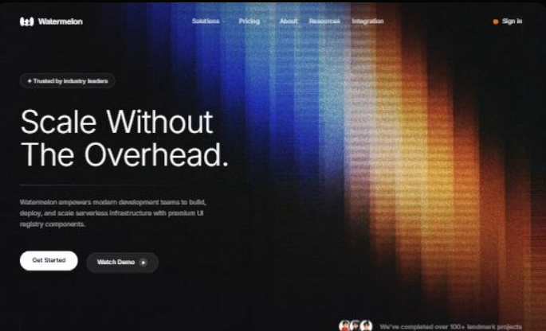

# Reference: Watermelon hero-13 ("Scale Without The Overhead")

- **Source:** [ui.watermelon.sh/block/hero-13](https://ui.watermelon.sh/block/hero-13). A React and Tailwind block; this is its demo copy, not Sentio's.
- **Saved:** 2026-11-03, as a possible direction for Sentio's landing page. Not adopted yet.

## What it is, measured from the live preview

- **Background:** a near-black page with a grainy photographic image of vertical blue, white and orange light bands (`hero-5.avif`). It is an image, not a canvas animation.
- **Headline:** Inter Variable at weight 300 (light), with tight negative letter-spacing, in white and left-aligned.
- **Body copy:** 14px white at 55% opacity.
- **Buttons:** a solid white pill (weight 600) next to a translucent white pill with a play icon (weight 500).
- **Extras:** a "Trusted by industry leaders" badge above the headline, and an avatar stack reading "We've completed over 100+ landmark projects".
- **Motion:** the content fades and slides in on load.

## How it differs from Sentio today

|                | This reference                         | Sentio app ([DESIGN.md](../../../DESIGN.md))                             |
| -------------- | -------------------------------------- | ------------------------------------------------------------------------ |
| Theme          | Dark only, cinematic                   | Light and dark as equals, flat                                           |
| Colour         | A spectrum of blue, white and orange   | One accent (Ink Indigo); green, amber and red only for status            |
| Depth          | Glowing, grainy light                  | No glows; hairline borders and tonal steps                               |
| Type           | Light (300), large, thin               | System font at 700 for headings, 400 for body                            |
| Buttons        | Pills                                  | 8px corners; pills only for small metadata                               |
| Proof          | Badge, avatars, "100+ projects"        | No testimonials or user counts exist ([PRODUCT.md](../../../PRODUCT.md)) |
| Call to action | Get started (sign up) and watch a demo | Install locally from GitHub (uv, Ollama), then create a local account    |

## What to resolve before using it

1. **The look conflicts with DESIGN.md.** Its glow, its colour spectrum and its dark-only setting are what DESIGN.md's Don'ts rule out for the app. A landing page can have its own expression, but adopting this would be a deliberate exception for the landing page only. Record it as such.
2. **The proof must go.** The badge, avatars and "100+ projects" claims have no Sentio equivalent. Use real evidence instead, such as the measured model comparison, labelled as a synthetic, author-labelled experiment.
3. **The call to action must match the real workflow.** Sentio has no sign-up and no hosted demo. Use "Get it on GitHub" or a "Quick start" link, and a short recorded clip if you want a "Watch" button.
4. **The colours need narrowing.** To keep it recognisably Sentio, tint the light bands toward Ink Indigo (`#465bb2` and `#a9baff`) instead of orange.
5. **Contrast needs checking.** The 55% white body text is readable on black, but it gets weaker where it crosses the bright bands.
